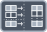

<!-- Generated by tools/export_studio_help.py; edit the reviewed source metadata, then regenerate. -->
# Build Array

[Array functions](overview.md) · [All functions](../index.md)

Combines elements and arrays into a new array.

Résumé français de l’aide Studio

**Construire un tableau**

Combine des elements et des tableaux dans un nouveau tableau. [Types] Dépliez Construire un tableau de 1 à 32 entrées ordonnées. Les éléments doivent être compatibles et leurs rangs égaux ou adjacents. Des entrées de rang N donnent un rang N+1, ou N avec « Concaténer les entrées ». Des rangs N et N-1 imposent la concaténation au rang N : le menu est coché et verrouillé. Des scalaires donnent un tableau 1D : la concaténation est décochée et verrouillée. Sans type connu en entrée, la sortie est void. Les numériques peuvent être promus, pas les types sans rapport. Le mode manuel et le nombre d’entrées sont sauvegardés ; l’exécution dépend toujours de la cible.

## Studio authoring profile

Contract status: **partial**. The connector below describes Studio authoring; execution availability is stated separately.

Expand Build Array from 1 to 32 ordered inputs. Compatible elements must have equal or adjacent ranks. Equal rank N produces rank N+1, or rank N when Concatenate Inputs is selected. Mixed ranks N and N-1 force concatenation at rank N and lock the checked menu item. All scalars produce a 1D array and lock concatenation off. Unwired inputs supply no type evidence; without known types the output is void. Numeric leaves may promote; unrelated types cannot mix. Manual mode and input count are saved; target execution remains separately gated.

Expand Build Array from 1 to 32 ordered inputs. Compatible elements must have equal or adjacent ranks. Equal rank N produces rank N+1, or rank N when Concatenate Inputs is selected. Mixed ranks N and N-1 force concatenation at rank N and lock the checked menu item. All scalars produce a 1D array and lock concatenation off. Unwired inputs supply no type evidence; without known types the output is void. Numeric leaves may promote; unrelated types cannot mix. Manual mode and input count are saved; target execution remains separately gated.

## IN — inputs

| Displayed terminal / internal ID | Accepted / resolved type | Studio connection | Unwired input default | Meaning |
| --- | --- | --- | --- | --- |
| element or subarray `array_a` | `T:any` | Required | Not specified | — |

A default is shown only for an input with an explicitly documented value. Preview/default *types* do not imply unwired operand values. If helper and binding flags differ, both are labelled.

## OUT — outputs

| Displayed terminal / internal ID | Accepted / resolved type | Studio connection | Unwired input default | Meaning |
| --- | --- | --- | --- | --- |
| built array `result` | `array<T:any,rank>=1>` | Recommended (help); Required (binding) | — | — |

A default is shown only for an input with an explicitly documented value. Preview/default *types* do not imply unwired operand values. If helper and binding flags differ, both are labelled.

Additional input IDs: `input_N`, starting at 2.

Expanded connector rows receive their live group/dimension number in Studio. Field selections and configured instances can also supply live names; the table documents the base connector and keeps its internal IDs separate.

## Types and connection rules

Expand Build Array from 1 to 32 ordered inputs. Compatible elements must have equal or adjacent ranks. Equal rank N produces rank N+1, or rank N when Concatenate Inputs is selected. Mixed ranks N and N-1 force concatenation at rank N and lock the checked menu item. All scalars produce a 1D array and lock concatenation off. Unwired inputs supply no type evidence; without known types the output is void. Numeric leaves may promote; unrelated types cannot mix. Manual mode and input count are saved; target execution remains separately gated.

- Type resolution: `custom_resolver`; result expression: `resolve:frog.studio.polymorphic.type-resolution@1`.
- Implicit coercion: not enabled by this resolver; individual port policies remain explicit.
- Arrays: accepted; lifting policy: `none`.
- Shape rule: `equal_or_adjacent_ranks; effective_concatenate_mode`.

**Expandable inputs:** 1 to 32. Reduction: `ordered_array_construction`.

Port order: `array_a` → `input_N_ascending`.

## Execution and limits

**Public FROG / target Runtime:** not declared available by this authoring contract.

Scope: `requires_explicit_target_capability`.

Provider identity is retained from Studio. Executability must be established by the active target; it is not inferred from catalog visibility.

**Authoring/target contract limits:**

- NI reference verified for authoring types; this does not establish runtime support on the active target.

Connector type defaults and persistence aliases

| Direction | ID | Preview/default type | Connection policy | Cardinality | Legacy port IDs |
| --- | --- | --- | --- | --- | --- |
| INPUT | `array_a` | `unknown` | `any_explicit` | `single` | — |
| OUTPUT | `result` | `unknown` | `exact` | `single` | — |

## Identity and references

- Catalogue ID: `array.build`.
- Profile: `frog.studio.polymorphic.array.build.v1`.
- Definition: `frog.studio.array.build`.
- [NI API reference](https://www.ni.com/docs/en-US/bundle/labview-api-ref/page/functions/build-array.html).

NI links are reference sources for the connector model; Studio support is limited to the profile above. [Reference provenance and notation](../index.md#provenance-and-notation).
