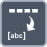

<!-- Generated by tools/export_studio_help.py; edit the reviewed source metadata, then regenerate. -->
# Array To Spreadsheet String

[Array functions](../overview.md) · [All functions](../../index.md)

Formats an array as spreadsheet text.

Résumé français de l’aide Studio

**Tableau en chaine format tableur**

Convertit un tableau en chaine au format tableur. [Types] Un tableau numérique ou de chaînes de tout rang produit une chaîne scalaire. Format et séparateur sont des chaînes scalaires ; tableaux de booléens, clusters, chemins ou horodatages refusés.

## Studio authoring profile

Contract status: **partial**. The connector below describes Studio authoring; execution availability is stated separately.

Any-rank numeric or String array produces a scalar String. Format and delimiter are scalar strings; arrays of Boolean, clusters, paths or timestamps are rejected.

Any-rank numeric or String array produces a scalar String. Format and delimiter are scalar strings; arrays of Boolean, clusters, paths or timestamps are rejected.

## IN — inputs

| Displayed terminal / internal ID | Accepted / resolved type | Studio connection | Unwired input default | Meaning |
| --- | --- | --- | --- | --- |
| array `array` | `array<T:any,rank>=1>` | Required | Not specified | — |
| format `format` | `string` | Required (help); Optional (binding) | Not specified | — |
| delimiter `delimiter` | `string` | Optional | Not specified | — |

A default is shown only for an input with an explicitly documented value. Preview/default *types* do not imply unwired operand values. If helper and binding flags differ, both are labelled.

## OUT — outputs

| Displayed terminal / internal ID | Accepted / resolved type | Studio connection | Unwired input default | Meaning |
| --- | --- | --- | --- | --- |
| spreadsheet string `string` | `string` | Recommended (help); Required (binding) | — | — |

A default is shown only for an input with an explicitly documented value. Preview/default *types* do not imply unwired operand values. If helper and binding flags differ, both are labelled.

## Types and connection rules

Any-rank numeric or String array produces a scalar String. Format and delimiter are scalar strings; arrays of Boolean, clusters, paths or timestamps are rejected.

- Type resolution: `custom_resolver`; result expression: `resolve:frog.studio.polymorphic.type-resolution@1`.
- Implicit coercion: not enabled by this resolver; individual port policies remain explicit.
- Arrays: accepted; lifting policy: `none`.

**Input count:** 3; this contract does not enable variadic inputs.

## Execution and limits

**Public FROG / target Runtime:** not declared available by this authoring contract.

Scope: `requires_explicit_target_capability`.

Authoring support is not an execution capability.

**Authoring/target contract limits:**

- NI reference verified for authoring types; this does not establish runtime support on the active target.

Connector type defaults and persistence aliases

| Direction | ID | Preview/default type | Connection policy | Cardinality | Legacy port IDs |
| --- | --- | --- | --- | --- | --- |
| INPUT | `array` | `unknown` | `any_explicit` | `single` | `value` |
| INPUT | `format` | `string` | `exact` | `single` | — |
| INPUT | `delimiter` | `string` | `exact` | `single` | — |
| OUTPUT | `string` | `string` | `exact` | `single` | `result` |

## Examples

No example for this object is currently declared in the shared index. [Browse the available examples](../../../examples/index.md).

## Identity and references

- Catalogue ID: `array.conversion.array_to_spreadsheet_string`.
- Parent palette: [Conversion](../conversion.md).
- Profile: `frog.studio.polymorphic.array.conversion.array_to_spreadsheet_string.v1`.
- Definition: `frog.studio.array.conversion.array_to_spreadsheet_string`.
- [NI API reference](https://www.ni.com/docs/en-US/bundle/labview-api-ref/page/functions/array-to-spreadsheet-string.html).

NI links are reference sources for the connector model; Studio support is limited to the profile above. [Reference provenance and notation](../../index.md#provenance-and-notation).
