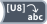

<!-- Generated by tools/export_studio_help.py; edit the reviewed source metadata, then regenerate. -->
# Byte Array To String

[Array functions](../overview.md) · [All functions](../../index.md)

Converts a byte array into a string.

## Product execution profiles

The shared index declares native examples for this object; see [the examples below](byte_array_to_string.md#examples) and [document profiles and evidence boundaries](../../../reference/studio-draft-examples.md). Older binding/help statements retained below can lag those product profiles. They do not establish or deny the separately measured native profiles. An example declaration alone is not an execution result or admission of every overload.

Résumé français de l’aide Studio

**Tableau d'octets en chaine**

Texte historique de l’aide conservé ci-dessous. Des exemples natifs distincts sont déclarés pour cet objet ; consultez les profils et preuves datés, sans déduire une compatibilité universelle de ce texte.

Convertit un tableau d'octets en chaine. [Types] Un tableau 1D d’U8 produit une chaîne scalaire. Les autres rangs et schémas d’éléments sont refusés.

## Studio authoring profile

Contract status: **partial**. The connector below describes Studio authoring; execution availability is stated separately.

Retained binding and help description

This is the source declaration, not the current measured product-execution assessment.

A one-dimensional U8 array produces a scalar String. Other ranks and non-byte element schemas are rejected.

A one-dimensional U8 array produces a scalar String. Other ranks and non-byte element schemas are rejected.

## IN — inputs

| Displayed terminal / internal ID | Accepted / resolved type | Studio connection | Unwired input default | Meaning |
| --- | --- | --- | --- | --- |
| unsigned byte array `array` | `array<u8,rank=1>` | Required | Not specified | — |

A default is shown only for an input with an explicitly documented value. Preview/default *types* do not imply unwired operand values. If helper and binding flags differ, both are labelled.

## OUT — outputs

| Displayed terminal / internal ID | Accepted / resolved type | Studio connection | Unwired input default | Meaning |
| --- | --- | --- | --- | --- |
| string `string` | `string` | Recommended (help); Required (binding) | — | — |

A default is shown only for an input with an explicitly documented value. Preview/default *types* do not imply unwired operand values. If helper and binding flags differ, both are labelled.

## Types and connection rules

A one-dimensional U8 array produces a scalar String. Other ranks and non-byte element schemas are rejected.

- Type resolution: `custom_resolver`; result expression: `resolve:frog.studio.polymorphic.type-resolution@1`.
- Implicit coercion: not enabled by this resolver; individual port policies remain explicit.
- Arrays: accepted; lifting policy: `none`.

**Input count:** 1; this contract does not enable variadic inputs.

## Execution and limits

**Public FROG / target Runtime:** not declared available by this authoring contract.

Scope: `requires_explicit_target_capability`.

Implementation: `frog.studio.array.conversion.byte_array_to_string.bytes.v1`.

Required provider: `frog.studio.string.raw-bytes@1`.

The exact raw-byte native operation is admitted by the selected Source/FIR/Runtime capability and its complete typed signature. This metadata does not grant every backend or configuration this capability. Legacy explicit UTF-8 profiles remain versioned separately.

Retained authoring-contract limitations

These declarations belong to the binding snapshot. Compare them with the separately admitted native profiles and dated measurements linked above; they are not a current denial of those product profiles.

**Authoring/target contract limits:**

- NI reference verified for authoring types; this does not establish runtime support on the active target.

Connector type defaults and persistence aliases

| Direction | ID | Preview/default type | Connection policy | Cardinality | Legacy port IDs |
| --- | --- | --- | --- | --- | --- |
| INPUT | `array` | `array<u8>` | `exact` | `single` | `value` |
| OUTPUT | `string` | `string` | `exact` | `single` | `result` |

## Examples

These are real `.frog` documents from the same index used by Studio. Backend names and expected results describe the examples; they are not execution certificates.

- [Convert bytes including NUL to String](../../../examples/array.bytes.to-string.md) — Byte Array To String preserves all bytes, including NUL; no C-string termination is used. (`execution`, `studio-draft`).

## Identity and references

- Catalogue ID: `array.conversion.byte_array_to_string`.
- Parent palette: [Conversion](../conversion.md).
- Profile: `frog.studio.polymorphic.array.conversion.byte_array_to_string.v1`.
- Definition: `frog.studio.array.conversion.byte_array_to_string`.
- [NI API reference](https://www.ni.com/docs/en-US/bundle/labview-api-ref/page/functions/byte-array-to-string.html).

NI links are reference sources for the connector model; Studio support is limited to the profile above. [Reference provenance and notation](../../index.md#provenance-and-notation).
