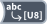

<!-- Generated by tools/export_studio_help.py; edit the reviewed source metadata, then regenerate. -->
# String To Byte Array

[Array functions](../overview.md) · [All functions](../../index.md)

Converts a string into its byte array representation.

## Product execution profiles

The shared index declares native examples for this object; see [the examples below](string_to_byte_array.md#examples) and [document profiles and evidence boundaries](../../../reference/studio-draft-examples.md). Older binding/help statements retained below can lag those product profiles. They do not establish or deny the separately measured native profiles. An example declaration alone is not an execution result or admission of every overload.

Résumé français de l’aide Studio

**Chaine en tableau d'octets**

Texte historique de l’aide conservé ci-dessous. Des exemples natifs distincts sont déclarés pour cet objet ; consultez les profils et preuves datés, sans déduire une compatibilité universelle de ce texte.

Convertit une chaine en tableau d'octets.

## Studio authoring profile

Contract status: **partial**. The connector below describes Studio authoring; execution availability is stated separately.

## IN — inputs

| Displayed terminal / internal ID | Accepted / resolved type | Studio connection | Unwired input default | Meaning |
| --- | --- | --- | --- | --- |
| string `string` | `string` | Required | Not specified | — |

A default is shown only for an input with an explicitly documented value. Preview/default *types* do not imply unwired operand values. If helper and binding flags differ, both are labelled.

## OUT — outputs

| Displayed terminal / internal ID | Accepted / resolved type | Studio connection | Unwired input default | Meaning |
| --- | --- | --- | --- | --- |
| unsigned byte array `array` | `array<u8,rank=1>` | Recommended (help); Required (binding) | — | — |

A default is shown only for an input with an explicitly documented value. Preview/default *types* do not imply unwired operand values. If helper and binding flags differ, both are labelled.

## Types and Compatibility

The notes below retain the reviewed help's original NI and Studio scopes. An NI overload is not a claim of Studio runtime support; the authoring profile and execution limits remain separate.

Retained binding and help statements

These are source declarations, not the current measured product-execution assessment. Compare historical limitations with the separately dated native profiles above.

A scalar String produces a one-dimensional U8 array.

Notes de types et de compatibilité de l’aide Studio

Les mentions NI et Studio gardent leur portée d’origine. Une variante NI ne constitue pas une déclaration de prise en charge par le runtime Studio ; consultez les profils et limites d’exécution de cette fiche.

Une chaîne scalaire produit un tableau 1D d’U8.

- Type resolution: `custom_resolver`; result expression: `resolve:frog.studio.polymorphic.type-resolution@1`.
- Implicit coercion: not enabled by this resolver; individual port policies remain explicit.
- Arrays: accepted; lifting policy: `none`.

**Input count:** 1; this contract does not enable variadic inputs.

## Execution and limits

**Public FROG / target Runtime:** not declared available by this authoring contract.

Scope: `requires_explicit_target_capability`.

Implementation: `frog.studio.array.conversion.string_to_byte_array.bytes.v1`.

Required provider: `frog.studio.string.raw-bytes@1`.

The exact raw-byte native operation is admitted by the selected Source/FIR/Runtime capability and its complete typed signature. This metadata does not grant every backend or configuration this capability. Legacy explicit UTF-8 profiles remain versioned separately.

Retained authoring-contract limitations

These declarations belong to the binding snapshot. Compare them with the separately admitted native profiles and dated measurements linked above; they are not a current denial of those product profiles.

**Authoring/target contract limits:**

- NI reference verified for authoring types; this does not establish runtime support on the active target.

Connector type defaults and persistence aliases

| Direction | ID | Preview/default type | Connection policy | Cardinality | Legacy port IDs |
| --- | --- | --- | --- | --- | --- |
| INPUT | `string` | `string` | `exact` | `single` | `value` |
| OUTPUT | `array` | `unknown` | `exact` | `single` | `result` |

## Examples

These are real `.frog` documents from the same index used by Studio. Backend names and expected results describe the examples; they are not execution certificates.

- [String bytes retain UTF-8 and NUL](../../../examples/array.bytes.utf8-nul.md) — This is a byte conversion, not Unicode character indexing. é, NUL and A produce bytes 195, 169, 0, 65. (`execution`, `studio-draft`).
- [Reverse bytes without repairing UTF-8](../../../examples/string.reverse.binary-intermediate.md) — Reverse moves bytes, not Unicode characters. Reversing the UTF-8 encoding of é creates bytes 169, 195. The next real function reads this binary intermediate as U8; no invalid UTF-8 string is saved as a literal. (`execution`, `studio-draft`).

## Identity and references

- Catalogue ID: `array.conversion.string_to_byte_array`.
- Parent palette: [Conversion](../conversion.md).
- Profile: `frog.studio.polymorphic.array.conversion.string_to_byte_array.v1`.
- Definition: `frog.studio.array.conversion.string_to_byte_array`.
- [NI API reference](https://www.ni.com/docs/en-US/bundle/labview-api-ref/page/functions/string-to-byte-array.html).

NI links are reference sources for the connector model; Studio support is limited to the profile above. [Reference provenance and notation](../../index.md#provenance-and-notation).
