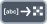

<!-- Generated by tools/export_studio_help.py; edit the reviewed source metadata, then regenerate. -->
# String To Byte Array

[Array functions](../overview.md) · [All functions](../../index.md)

Converts a string into its byte array representation.

Résumé français de l’aide Studio

**Chaine en tableau d'octets**

Convertit une chaine en tableau d'octets. [Types] Une chaîne scalaire produit un tableau 1D d’U8.

## Studio authoring profile

Contract status: **partial**. The connector below describes Studio authoring; execution availability is stated separately.

A scalar String produces a one-dimensional U8 array.

A scalar String produces a one-dimensional U8 array.

## IN — inputs

| Displayed terminal / internal ID | Accepted / resolved type | Studio connection | Unwired input default | Meaning |
| --- | --- | --- | --- | --- |
| string `string` | `string` | Required | Not specified | — |

A default is shown only for an input with an explicitly documented value. Preview/default *types* do not imply unwired operand values. If helper and binding flags differ, both are labelled.

## OUT — outputs

| Displayed terminal / internal ID | Accepted / resolved type | Studio connection | Unwired input default | Meaning |
| --- | --- | --- | --- | --- |
| unsigned byte array `array` | `array<u8,rank=1>` | Recommended (help); Required (binding) | — | — |

A default is shown only for an input with an explicitly documented value. Preview/default *types* do not imply unwired operand values. If helper and binding flags differ, both are labelled.

## Types and connection rules

A scalar String produces a one-dimensional U8 array.

- Type resolution: `custom_resolver`; result expression: `resolve:frog.studio.polymorphic.type-resolution@1`.
- Implicit coercion: not enabled by this resolver; individual port policies remain explicit.
- Arrays: accepted; lifting policy: `none`.

**Input count:** 1; this contract does not enable variadic inputs.

## Execution and limits

**Public FROG / target Runtime:** not declared available by this authoring contract.

Scope: `requires_explicit_target_capability`.

Authoring support is not an execution capability.

**Authoring/target contract limits:**

- NI reference verified for authoring types; this does not establish runtime support on the active target.

Connector type defaults and persistence aliases

| Direction | ID | Preview/default type | Connection policy | Cardinality | Legacy port IDs |
| --- | --- | --- | --- | --- | --- |
| INPUT | `string` | `string` | `exact` | `single` | `value` |
| OUTPUT | `array` | `unknown` | `exact` | `single` | `result` |

## Identity and references

- Catalogue ID: `array.conversion.string_to_byte_array`.
- Parent palette: [Conversion](../conversion.md).
- Profile: `frog.studio.polymorphic.array.conversion.string_to_byte_array.v1`.
- Definition: `frog.studio.array.conversion.string_to_byte_array`.
- [NI API reference](https://www.ni.com/docs/en-US/bundle/labview-api-ref/page/functions/string-to-byte-array.html).

NI links are reference sources for the connector model; Studio support is limited to the profile above. [Reference provenance and notation](../../index.md#provenance-and-notation).
