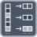

<!-- Generated by tools/export_studio_help.py; edit the reviewed source metadata, then regenerate. -->
# Decimate 1D Array

[Array functions](overview.md) · [All functions](../index.md)

Separates alternating elements into two output arrays.

Résumé français de l’aide Studio

**Decimer un tableau 1D**

Separe les elements alternes dans deux tableaux de sortie. [Types] Un tableau 1D de T produit 1–32 sorties déroulables, chacune tableau 1D du même schéma T. Le nombre de sorties ne change pas leur rang.

## Studio authoring profile

Contract status: **partial**. The connector below describes Studio authoring; execution availability is stated separately.

A 1D array of any T produces 1–32 expandable output arrays, each 1D with the complete element schema T. The number of outputs does not change their rank.

A 1D array of any T produces 1–32 expandable output arrays, each 1D with the complete element schema T. The number of outputs does not change their rank.

## IN — inputs

| Displayed terminal / internal ID | Accepted / resolved type | Studio connection | Unwired input default | Meaning |
| --- | --- | --- | --- | --- |
| array `array` | `array<T:any,rank=1>` | Required | Not specified | — |

A default is shown only for an input with an explicitly documented value. Preview/default *types* do not imply unwired operand values. If helper and binding flags differ, both are labelled.

## OUT — outputs

| Displayed terminal / internal ID | Accepted / resolved type | Studio connection | Unwired input default | Meaning |
| --- | --- | --- | --- | --- |
| decimated array `first` | `array<T:any,rank>=1>` | Recommended (help); Required (binding) | — | — |

A default is shown only for an input with an explicitly documented value. Preview/default *types* do not imply unwired operand values. If helper and binding flags differ, both are labelled.

## Types and connection rules

A 1D array of any T produces 1–32 expandable output arrays, each 1D with the complete element schema T. The number of outputs does not change their rank.

- Type resolution: `custom_resolver`; result expression: `resolve:frog.studio.polymorphic.type-resolution@1`.
- Implicit coercion: not enabled by this resolver; individual port policies remain explicit.
- Arrays: accepted; lifting policy: `none`.

**Input count:** 1; this contract does not enable variadic inputs.

## Execution and limits

**Public FROG / target Runtime:** not declared available by this authoring contract.

Scope: `requires_explicit_target_capability`.

Provider identity is retained from Studio. Executability must be established by the active target; it is not inferred from catalog visibility.

**Authoring/target contract limits:**

- NI reference verified for authoring types; this does not establish runtime support on the active target.

Connector type defaults and persistence aliases

| Direction | ID | Preview/default type | Connection policy | Cardinality | Legacy port IDs |
| --- | --- | --- | --- | --- | --- |
| INPUT | `array` | `unknown` | `any_explicit` | `single` | — |
| OUTPUT | `first` | `unknown` | `exact` | `single` | — |

## Identity and references

- Catalogue ID: `array.decimate_1d`.
- Profile: `frog.studio.polymorphic.array.decimate_1d.v1`.
- Definition: `frog.studio.array.decimate_1d`.
- [NI API reference](https://www.ni.com/docs/en-US/bundle/labview-api-ref/page/functions/decimate-1d-array.html).

NI links are reference sources for the connector model; Studio support is limited to the profile above. [Reference provenance and notation](../index.md#provenance-and-notation).
