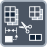

<!-- Generated by tools/export_studio_help.py; edit the reviewed source metadata, then regenerate. -->
# Delete From Array

[Array functions](overview.md) · [All functions](../index.md)

Deletes elements or slices and returns both the remaining array and the deleted portion.

Résumé français de l’aide Studio

**Supprimer une portion de tableau**

Supprime des éléments ou des tranches et renvoie le tableau restant ainsi que la portion supprimée. [Types] Un tableau ND de T expose N indices ; un seul peut être câblé pour choisir la dimension de suppression. Le tableau restant conserve le rang N. La portion supprimée est de rang N-1 si la longueur n'est pas câblée (scalaire en 1D), sinon de rang N, même avec une longueur câblée à un. La longueur par défaut vaut un ; sans indice, la suppression commence au dernier élément ou à la dernière tranche.

## Studio authoring profile

Contract status: **partial**. The connector below describes Studio authoring; execution availability is stated separately.

An N-D array of T exposes N index terminals, with only one dimension selectable for deletion. The remaining array retains rank N. The deleted portion has rank N-1 when length is unwired (scalar for 1D), or rank N when length is wired, including a wired value of one. Default length is one; without an index, deletion starts at the last element or slice.

An N-D array of T exposes N index terminals, with only one dimension selectable for deletion. The remaining array retains rank N. The deleted portion has rank N-1 when length is unwired (scalar for 1D), or rank N when length is wired, including a wired value of one. Default length is one; without an index, deletion starts at the last element or slice.

## IN — inputs

| Displayed terminal / internal ID | Accepted / resolved type | Studio connection | Unwired input default | Meaning |
| --- | --- | --- | --- | --- |
| array `array` | `array<T:any,rank>=1>` | Required | Not specified | — |
| length `length` | `T:integer` | Recommended (help); Optional (binding) | Not specified | — |
| index `index` | `T:integer` | Recommended (help); Optional (binding) | Not specified | — |

A default is shown only for an input with an explicitly documented value. Preview/default *types* do not imply unwired operand values. If helper and binding flags differ, both are labelled.

## OUT — outputs

| Displayed terminal / internal ID | Accepted / resolved type | Studio connection | Unwired input default | Meaning |
| --- | --- | --- | --- | --- |
| remaining array `result` | `array<T:any,rank>=1>` | Recommended (help); Required (binding) | — | — |
| deleted portion `deleted` | `T:any` | Recommended (help); Required (binding) | — | — |

A default is shown only for an input with an explicitly documented value. Preview/default *types* do not imply unwired operand values. If helper and binding flags differ, both are labelled.

## Types and connection rules

An N-D array of T exposes N index terminals, with only one dimension selectable for deletion. The remaining array retains rank N. The deleted portion has rank N-1 when length is unwired (scalar for 1D), or rank N when length is wired, including a wired value of one. Default length is one; without an index, deletion starts at the last element or slice.

- Type resolution: `custom_resolver`; result expression: `resolve:frog.studio.polymorphic.type-resolution@1`.
- Implicit coercion: permitted by this profile.
- Arrays: accepted; lifting policy: `none`.

**Input count:** 3; this contract does not enable variadic inputs.

## Execution and limits

**Public FROG / target Runtime:** not declared available by this authoring contract.

Scope: `requires_explicit_target_capability`.

Provider identity is retained from Studio. Executability must be established by the active target; it is not inferred from catalog visibility.

**Authoring/target contract limits:**

- NI reference verified for authoring types; this does not establish runtime support on the active target.

Connector type defaults and persistence aliases

| Direction | ID | Preview/default type | Connection policy | Cardinality | Legacy port IDs |
| --- | --- | --- | --- | --- | --- |
| INPUT | `array` | `array:f64` | `any_explicit` | `single` | — |
| INPUT | `length` | `i32` | `numeric_implicit` | `single` | — |
| INPUT | `index` | `i32` | `numeric_implicit` | `single` | — |
| OUTPUT | `result` | `array:f64` | `exact` | `single` | — |
| OUTPUT | `deleted` | `unknown` | `exact` | `single` | — |

## Examples

No example for this object is currently declared in the shared index. [Browse the available examples](../../examples/index.md).

## Identity and references

- Catalogue ID: `array.delete`.
- Profile: `frog.studio.polymorphic.array.delete.v1`.
- Definition: `frog.studio.array.delete`.
- [NI API reference](https://www.ni.com/docs/en-US/bundle/labview-api-ref/page/functions/delete-from-array.html).

NI links are reference sources for the connector model; Studio support is limited to the profile above. [Reference provenance and notation](../index.md#provenance-and-notation).
