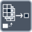

<!-- Generated by tools/export_studio_help.py; edit the reviewed source metadata, then regenerate. -->
# Index Array

[Array functions](overview.md) · [All functions](../index.md)

Returns an element or subarray at the requested index.

Résumé français de l’aide Studio

**Indexer un tableau**

Renvoie un element ou un sous-tableau a l'index demande. [Types] Un tableau nD de T produit T si toutes les dimensions sont indexées ; sinon un sous-tableau de T. Chaque dimension indexée retire un rang. Sans index câblé, la première dimension utilise zéro. Une waveform expose les éléments de Y. Studio: Studio fournit un index par dimension (jusqu’à 16) et jusqu’à 32 groupes de sorties extensibles. Un groupe non câblé reprend les dimensions indexées du groupe précédent. L’exécution dépend de la cible. [Local Studio] Play/Highlight local exécute un tableau fini array&lt;f64&gt; de rang 1, un seul index i32 explicitement câblé et une seule sortie f64. Index négatif/hors borne ou tableau vide : ARRAY_INDEX_RANGE sans sortie, jamais un zéro inventé. Lecture bornée à un million d’éléments. Autres types/rangs, sous-tableaux et groupes étendus d’index/sorties : refus explicite ARRAY_LOCAL_PROFILE_UNAVAILABLE. Ce profil FROG borné n’annonce ni le comportement NI général ni un support cible public FROG/LLVM.

## Studio authoring profile

Contract status: **partial**. The connector below describes Studio authoring; execution availability is stated separately.

An n-D array of T yields T when all dimensions are indexed; otherwise an array of T with one dimension removed per indexed dimension. With no index wired, the first dimension defaults to index zero. Waveforms expose Y elements. [Local Studio] Local Studio Play/Highlight executes one finite rank-1 array&lt;f64&gt; with one explicitly wired i32 index and one scalar f64 element output. Negative/out-of-range indexes and empty arrays produce ARRAY_INDEX_RANGE with no output; there is no invented zero. Reads are bounded to one million elements. Other types/ranks, subarrays and expanded index/output groups fail explicitly with ARRAY_LOCAL_PROFILE_UNAVAILABLE. This bounded FROG profile does not claim general NI Index Array behavior or public FROG/LLVM target support.

An n-D array of T yields T when all dimensions are indexed; otherwise an array of T with one dimension removed per indexed dimension. With no index wired, the first dimension defaults to index zero. Waveforms expose Y elements. Studio: Studio provides one index per dimension (up to 16) and up to 32 expandable output groups. An unwired group follows the preceding group's indexed dimensions. Runtime support depends on the target. [Local Studio] Local Studio Play/Highlight executes one finite rank-1 array&lt;f64&gt; with one explicitly wired i32 index and one scalar f64 element output. Negative/out-of-range indexes and empty arrays produce ARRAY_INDEX_RANGE with no output; there is no invented zero. Reads are bounded to one million elements. Other types/ranks, subarrays and expanded index/output groups fail explicitly with ARRAY_LOCAL_PROFILE_UNAVAILABLE. This bounded FROG profile does not claim general NI Index Array behavior or public FROG/LLVM target support.

## IN — inputs

| Displayed terminal / internal ID | Accepted / resolved type | Studio connection | Unwired input default | Meaning |
| --- | --- | --- | --- | --- |
| array `array` | `T:any` | Required | Not specified | — |
| index `index` | `T:integer` | Recommended (help); Optional (binding) | Not specified | — |

A default is shown only for an input with an explicitly documented value. Preview/default *types* do not imply unwired operand values. If helper and binding flags differ, both are labelled.

## OUT — outputs

| Displayed terminal / internal ID | Accepted / resolved type | Studio connection | Unwired input default | Meaning |
| --- | --- | --- | --- | --- |
| element or subarray `element` | `T:any` | Recommended (help); Required (binding) | — | — |

A default is shown only for an input with an explicitly documented value. Preview/default *types* do not imply unwired operand values. If helper and binding flags differ, both are labelled.

## Types and connection rules

An n-D array of T yields T when all dimensions are indexed; otherwise an array of T with one dimension removed per indexed dimension. With no index wired, the first dimension defaults to index zero. Waveforms expose Y elements.

- Type resolution: `custom_resolver`; result expression: `resolve:frog.studio.polymorphic.type-resolution@1`.
- Implicit coercion: permitted by this profile.
- Arrays: accepted; lifting policy: `none`.

**Input count:** 2; this contract does not enable variadic inputs.

## Execution and limits

**Public FROG / target Runtime:** not declared available by this authoring contract.

Scope: `requires_explicit_target_capability`.

Local Studio Play/Highlight executes one finite rank-1 array&lt;f64&gt; with one explicitly wired i32 index and one scalar f64 element output. Negative/out-of-range indexes and empty arrays produce ARRAY_INDEX_RANGE with no output; there is no invented zero. Reads are bounded to one million elements. Other types/ranks, subarrays and expanded index/output groups fail explicitly with ARRAY_LOCAL_PROFILE_UNAVAILABLE. This bounded FROG profile does not claim general NI Index Array behavior or public FROG/LLVM target support.

**Authoring/target contract limits:**

- NI reference verified for authoring types; this does not establish runtime support on the active target.
- Studio provides one index per dimension (up to 16) and up to 32 expandable output groups. An unwired group follows the preceding group's indexed dimensions. Runtime support depends on the target.
- Local f64 vector execution: finite rank-1 Index/single i32 index or Build/1..32 scalar f64 inputs only; no general Array or public LLVM provider.

Connector type defaults and persistence aliases

| Direction | ID | Preview/default type | Connection policy | Cardinality | Legacy port IDs |
| --- | --- | --- | --- | --- | --- |
| INPUT | `array` | `array:f64` | `any_explicit` | `single` | — |
| INPUT | `index` | `i32` | `numeric_implicit` | `single` | — |
| OUTPUT | `element` | `f64` | `exact` | `single` | — |

## Examples

No example for this object is currently declared in the shared index. [Browse the available examples](../../examples/index.md).

## Identity and references

- Catalogue ID: `array.index`.
- Profile: `frog.studio.polymorphic.array.index.v1`.
- Definition: `frog.studio.array.index`.
- [NI API reference](https://www.ni.com/docs/en-US/bundle/labview-api-ref/page/functions/index-array.html).

NI links are reference sources for the connector model; Studio support is limited to the profile above. [Reference provenance and notation](../index.md#provenance-and-notation).
