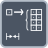

<!-- Generated by tools/export_studio_help.py; edit the reviewed source metadata, then regenerate. -->
# Initialize Array

[Array functions](overview.md) · [All functions](../index.md)

Creates an array filled with the supplied element.

Résumé français de l’aide Studio

**Initialiser un tableau**

Cree un tableau rempli avec l'element fourni. [Types] Un scalaire ou cluster T initialise un tableau de T à M dimensions. Dérouler la fonction expose M tailles (1–16), numériques réelles converties en I32. Un tableau direct n’est pas accepté comme élément.

## Studio authoring profile

Contract status: **partial**. The connector below describes Studio authoring; execution availability is stated separately.

A scalar or cluster T initializes an M-dimensional array of T. Resize to expose M dimension-size inputs (1–16); real numeric sizes are converted to I32. A direct array element is not accepted.

A scalar or cluster T initializes an M-dimensional array of T. Resize to expose M dimension-size inputs (1–16); real numeric sizes are converted to I32. A direct array element is not accepted.

## IN — inputs

| Displayed terminal / internal ID | Accepted / resolved type | Studio connection | Unwired input default | Meaning |
| --- | --- | --- | --- | --- |
| element `element` | `T:any` | Required | Not specified | — |
| dimension size `size` | `T:numeric` | Required | Not specified | — |

A default is shown only for an input with an explicitly documented value. Preview/default *types* do not imply unwired operand values. If helper and binding flags differ, both are labelled.

## OUT — outputs

| Displayed terminal / internal ID | Accepted / resolved type | Studio connection | Unwired input default | Meaning |
| --- | --- | --- | --- | --- |
| initialized array `result` | `array<T:any,rank>=1>` | Recommended (help); Required (binding) | — | — |

A default is shown only for an input with an explicitly documented value. Preview/default *types* do not imply unwired operand values. If helper and binding flags differ, both are labelled.

Additional input IDs: `input_N`, starting at 3.

Expanded connector rows receive their live group/dimension number in Studio. Field selections and configured instances can also supply live names; the table documents the base connector and keeps its internal IDs separate.

## Types and connection rules

A scalar or cluster T initializes an M-dimensional array of T. Resize to expose M dimension-size inputs (1–16); real numeric sizes are converted to I32. A direct array element is not accepted.

- Type resolution: `custom_resolver`; result expression: `resolve:frog.studio.polymorphic.type-resolution@1`.
- Implicit coercion: permitted by this profile.
- Arrays: accepted; lifting policy: `none`.

**Expandable inputs:** 2 to 17. Reduction: `editor_terminal_count`.

Port order: `element` → `size` → `input_N_ascending`.

## Execution and limits

**Public FROG / target Runtime:** not declared available by this authoring contract.

Scope: `requires_explicit_target_capability`.

Provider identity is retained from Studio. Executability must be established by the active target; it is not inferred from catalog visibility.

**Authoring/target contract limits:**

- NI reference verified for authoring types; this does not establish runtime support on the active target.

Connector type defaults and persistence aliases

| Direction | ID | Preview/default type | Connection policy | Cardinality | Legacy port IDs |
| --- | --- | --- | --- | --- | --- |
| INPUT | `element` | `unknown` | `any_explicit` | `single` | — |
| INPUT | `size` | `i32` | `numeric_implicit` | `single` | — |
| OUTPUT | `result` | `unknown` | `exact` | `single` | — |

## Identity and references

- Catalogue ID: `array.initialize`.
- Profile: `frog.studio.polymorphic.array.initialize.v1`.
- Definition: `frog.studio.array.initialize`.
- [NI API reference](https://www.ni.com/docs/en-US/bundle/labview-api-ref/page/functions/initialize-array.html).

NI links are reference sources for the connector model; Studio support is limited to the profile above. [Reference provenance and notation](../index.md#provenance-and-notation).
