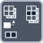

<!-- Generated by tools/export_studio_help.py; edit the reviewed source metadata, then regenerate. -->
# Insert Into Array

[Array functions](overview.md) · [All functions](../index.md)

Inserts an element or subarray at the requested index.

Résumé français de l’aide Studio

**Inserer dans un tableau**

Insere un element ou un sous-tableau a l'index demande. [Types] Un tableau ND de T accepte des données T de rang N-1 ou N. Ses N indices choisissent une seule dimension d'insertion : en câbler un désactive les autres ; sans indice, l'ajout se fait à la fin. Les entrées de valeur supplémentaires insèrent des blocs consécutifs au même emplacement, sans nouveau groupe d'indices. La sortie conserve T et le rang N.

## Studio authoring profile

Contract status: **partial**. The connector below describes Studio authoring; execution availability is stated separately.

An N-D array of T accepts T data of rank N-1 or N. Its N index terminals select one insertion dimension: wiring one disables the others; without an index, insertion appends. Additional value terminals insert consecutive blocks at the same position, with no extra index group. The result retains T and rank N.

An N-D array of T accepts T data of rank N-1 or N. Its N index terminals select one insertion dimension: wiring one disables the others; without an index, insertion appends. Additional value terminals insert consecutive blocks at the same position, with no extra index group. The result retains T and rank N.

## IN — inputs

| Displayed terminal / internal ID | Accepted / resolved type | Studio connection | Unwired input default | Meaning |
| --- | --- | --- | --- | --- |
| array `array` | `array<T:any,rank>=1>` | Required | Not specified | — |
| new element or subarray `subset` | `T:any` | Required | Not specified | — |
| index `index` | `T:integer` | Recommended (help); Optional (binding) | Not specified | — |

A default is shown only for an input with an explicitly documented value. Preview/default *types* do not imply unwired operand values. If helper and binding flags differ, both are labelled.

## OUT — outputs

| Displayed terminal / internal ID | Accepted / resolved type | Studio connection | Unwired input default | Meaning |
| --- | --- | --- | --- | --- |
| array with inserted elements `result` | `array<T:any,rank>=1>` | Recommended (help); Required (binding) | — | — |

A default is shown only for an input with an explicitly documented value. Preview/default *types* do not imply unwired operand values. If helper and binding flags differ, both are labelled.

## Types and connection rules

An N-D array of T accepts T data of rank N-1 or N. Its N index terminals select one insertion dimension: wiring one disables the others; without an index, insertion appends. Additional value terminals insert consecutive blocks at the same position, with no extra index group. The result retains T and rank N.

- Type resolution: `custom_resolver`; result expression: `resolve:frog.studio.polymorphic.type-resolution@1`.
- Implicit coercion: permitted by this profile.
- Arrays: accepted; lifting policy: `none`.

**Input count:** 3; this contract does not enable variadic inputs.

## Execution and limits

**Public FROG / target Runtime:** not declared available by this authoring contract.

Scope: `requires_explicit_target_capability`.

Provider identity is retained from Studio. Executability must be established by the active target; it is not inferred from catalog visibility.

**Authoring/target contract limits:**

- NI reference verified for authoring types; this does not establish runtime support on the active target.

Connector type defaults and persistence aliases

| Direction | ID | Preview/default type | Connection policy | Cardinality | Legacy port IDs |
| --- | --- | --- | --- | --- | --- |
| INPUT | `array` | `array:f64` | `any_explicit` | `single` | — |
| INPUT | `subset` | `array:f64` | `any_explicit` | `single` | — |
| INPUT | `index` | `i32` | `numeric_implicit` | `single` | — |
| OUTPUT | `result` | `array:f64` | `exact` | `single` | — |

## Examples

No example for this object is currently declared in the shared index. [Browse the available examples](../../examples/index.md).

## Identity and references

- Catalogue ID: `array.insert`.
- Profile: `frog.studio.polymorphic.array.insert.v1`.
- Definition: `frog.studio.array.insert`.
- [NI API reference](https://www.ni.com/docs/en-US/bundle/labview-api-ref/page/functions/insert-into-array.html).

NI links are reference sources for the connector model; Studio support is limited to the profile above. [Reference provenance and notation](../index.md#provenance-and-notation).
