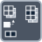

<!-- Generated by tools/export_studio_help.py; edit the reviewed source metadata, then regenerate. -->
# Insert Into Array

[Array functions](overview.md) · [All functions](../index.md)

Inserts an element or subarray at the requested index.

## Product execution profiles

The shared index declares native examples for this object; see [the examples below](insert.md#examples) and [document profiles and evidence boundaries](../../reference/studio-draft-examples.md). Older binding/help statements retained below can lag those product profiles. They do not establish or deny the separately measured native profiles. An example declaration alone is not an execution result or admission of every overload.

Résumé français de l’aide Studio

**Inserer dans un tableau**

Texte historique de l’aide conservé ci-dessous. Des exemples natifs distincts sont déclarés pour cet objet ; consultez les profils et preuves datés, sans déduire une compatibilité universelle de ce texte.

Insere un element ou un sous-tableau a l'index demande.

## Studio authoring profile

Contract status: **partial**. The connector below describes Studio authoring; execution availability is stated separately.

## IN — inputs

| Displayed terminal / internal ID | Accepted / resolved type | Studio connection | Unwired input default | Meaning |
| --- | --- | --- | --- | --- |
| array `array` | `array<T:any,rank>=1>` | Required | Not specified | — |
| new element or subarray `subset` | `T:any` | Required | Not specified | — |
| index `index` | `T:numeric` | Recommended (help); Optional (binding) | Not specified | — |

A default is shown only for an input with an explicitly documented value. Preview/default *types* do not imply unwired operand values. If helper and binding flags differ, both are labelled.

## OUT — outputs

| Displayed terminal / internal ID | Accepted / resolved type | Studio connection | Unwired input default | Meaning |
| --- | --- | --- | --- | --- |
| array with inserted elements `result` | `array<T:any,rank>=1>` | Recommended (help); Required (binding) | — | — |

A default is shown only for an input with an explicitly documented value. Preview/default *types* do not imply unwired operand values. If helper and binding flags differ, both are labelled.

## Types and Compatibility

The notes below retain the reviewed help's original NI and Studio scopes. An NI overload is not a claim of Studio runtime support; the authoring profile and execution limits remain separate.

Retained binding and help statements

These are source declarations, not the current measured product-execution assessment. Compare historical limitations with the separately dated native profiles above.

An N-D array of T accepts T data of rank N-1 or N. Its N index terminals select one insertion dimension: wiring one disables the others; without an index, insertion appends. Additional value terminals insert consecutive blocks at the same position, with no extra index group. The result retains T and rank N.

Notes de types et de compatibilité de l’aide Studio

Les mentions NI et Studio gardent leur portée d’origine. Une variante NI ne constitue pas une déclaration de prise en charge par le runtime Studio ; consultez les profils et limites d’exécution de cette fiche.

Un tableau ND de T accepte des données T de rang N-1 ou N. Ses N indices choisissent une seule dimension d'insertion : en câbler un désactive les autres ; sans indice, l'ajout se fait à la fin. Les entrées de valeur supplémentaires insèrent des blocs consécutifs au même emplacement, sans nouveau groupe d'indices. La sortie conserve T et le rang N.

- Type resolution: `custom_resolver`; result expression: `resolve:frog.studio.polymorphic.type-resolution@1`.
- Implicit coercion: permitted by this profile.
- Arrays: accepted; lifting policy: `none`.

**Input count:** 3; this contract does not enable variadic inputs.

## Execution and limits

**Public FROG / target Runtime:** not declared available by this authoring contract.

Scope: `requires_explicit_target_capability`.

Implementation: `frog.studio.array.insert.owned.v1`.

Required provider: `frog.studio.array.owned@1`.

Conditional exact owned-value implementation selected by the current Source/FIR/native target; configuration and full element signatures are validated separately. This metadata is not unconditional support for every representation, backend or deployment profile.

Retained authoring-contract limitations

These declarations belong to the binding snapshot. Compare them with the separately admitted native profiles and dated measurements linked above; they are not a current denial of those product profiles.

**Authoring/target contract limits:**

- NI reference verified for authoring types; this does not establish runtime support on the active target.

Connector type defaults and persistence aliases

| Direction | ID | Preview/default type | Connection policy | Cardinality | Legacy port IDs |
| --- | --- | --- | --- | --- | --- |
| INPUT | `array` | `array:f64` | `any_explicit` | `single` | — |
| INPUT | `subset` | `array:f64` | `any_explicit` | `single` | — |
| INPUT | `index` | `i32` | `numeric_implicit` | `single` | — |
| OUTPUT | `result` | `array:f64` | `exact` | `single` | — |

## Examples

These are real `.frog` documents from the same index used by Studio. Backend names and expected results describe the examples; they are not execution certificates.

- [Insert Into Array](../../examples/array.insert.worked.md) — With array = \[-3, 1, -1, 5\], index = 1, subset = -3, Run displays result = \[-3, -3, 1, -1, 5\]. (`execution`, `studio-draft`).

## Identity and references

- Catalogue ID: `array.insert`.
- Profile: `frog.studio.polymorphic.array.insert.v1`.
- Definition: `frog.studio.array.insert`.
- [NI API reference](https://www.ni.com/docs/en-US/bundle/labview-api-ref/page/functions/insert-into-array.html).

NI links are reference sources for the connector model; Studio support is limited to the profile above. [Reference provenance and notation](../index.md#provenance-and-notation).
