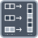

<!-- Generated by tools/export_studio_help.py; edit the reviewed source metadata, then regenerate. -->
# Interleave 1D Arrays

[Array functions](overview.md) · [All functions](../index.md)

Interleaves elements from two one-dimensional arrays.

Résumé français de l’aide Studio

**Entrelacer des tableaux 1D**

Entrelace les elements de deux tableaux a une dimension. [Types] Dérouler pour 1–32 tableaux 1D de schémas compatibles ; les représentations numériques sont promues vers un type T commun. La sortie reste un tableau 1D de T. Les longueurs peuvent différer et ne modifient pas le type d’édition.

## Studio authoring profile

Contract status: **partial**. The connector below describes Studio authoring; execution availability is stated separately.

Resize for 1–32 one-dimensional arrays with compatible element schemas; all connected numeric representations promote to a shared T. Output remains a 1D array of T. Input lengths need not match; their values do not affect the authoring type.

Resize for 1–32 one-dimensional arrays with compatible element schemas; all connected numeric representations promote to a shared T. Output remains a 1D array of T. Input lengths need not match; their values do not affect the authoring type.

## IN — inputs

| Displayed terminal / internal ID | Accepted / resolved type | Studio connection | Unwired input default | Meaning |
| --- | --- | --- | --- | --- |
| array `array_a` | `array<T:any,rank=1>` | Required | Not specified | — |

A default is shown only for an input with an explicitly documented value. Preview/default *types* do not imply unwired operand values. If helper and binding flags differ, both are labelled.

## OUT — outputs

| Displayed terminal / internal ID | Accepted / resolved type | Studio connection | Unwired input default | Meaning |
| --- | --- | --- | --- | --- |
| interleaved array `result` | `array<T:any,rank>=1>` | Recommended (help); Required (binding) | — | — |

A default is shown only for an input with an explicitly documented value. Preview/default *types* do not imply unwired operand values. If helper and binding flags differ, both are labelled.

Additional input IDs: `input_N`, starting at 2.

Expanded connector rows receive their live group/dimension number in Studio. Field selections and configured instances can also supply live names; the table documents the base connector and keeps its internal IDs separate.

## Types and connection rules

Resize for 1–32 one-dimensional arrays with compatible element schemas; all connected numeric representations promote to a shared T. Output remains a 1D array of T. Input lengths need not match; their values do not affect the authoring type.

- Type resolution: `custom_resolver`; result expression: `resolve:frog.studio.polymorphic.type-resolution@1`.
- Implicit coercion: not enabled by this resolver; individual port policies remain explicit.
- Arrays: accepted; lifting policy: `none`.

**Expandable inputs:** 1 to 32. Reduction: `editor_terminal_count`.

Port order: `array_a` → `input_N_ascending`.

## Execution and limits

**Public FROG / target Runtime:** not declared available by this authoring contract.

Scope: `requires_explicit_target_capability`.

Provider identity is retained from Studio. Executability must be established by the active target; it is not inferred from catalog visibility.

**Authoring/target contract limits:**

- NI reference verified for authoring types; this does not establish runtime support on the active target.

Connector type defaults and persistence aliases

| Direction | ID | Preview/default type | Connection policy | Cardinality | Legacy port IDs |
| --- | --- | --- | --- | --- | --- |
| INPUT | `array_a` | `unknown` | `any_explicit` | `single` | — |
| OUTPUT | `result` | `unknown` | `exact` | `single` | — |

## Examples

No example for this object is currently declared in the shared index. [Browse the available examples](../../examples/index.md).

## Identity and references

- Catalogue ID: `array.interleave_1d`.
- Profile: `frog.studio.polymorphic.array.interleave_1d.v1`.
- Definition: `frog.studio.array.interleave_1d`.
- [NI API reference](https://www.ni.com/docs/en-US/bundle/labview-api-ref/page/functions/interleave-1d-arrays.html).

NI links are reference sources for the connector model; Studio support is limited to the profile above. [Reference provenance and notation](../index.md#provenance-and-notation).
