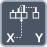

<!-- Generated by tools/export_studio_help.py; edit the reviewed source metadata, then regenerate. -->
# Interpolate 1D Array

[Array functions](overview.md) · [All functions](../index.md)

Interpolates a value at a fractional array index.

Résumé français de l’aide Studio

**Interpoler un tableau 1D**

Interpole une valeur a un index fractionnaire du tableau.

## Studio authoring profile

Contract status: **partial**. The connector below describes Studio authoring; execution availability is stated separately.

## IN — inputs

| Displayed terminal / internal ID | Accepted / resolved type | Studio connection | Unwired input default | Meaning |
| --- | --- | --- | --- | --- |
| array `array` | `array<T:any,rank=1>` | Required | Not specified | — |
| fractional index `index` | `T:numeric` | Required | Not specified | — |

A default is shown only for an input with an explicitly documented value. Preview/default *types* do not imply unwired operand values. If helper and binding flags differ, both are labelled.

## OUT — outputs

| Displayed terminal / internal ID | Accepted / resolved type | Studio connection | Unwired input default | Meaning |
| --- | --- | --- | --- | --- |
| interpolated value `result` | `T:numeric` | Recommended (help); Required (binding) | — | — |

A default is shown only for an input with an explicitly documented value. Preview/default *types* do not imply unwired operand values. If helper and binding flags differ, both are labelled.

## Types and Compatibility

The notes below retain the reviewed help's original NI and Studio scopes. An NI overload is not a claim of Studio runtime support; the authoring profile and execution limits remain separate.

Accepts a 1D array of real numbers or two-real-number point clusters (x,y); not a multidimensional, Boolean, String or complex array. Numeric data and the fractional index/threshold use DBL. The output is a scalar DBL.

Notes de types et de compatibilité de l’aide Studio

Les mentions NI et Studio gardent leur portée d’origine. Une variante NI ne constitue pas une déclaration de prise en charge par le runtime Studio ; consultez les profils et limites d’exécution de cette fiche.

Accepte un tableau 1D de nombres réels ou de clusters de deux réels (x,y), pas de tableau multidimensionnel, booléen, chaîne ou complexe. Les données numériques et l’indice fractionnaire/seuil utilisent DBL. La sortie est un scalaire DBL.

- Type resolution: `custom_resolver`; result expression: `resolve:frog.studio.polymorphic.type-resolution@1`.
- Implicit coercion: permitted by this profile.
- Arrays: accepted; lifting policy: `none`.

**Input count:** 2; this contract does not enable variadic inputs.

## Execution and limits

**Public FROG / target Runtime:** not declared available by this authoring contract.

Scope: `requires_explicit_target_capability`.

Implementation: `frog.studio.array.interpolate_1d.owned.v1`.

Required provider: `frog.studio.array.owned@1`.

Conditional exact owned-value implementation selected by the current Source/FIR/native target; configuration and full element signatures are validated separately. This metadata is not unconditional support for every representation, backend or deployment profile.

**Authoring/target contract limits:**

- NI reference verified for authoring types; this does not establish runtime support on the active target.

Connector type defaults and persistence aliases

| Direction | ID | Preview/default type | Connection policy | Cardinality | Legacy port IDs |
| --- | --- | --- | --- | --- | --- |
| INPUT | `array` | `unknown` | `numeric_scalar_or_array_implicit` | `single` | — |
| INPUT | `index` | `f64` | `numeric_implicit` | `single` | — |
| OUTPUT | `result` | `f64` | `exact` | `single` | — |

## Examples

No example for this object is currently declared in the shared index. [Browse the available examples](../../examples/index.md).

## Identity and references

- Catalogue ID: `array.interpolate_1d`.
- Profile: `frog.studio.polymorphic.array.interpolate_1d.v1`.
- Definition: `frog.studio.array.interpolate_1d`.
- [NI API reference](https://www.ni.com/docs/en-US/bundle/labview-api-ref/page/functions/interpolate-1d-array.html).

NI links are reference sources for the connector model; Studio support is limited to the profile above. [Reference provenance and notation](../index.md#provenance-and-notation).
