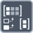

<!-- Generated by tools/export_studio_help.py; edit the reviewed source metadata, then regenerate. -->
# Get Matrix Subset

[Array functions](../overview.md) · [All functions](../../index.md)

Extracts a rectangular subset from a matrix.

Résumé français de l’aide Studio

**Obtenir une sous-matrice**

Extrait une sous-matrice rectangulaire d'une matrice. [Types] Entrée/sortie numérique 2D. Quatre bornes optionnelles réelles (première/dernière ligne, première/dernière colonne), converties en I32. Les fins sont des indices inclusifs, pas des longueurs. Sans bornes, toute la matrice est sélectionnée.

## Studio authoring profile

Contract status: **partial**. The connector below describes Studio authoring; execution availability is stated separately.

Numeric 2D input/output. Four optional scalar real numeric bounds (first/last row, first/last column) convert to I32. End bounds are inclusive indices, not lengths. Unwired bounds select the full extent.

Numeric 2D input/output. Four optional scalar real numeric bounds (first/last row, first/last column) convert to I32. End bounds are inclusive indices, not lengths. Unwired bounds select the full extent.

## IN — inputs

| Displayed terminal / internal ID | Accepted / resolved type | Studio connection | Unwired input default | Meaning |
| --- | --- | --- | --- | --- |
| matrix `matrix` | `array<T:numeric,rank=2>` | Required | Not specified | — |
| first row `row` | `T:numeric` | Recommended (help); Optional (binding) | Not specified | — |
| first column `column` | `T:numeric` | Recommended (help); Optional (binding) | Not specified | — |
| last row `rows` | `T:numeric` | Recommended (help); Optional (binding) | Not specified | — |
| last column `columns` | `T:numeric` | Recommended (help); Optional (binding) | Not specified | — |

A default is shown only for an input with an explicitly documented value. Preview/default *types* do not imply unwired operand values. If helper and binding flags differ, both are labelled.

## OUT — outputs

| Displayed terminal / internal ID | Accepted / resolved type | Studio connection | Unwired input default | Meaning |
| --- | --- | --- | --- | --- |
| submatrix `result` | `array<T:numeric,rank=2>` | Recommended (help); Required (binding) | — | — |

A default is shown only for an input with an explicitly documented value. Preview/default *types* do not imply unwired operand values. If helper and binding flags differ, both are labelled.

## Types and connection rules

Numeric 2D input/output. Four optional scalar real numeric bounds (first/last row, first/last column) convert to I32. End bounds are inclusive indices, not lengths. Unwired bounds select the full extent.

- Type resolution: `custom_resolver`; result expression: `resolve:frog.studio.polymorphic.type-resolution@1`.
- Implicit coercion: not enabled by this resolver; individual port policies remain explicit.
- Arrays: accepted; lifting policy: `none`.

**Input count:** 5; this contract does not enable variadic inputs.

## Execution and limits

**Public FROG / target Runtime:** not declared available by this authoring contract.

Scope: `requires_explicit_target_capability`.

Authoring support is not an execution capability.

**Authoring/target contract limits:**

- NI reference verified for authoring types; this does not establish runtime support on the active target.

Connector type defaults and persistence aliases

| Direction | ID | Preview/default type | Connection policy | Cardinality | Legacy port IDs |
| --- | --- | --- | --- | --- | --- |
| INPUT | `matrix` | `unknown` | `any_explicit` | `single` | — |
| INPUT | `row` | `i32` | `numeric_implicit` | `single` | — |
| INPUT | `column` | `i32` | `numeric_implicit` | `single` | — |
| INPUT | `rows` | `i32` | `numeric_implicit` | `single` | — |
| INPUT | `columns` | `i32` | `numeric_implicit` | `single` | — |
| OUTPUT | `result` | `unknown` | `any_explicit` | `single` | — |

## Identity and references

- Catalogue ID: `array.matrix.get_subset`.
- Parent palette: [Matrix](../matrix.md).
- Profile: `frog.studio.polymorphic.array.matrix.get_subset.v1`.
- Definition: `frog.studio.array.matrix.get_subset`.
- [NI API reference](https://www.ni.com/docs/en-US/bundle/labview-api-ref/page/functions/get-submatrix.html).

NI links are reference sources for the connector model; Studio support is limited to the profile above. [Reference provenance and notation](../../index.md#provenance-and-notation).
