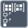

<!-- Generated by tools/export_studio_help.py; edit the reviewed source metadata, then regenerate. -->
# Set Matrix Subset

[Array functions](../overview.md) · [All functions](../../index.md)

Replaces a rectangular subset in a matrix.

Résumé français de l’aide Studio

**Definir une sous-matrice**

Remplace une sous-matrice rectangulaire dans une matrice. [Types] Matrice numérique 2D en entrée/sortie. Groupes déroulables de quatre bornes numériques scalaires inclusives et d’un remplacement scalaire ou tableau numérique 2D. Indices convertis en I32, matrice et remplacement promus vers une représentation numérique commune. Sans bornes, toute la matrice est sélectionnée.

## Studio authoring profile

Contract status: **partial**. The connector below describes Studio authoring; execution availability is stated separately.

Numeric 2D matrix input/output. Repeatable groups contain four optional scalar numeric inclusive bounds and a scalar fill or numeric 2D replacement. Indices convert to I32; matrix and replacement promote to a common numeric representation. Unwired bounds select the full matrix.

Numeric 2D matrix input/output. Repeatable groups contain four optional scalar numeric inclusive bounds and a scalar fill or numeric 2D replacement. Indices convert to I32; matrix and replacement promote to a common numeric representation. Unwired bounds select the full matrix.

## IN — inputs

| Displayed terminal / internal ID | Accepted / resolved type | Studio connection | Unwired input default | Meaning |
| --- | --- | --- | --- | --- |
| matrix `matrix` | `array<T:numeric,rank=2>` | Required | Not specified | — |
| first row `row` | `T:numeric` | Recommended (help); Optional (binding) | Not specified | — |
| first column `column` | `T:numeric` | Recommended (help); Optional (binding) | Not specified | — |
| new submatrix `subset` | `T:any` | Recommended (help); Optional (binding) | Not specified | — |
| last row `rows` | `T:numeric` | Recommended (help); Optional (binding) | Not specified | — |
| last column `columns` | `T:numeric` | Recommended (help); Optional (binding) | Not specified | — |

A default is shown only for an input with an explicitly documented value. Preview/default *types* do not imply unwired operand values. If helper and binding flags differ, both are labelled.

## OUT — outputs

| Displayed terminal / internal ID | Accepted / resolved type | Studio connection | Unwired input default | Meaning |
| --- | --- | --- | --- | --- |
| matrix with replaced submatrix `result` | `array<T:numeric,rank=2>` | Recommended (help); Required (binding) | — | — |

A default is shown only for an input with an explicitly documented value. Preview/default *types* do not imply unwired operand values. If helper and binding flags differ, both are labelled.

## Types and connection rules

Numeric 2D matrix input/output. Repeatable groups contain four optional scalar numeric inclusive bounds and a scalar fill or numeric 2D replacement. Indices convert to I32; matrix and replacement promote to a common numeric representation. Unwired bounds select the full matrix.

- Type resolution: `custom_resolver`; result expression: `resolve:frog.studio.polymorphic.type-resolution@1`.
- Implicit coercion: not enabled by this resolver; individual port policies remain explicit.
- Arrays: accepted; lifting policy: `none`.

**Input count:** 6; this contract does not enable variadic inputs.

## Execution and limits

**Public FROG / target Runtime:** not declared available by this authoring contract.

Scope: `requires_explicit_target_capability`.

Authoring support is not an execution capability.

**Authoring/target contract limits:**

- NI reference verified for authoring types; this does not establish runtime support on the active target.

Connector type defaults and persistence aliases

| Direction | ID | Preview/default type | Connection policy | Cardinality | Legacy port IDs |
| --- | --- | --- | --- | --- | --- |
| INPUT | `matrix` | `unknown` | `any_explicit` | `single` | — |
| INPUT | `row` | `i32` | `numeric_implicit` | `single` | — |
| INPUT | `column` | `i32` | `numeric_implicit` | `single` | — |
| INPUT | `subset` | `f64` | `any_explicit` | `single` | — |
| INPUT | `rows` | `i32` | `numeric_implicit` | `single` | — |
| INPUT | `columns` | `i32` | `numeric_implicit` | `single` | — |
| OUTPUT | `result` | `unknown` | `any_explicit` | `single` | — |

## Identity and references

- Catalogue ID: `array.matrix.set_subset`.
- Parent palette: [Matrix](../matrix.md).
- Profile: `frog.studio.polymorphic.array.matrix.set_subset.v1`.
- Definition: `frog.studio.array.matrix.set_subset`.
- [NI API reference](https://www.ni.com/docs/en-US/bundle/labview-api-ref/page/functions/set-submatrix.html).

NI links are reference sources for the connector model; Studio support is limited to the profile above. [Reference provenance and notation](../../index.md#provenance-and-notation).
