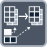

<!-- Generated by tools/export_studio_help.py; edit the reviewed source metadata, then regenerate. -->
# Replace Array Subset

[Array functions](overview.md) · [All functions](../index.md)

Replaces an element or contiguous subset in an array.

Résumé français de l’aide Studio

**Remplacer une portion de tableau**

Remplace un element ou une portion contigue dans un tableau. [Types] Un tableau ND de T expose N indices par groupe de remplacement. Avec x dimensions indexées, le remplacement proposé est de rang N-x (scalaire si x=N) ; les blocs de rang N sont aussi acceptés. Un groupe non câblé reprend les dimensions indexées du précédent, initialement la première. Déplier la fonction permet plusieurs remplacements sans agrandir le tableau. La sortie conserve T et le rang N.

## Studio authoring profile

Contract status: **partial**. The connector below describes Studio authoring; execution availability is stated separately.

An N-D array of T exposes N indices per replacement group. With x indexed dimensions, the inferred replacement is T of rank N-x (a scalar when x=N); full-rank replacement blocks are also accepted. Unwired groups inherit the preceding indexed dimensions, initially the first dimension. Extend the node to replace multiple subsets without enlarging the array. The result retains T and rank N.

An N-D array of T exposes N indices per replacement group. With x indexed dimensions, the inferred replacement is T of rank N-x (a scalar when x=N); full-rank replacement blocks are also accepted. Unwired groups inherit the preceding indexed dimensions, initially the first dimension. Extend the node to replace multiple subsets without enlarging the array. The result retains T and rank N.

## IN — inputs

| Displayed terminal / internal ID | Accepted / resolved type | Studio connection | Unwired input default | Meaning |
| --- | --- | --- | --- | --- |
| array `array` | `array<T:any,rank>=1>` | Required | Not specified | — |
| new element or subarray `subset` | `T:any` | Required | Not specified | — |
| index `index` | `T:integer` | Recommended (help); Optional (binding) | Not specified | — |

A default is shown only for an input with an explicitly documented value. Preview/default *types* do not imply unwired operand values. If helper and binding flags differ, both are labelled.

## OUT — outputs

| Displayed terminal / internal ID | Accepted / resolved type | Studio connection | Unwired input default | Meaning |
| --- | --- | --- | --- | --- |
| replaced array `result` | `array<T:any,rank>=1>` | Recommended (help); Required (binding) | — | — |

A default is shown only for an input with an explicitly documented value. Preview/default *types* do not imply unwired operand values. If helper and binding flags differ, both are labelled.

## Types and connection rules

An N-D array of T exposes N indices per replacement group. With x indexed dimensions, the inferred replacement is T of rank N-x (a scalar when x=N); full-rank replacement blocks are also accepted. Unwired groups inherit the preceding indexed dimensions, initially the first dimension. Extend the node to replace multiple subsets without enlarging the array. The result retains T and rank N.

- Type resolution: `custom_resolver`; result expression: `resolve:frog.studio.polymorphic.type-resolution@1`.
- Implicit coercion: permitted by this profile.
- Arrays: accepted; lifting policy: `none`.

**Input count:** 3; this contract does not enable variadic inputs.

## Execution and limits

**Public FROG / target Runtime:** not declared available by this authoring contract.

Scope: `requires_explicit_target_capability`.

Provider identity is retained from Studio. Executability must be established by the active target; it is not inferred from catalog visibility.

**Authoring/target contract limits:**

- NI reference verified for authoring types; this does not establish runtime support on the active target.

Connector type defaults and persistence aliases

| Direction | ID | Preview/default type | Connection policy | Cardinality | Legacy port IDs |
| --- | --- | --- | --- | --- | --- |
| INPUT | `array` | `array:f64` | `any_explicit` | `single` | — |
| INPUT | `subset` | `array:f64` | `any_explicit` | `single` | — |
| INPUT | `index` | `i32` | `numeric_implicit` | `single` | — |
| OUTPUT | `result` | `array:f64` | `exact` | `single` | — |

## Examples

No example for this object is currently declared in the shared index. [Browse the available examples](../../examples/index.md).

## Identity and references

- Catalogue ID: `array.replace_subset`.
- Profile: `frog.studio.polymorphic.array.replace_subset.v1`.
- Definition: `frog.studio.array.replace_subset`.
- [NI API reference](https://www.ni.com/docs/en-US/bundle/labview-api-ref/page/functions/replace-array-subset.html).

NI links are reference sources for the connector model; Studio support is limited to the profile above. [Reference provenance and notation](../index.md#provenance-and-notation).
