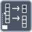

<!-- Generated by tools/export_studio_help.py; edit the reviewed source metadata, then regenerate. -->
# Split 1D Array

[Array functions](overview.md) · [All functions](../index.md)

Splits a one-dimensional array at an index.

## Product execution profiles

The shared index declares native examples for this object; see [the examples below](split_1d.md#examples) and [document profiles and evidence boundaries](../../reference/studio-draft-examples.md). Older binding/help statements retained below can lag those product profiles. They do not establish or deny the separately measured native profiles. An example declaration alone is not an execution result or admission of every overload.

Résumé français de l’aide Studio

**Diviser un tableau 1D**

Texte historique de l’aide conservé ci-dessous. Des exemples natifs distincts sont déclarés pour cet objet ; consultez les profils et preuves datés, sans déduire une compatibilité universelle de ce texte.

Divise un tableau a une dimension a un index donne.

## Studio authoring profile

Contract status: **partial**. The connector below describes Studio authoring; execution availability is stated separately.

## IN — inputs

| Displayed terminal / internal ID | Accepted / resolved type | Studio connection | Unwired input default | Meaning |
| --- | --- | --- | --- | --- |
| array `array` | `array<T:any,rank=1>` | Required | Not specified | — |
| index `index` | `T:numeric` | Required | Not specified | — |

A default is shown only for an input with an explicitly documented value. Preview/default *types* do not imply unwired operand values. If helper and binding flags differ, both are labelled.

## OUT — outputs

| Displayed terminal / internal ID | Accepted / resolved type | Studio connection | Unwired input default | Meaning |
| --- | --- | --- | --- | --- |
| first subarray `before` | `array<T:any,rank>=1>` | Recommended (help); Required (binding) | — | — |
| second subarray `after` | `array<T:any,rank>=1>` | Recommended (help); Required (binding) | — | — |

A default is shown only for an input with an explicitly documented value. Preview/default *types* do not imply unwired operand values. If helper and binding flags differ, both are labelled.

## Types and Compatibility

The notes below retain the reviewed help's original NI and Studio scopes. An NI overload is not a claim of Studio runtime support; the authoring profile and execution limits remain separate.

Retained binding and help statements

These are source declarations, not the current measured product-execution assessment. Compare historical limitations with the separately dated native profiles above.

Accepts only a 1D array of any T; splits its elements without changing T or rank. Both outputs remain 1D arrays of T. The split index is a real number converted to I32.

Notes de types et de compatibilité de l’aide Studio

Les mentions NI et Studio gardent leur portée d’origine. Une variante NI ne constitue pas une déclaration de prise en charge par le runtime Studio ; consultez les profils et limites d’exécution de cette fiche.

Accepte uniquement un tableau 1D de T ; sépare ses éléments sans changer le type ni le rang. Les deux sorties restent des tableaux 1D de T. L’indice numérique réel est converti en I32.

- Type resolution: `custom_resolver`; result expression: `resolve:frog.studio.polymorphic.type-resolution@1`.
- Implicit coercion: permitted by this profile.
- Arrays: accepted; lifting policy: `none`.

**Input count:** 2; this contract does not enable variadic inputs.

## Execution and limits

**Public FROG / target Runtime:** not declared available by this authoring contract.

Scope: `requires_explicit_target_capability`.

Implementation: `frog.studio.array.split_1d.owned.v1`.

Required provider: `frog.studio.array.owned@1`.

Conditional exact owned-value implementation selected by the current Source/FIR/native target; configuration and full element signatures are validated separately. This metadata is not unconditional support for every representation, backend or deployment profile.

Retained authoring-contract limitations

These declarations belong to the binding snapshot. Compare them with the separately admitted native profiles and dated measurements linked above; they are not a current denial of those product profiles.

**Authoring/target contract limits:**

- NI reference verified for authoring types; this does not establish runtime support on the active target.

Connector type defaults and persistence aliases

| Direction | ID | Preview/default type | Connection policy | Cardinality | Legacy port IDs |
| --- | --- | --- | --- | --- | --- |
| INPUT | `array` | `unknown` | `any_explicit` | `single` | — |
| INPUT | `index` | `i32` | `numeric_implicit` | `single` | — |
| OUTPUT | `before` | `unknown` | `exact` | `single` | — |
| OUTPUT | `after` | `unknown` | `exact` | `single` | — |

## Examples

These are real `.frog` documents from the same index used by Studio. Backend names and expected results describe the examples; they are not execution certificates.

- [Split 1D Array — middle](../../examples/array.split.middle.md) — The second array starts at the split index. Indices outside the array clamp to its ends; elements are preserved. (`execution`, `studio-draft`).
- [Split 1D Array — negative](../../examples/array.split.negative.md) — The second array starts at the split index. Indices outside the array clamp to its ends; elements are preserved. (`execution`, `studio-draft`).
- [Split 1D Array — past-end](../../examples/array.split.past-end.md) — The second array starts at the split index. Indices outside the array clamp to its ends; elements are preserved. (`execution`, `studio-draft`).

## Identity and references

- Catalogue ID: `array.split_1d`.
- Profile: `frog.studio.polymorphic.array.split_1d.v1`.
- Definition: `frog.studio.array.split_1d`.
- [NI API reference](https://www.ni.com/docs/en-US/bundle/labview-api-ref/page/functions/split-1d-array.html).

NI links are reference sources for the connector model; Studio support is limited to the profile above. [Reference provenance and notation](../index.md#provenance-and-notation).
