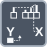

<!-- Generated by tools/export_studio_help.py; edit the reviewed source metadata, then regenerate. -->
# Threshold 1D Array

[Array functions](overview.md) · [All functions](../index.md)

Returns the fractional index where the threshold is crossed.

Résumé français de l’aide Studio

**Seuil d'un tableau 1D**

Renvoie l'index fractionnaire auquel le seuil est franchi. [Types] Accepte un tableau 1D de nombres réels ou de clusters de deux réels (x,y), pas de tableau multidimensionnel, booléen, chaîne ou complexe. Les données numériques et l’indice fractionnaire/seuil utilisent DBL. La sortie est un scalaire DBL. L’indice de départ optionnel est numérique réel, converti en I32, zéro par défaut.

## Studio authoring profile

Contract status: **partial**. The connector below describes Studio authoring; execution availability is stated separately.

Accepts a 1D array of real numbers or two-real-number point clusters (x,y); not a multidimensional, Boolean, String or complex array. Numeric data and the fractional index/threshold use DBL. The output is a scalar DBL. Optional start index is a real numeric scalar converted to I32, default zero.

Accepts a 1D array of real numbers or two-real-number point clusters (x,y); not a multidimensional, Boolean, String or complex array. Numeric data and the fractional index/threshold use DBL. The output is a scalar DBL. Optional start index is a real numeric scalar converted to I32, default zero.

## IN — inputs

| Displayed terminal / internal ID | Accepted / resolved type | Studio connection | Unwired input default | Meaning |
| --- | --- | --- | --- | --- |
| array `array` | `array<T:any,rank=1>` | Required | Not specified | — |
| threshold `threshold` | `T:numeric` | Required | Not specified | — |
| start index `start_index` | `T:numeric` | Recommended (help); Optional (binding) | Not specified | — |

A default is shown only for an input with an explicitly documented value. Preview/default *types* do not imply unwired operand values. If helper and binding flags differ, both are labelled.

## OUT — outputs

| Displayed terminal / internal ID | Accepted / resolved type | Studio connection | Unwired input default | Meaning |
| --- | --- | --- | --- | --- |
| fractional index `index` | `T:numeric` | Recommended (help); Required (binding) | — | — |

A default is shown only for an input with an explicitly documented value. Preview/default *types* do not imply unwired operand values. If helper and binding flags differ, both are labelled.

## Types and connection rules

Accepts a 1D array of real numbers or two-real-number point clusters (x,y); not a multidimensional, Boolean, String or complex array. Numeric data and the fractional index/threshold use DBL. The output is a scalar DBL. Optional start index is a real numeric scalar converted to I32, default zero.

- Type resolution: `custom_resolver`; result expression: `resolve:frog.studio.polymorphic.type-resolution@1`.
- Implicit coercion: permitted by this profile.
- Arrays: accepted; lifting policy: `none`.

**Input count:** 3; this contract does not enable variadic inputs.

## Execution and limits

**Public FROG / target Runtime:** not declared available by this authoring contract.

Scope: `requires_explicit_target_capability`.

Provider identity is retained from Studio. Executability must be established by the active target; it is not inferred from catalog visibility.

**Authoring/target contract limits:**

- NI reference verified for authoring types; this does not establish runtime support on the active target.

Connector type defaults and persistence aliases

| Direction | ID | Preview/default type | Connection policy | Cardinality | Legacy port IDs |
| --- | --- | --- | --- | --- | --- |
| INPUT | `array` | `unknown` | `any_explicit` | `single` | — |
| INPUT | `threshold` | `f64` | `numeric_implicit` | `single` | — |
| INPUT | `start_index` | `i32` | `numeric_implicit` | `single` | — |
| OUTPUT | `index` | `f64` | `exact` | `single` | — |

## Examples

No example for this object is currently declared in the shared index. [Browse the available examples](../../examples/index.md).

## Identity and references

- Catalogue ID: `array.threshold_1d`.
- Profile: `frog.studio.polymorphic.array.threshold_1d.v1`.
- Definition: `frog.studio.array.threshold_1d`.
- [NI API reference](https://www.ni.com/docs/en-US/bundle/labview-api-ref/page/functions/threshold-1d-array.html).

NI links are reference sources for the connector model; Studio support is limited to the profile above. [Reference provenance and notation](../index.md#provenance-and-notation).
