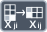

<!-- Generated by tools/export_studio_help.py; edit the reviewed source metadata, then regenerate. -->
# Transpose 2D Array

[Array functions](overview.md) · [All functions](../index.md)

Transposes rows and columns of a two-dimensional array.

## Product execution profiles

The shared index declares native examples for this object; see [the examples below](transpose_2d.md#examples) and [document profiles and evidence boundaries](../../reference/studio-draft-examples.md). Older binding/help statements retained below can lag those product profiles. They do not establish or deny the separately measured native profiles. An example declaration alone is not an execution result or admission of every overload.

Résumé français de l’aide Studio

**Transposer un tableau 2D**

Texte historique de l’aide conservé ci-dessous. Des exemples natifs distincts sont déclarés pour cet objet ; consultez les profils et preuves datés, sans déduire une compatibilité universelle de ce texte.

Transpose les lignes et les colonnes d'un tableau a deux dimensions. [Types] Accepte exactement un tableau 2D de T et conserve son rang et son schéma complet. Les tableaux 1D ou de rang supérieur à 2 sont refusés.

## Studio authoring profile

Contract status: **partial**. The connector below describes Studio authoring; execution availability is stated separately.

Retained binding and help description

This is the source declaration, not the current measured product-execution assessment.

Accepts exactly a 2D array of any T and preserves its rank and full element schema. 1D and rank greater than 2 are rejected.

Accepts exactly a 2D array of any T and preserves its rank and full element schema. 1D and rank greater than 2 are rejected.

## IN — inputs

| Displayed terminal / internal ID | Accepted / resolved type | Studio connection | Unwired input default | Meaning |
| --- | --- | --- | --- | --- |
| 2D array `array` | `array<T:any,rank=2>` | Required | Not specified | — |

A default is shown only for an input with an explicitly documented value. Preview/default *types* do not imply unwired operand values. If helper and binding flags differ, both are labelled.

## OUT — outputs

| Displayed terminal / internal ID | Accepted / resolved type | Studio connection | Unwired input default | Meaning |
| --- | --- | --- | --- | --- |
| transposed array `result` | `array<T:any,rank>=1>` | Recommended (help); Required (binding) | — | — |

A default is shown only for an input with an explicitly documented value. Preview/default *types* do not imply unwired operand values. If helper and binding flags differ, both are labelled.

## Types and connection rules

Accepts exactly a 2D array of any T and preserves its rank and full element schema. 1D and rank greater than 2 are rejected.

- Type resolution: `custom_resolver`; result expression: `resolve:frog.studio.polymorphic.type-resolution@1`.
- Implicit coercion: not enabled by this resolver; individual port policies remain explicit.
- Arrays: accepted; lifting policy: `none`.

**Input count:** 1; this contract does not enable variadic inputs.

## Execution and limits

**Public FROG / target Runtime:** not declared available by this authoring contract.

Scope: `requires_explicit_target_capability`.

Provider identity is retained from Studio. Executability must be established by the active target; it is not inferred from catalog visibility.

Retained authoring-contract limitations

These declarations belong to the binding snapshot. Compare them with the separately admitted native profiles and dated measurements linked above; they are not a current denial of those product profiles.

**Authoring/target contract limits:**

- NI reference verified for authoring types; this does not establish runtime support on the active target.

Connector type defaults and persistence aliases

| Direction | ID | Preview/default type | Connection policy | Cardinality | Legacy port IDs |
| --- | --- | --- | --- | --- | --- |
| INPUT | `array` | `unknown` | `any_explicit` | `single` | — |
| OUTPUT | `result` | `unknown` | `exact` | `single` | — |

## Examples

These are real `.frog` documents from the same index used by Studio. Backend names and expected results describe the examples; they are not execution certificates.

- [Transpose a 2 × 3 Array](../../examples/array.transpose.rectangular.md) — A two-dimensional Array is distinct from the Matrix type. Transpose swaps the two dimensions and preserves every exact element in row-major order. (`execution`, `studio-draft`).
- [Transpose an empty rectangular shape](../../examples/array.transpose.empty-shape.md) — An empty Array still has two distinct dimensions. Shape \[0,3\] becomes \[3,0\], without allocating elements or losing its rank. (`execution`, `studio-draft`).

## Identity and references

- Catalogue ID: `array.transpose_2d`.
- Profile: `frog.studio.polymorphic.array.transpose_2d.v1`.
- Definition: `frog.studio.array.transpose_2d`.
- [NI API reference](https://www.ni.com/docs/en-US/bundle/labview-api-ref/page/functions/transpose-2d-array.html).

NI links are reference sources for the connector model; Studio support is limited to the profile above. [Reference provenance and notation](../index.md#provenance-and-notation).
