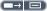

<!-- Generated by tools/export_studio_help.py; edit the reviewed source metadata, then regenerate. -->
# Build Cluster Array

[Cluster functions](index.md) · [All functions](../index.md)

Diagram node for building an array of clusters. Ports are available for authoring; execution requires target support.

Résumé français de l’aide Studio

**Construire un tableau de clusters**

Noeud de diagramme pour construire un tableau de clusters. Ports disponibles pour l'edition ; execution selon le moteur cible. [Types] N valeurs compatibles T -&gt; Array 1D de N Clusters&lt;T&gt; à un champ. Studio accepte scalaires et agrégats de formes compatibles, avec coercition numérique.

## Studio authoring profile

Contract status: **partial**. The connector below describes Studio authoring; execution availability is stated separately.

Wraps each input value independently in a single-field Cluster and builds a 1D Array with one element per input. Scalars, Arrays and Clusters are accepted; all inputs must have one common effective type under normal numeric coercion rules.

N compatible values of T -&gt; 1D Array of N single-field Clusters&lt;T&gt;. Studio accepts scalars and aggregates with compatible shapes and numeric coercions.

## IN — inputs

| Displayed terminal / internal ID | Accepted / resolved type | Studio connection | Unwired input default | Meaning |
| --- | --- | --- | --- | --- |
| element1 `element1` | `T:any` | Required | Not specified | — |

A default is shown only for an input with an explicitly documented value. Preview/default *types* do not imply unwired operand values. If helper and binding flags differ, both are labelled.

## OUT — outputs

| Displayed terminal / internal ID | Accepted / resolved type | Studio connection | Unwired input default | Meaning |
| --- | --- | --- | --- | --- |
| array `array` | `array<T:cluster,rank>=1>` | Recommended (help); Required (binding) | — | — |

A default is shown only for an input with an explicitly documented value. Preview/default *types* do not imply unwired operand values. If helper and binding flags differ, both are labelled.

Additional input IDs: `elementN`, starting at 2.

## Types and connection rules

- Type resolution: `custom_resolver`; result expression: `resolve:frog.studio.polymorphic.type-resolution@1`.
- Implicit coercion: permitted by this profile.
- Arrays: not established; lifting policy: `none`.

Only the declared port expressions and connection policies are defined by this Studio profile; general array semantics remain unspecified.

**Expandable inputs:** 1 to 32. Reduction: `unspecified`.

Port order: `element1` → `elementN_ascending`.

## Execution and limits

**Public FROG / target Runtime:** not declared available by this authoring contract.

Scope: `requires_explicit_target_capability`.

Authoring support is not an execution capability.

**Authoring/target contract limits:**

- Execution requires explicit support by the active target.

Connector type defaults and persistence aliases

| Direction | ID | Preview/default type | Connection policy | Cardinality | Legacy port IDs |
| --- | --- | --- | --- | --- | --- |
| INPUT | `element1` | `f64` | `any_explicit` | `single` | — |
| OUTPUT | `array` | `array<cluster<>,rank=1>` | `any_explicit` | `single` | — |

## Identity and references

- Catalogue ID: `cluster.build_array`.
- Profile: `frog.studio.palette.cluster.build_array.v1`.
- Definition: `frog.studio.cluster.build_array`.
- [NI API reference](https://www.ni.com/docs/en-US/bundle/labview-nxg-nodes-api-ref/page/build-cluster-array.html).

NI links are reference sources for the connector model; Studio support is limited to the profile above. [Reference provenance and notation](../index.md#provenance-and-notation).
