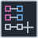

<!-- Generated by tools/export_studio_help.py; edit the reviewed source metadata, then regenerate. -->
# Build Map

[Collection functions](../index.md) · [All functions](../../index.md)

Builds Map&lt;K,V&gt; from stable key/value rows, evaluated in logical row order; the last duplicate key wins. An empty Build retains its resolved type.

## Product execution profiles

The shared index declares native examples for this object; see [the examples below](build.md#examples) and [document profiles and evidence boundaries](../../../reference/studio-draft-examples.md). Older binding/help statements retained below can lag those product profiles. They do not establish or deny the separately measured native profiles. An example declaration alone is not an execution result or admission of every overload.

Résumé français de l’aide Studio

**Build Map**

Texte historique de l’aide conservé ci-dessous. Des exemples natifs distincts sont déclarés pour cet objet ; consultez les profils et preuves datés, sans déduire une compatibilité universelle de ce texte.

Construit Map&lt;K,V&gt; depuis les lignes clé/valeur stables, dans leur ordre logique ; la dernière clé répétée l’emporte. Un Build vide conserve son type résolu.

## Studio authoring profile

Contract status: **defined**. The connector below describes Studio authoring; execution availability is stated separately.

Retained binding and help description

This is the source declaration, not the current measured product-execution assessment.

Build a value Map from stable logical rows; the last equal key in row order wins. Row count is 0..32, monotone row identities survive insertion/removal, and zero rows require a complete retained type witness.

## IN — inputs

| Displayed terminal / internal ID | Accepted / resolved type | Studio connection | Unwired input default | Meaning |
| --- | --- | --- | --- | --- |
| key `row:row_0:key` | `K:any` | Required | Not specified | — |
| value `row:row_0:value` | `V:any` | Required | Not specified | — |

A default is shown only for an input with an explicitly documented value. Preview/default *types* do not imply unwired operand values. If helper and binding flags differ, both are labelled.

## OUT — outputs

| Displayed terminal / internal ID | Accepted / resolved type | Studio connection | Unwired input default | Meaning |
| --- | --- | --- | --- | --- |
| map `map` | `M:any` | Required | — | — |

A default is shown only for an input with an explicitly documented value. Preview/default *types* do not imply unwired operand values. If helper and binding flags differ, both are labelled.

## Types and connection rules

CollectionBinding is the single actual connector/type authority. Generic variables describe roles only: Map M&lt;K,V&gt;, Set S&lt;T&gt;, C=Map\|Set, Cartesian A/B independent. Full types are invariant and unresolved models stay unknown.

- Type resolution: `custom_resolver`; result expression: `resolve:frog.studio.collection.type-resolution@1`.
- Implicit coercion: not enabled by this resolver; individual port policies remain explicit.
- Arrays: accepted; lifting policy: `none`.

Nested Array/Cluster/Enum/reference metadata is preserved according to CollectionBinding and the shared comparator domain. No scalar lift, flattening or implicit conversion is authorized.

Input count is instance-dependent or not established by this contract.

Port order: `row:row_0:key` → `row:row_0:value`.

Initial row_0 is a descriptor prototype only. CollectionBuildState and CollectionBinding expand the actual 0..32 stable row groups; this is not the legacy ordinal variadic-input mechanism.

## Execution and limits

**Public FROG / target Runtime:** not declared available by this authoring contract.

Scope: `requires_explicit_target_capability`.

Implementation: `frog.collection.map.build`.

Required provider: `frog.studio.collection@1`.

Local Studio profile only. A catalog contract is not a target capability or a published FROG primitive. Actual execution requires Source/FIR lowering, exact type admission and the selected native backend/runtime services; no implicit realization fallback.

Connector type defaults and persistence aliases

| Direction | ID | Preview/default type | Connection policy | Cardinality | Legacy port IDs |
| --- | --- | --- | --- | --- | --- |
| INPUT | `row:row_0:key` | `unknown` | `any_explicit` | `single` | — |
| INPUT | `row:row_0:value` | `unknown` | `any_explicit` | `single` | — |
| OUTPUT | `map` | `unknown` | `any_explicit` | `single` | — |

## Examples

These are real `.frog` documents from the same index used by Studio. Backend names and expected results describe the examples; they are not execution certificates.

- [Build Map — last repeated key wins](../../../examples/collection.map.build.duplicate-key.md) — Rows are evaluated in their persisted logical order. The last value supplied for key A replaces the first; the displayed Map is ordered by its declared key comparator. (`execution`, `studio-draft`).

## Identity and references

- Catalogue ID: `collection.map.build`.
- Parent palette: [Map](../map.md).
- Profile: `frog.studio.collection.map.build.v1`.
- Definition: `frog.studio.collection.map.build`.

NI links are reference sources for the connector model; Studio support is limited to the profile above. [Reference provenance and notation](../../index.md#provenance-and-notation).
