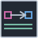

<!-- Generated by tools/export_studio_help.py; edit the reviewed source metadata, then regenerate. -->
# Map Constant

[Collection functions](../index.md) · [All functions](../../index.md)

A Map type model and complete value. Setting K and V creates no entries. Copy Data and Paste Data transfer compatible complete typed data. Unconfigured constants remain editable but cannot run.

Résumé français de l’aide Studio

**Map Constant**

Modèles de types et valeur complète de Map. Définir K et V ne crée aucune entrée. Copy Data et Paste Data transfèrent une valeur complète typée compatible. Une constante non configurée reste éditable mais ne peut pas être exécutée.

## Studio authoring profile

Contract status: **editor managed**. This is an editor-managed element; placement and configured values are distinct from an executable function provider.

Typed Map value literal. Independent K/V type models define no entries. Actual values and complete nominal metadata use the common Collection authoring codec.

## IN — inputs

No fixed inputs are declared in this binding profile. The editor or selected instance owns any contextual terminals.

## OUT — outputs

| Displayed terminal / internal ID | Accepted / resolved type | Studio connection | Unwired input default | Meaning |
| --- | --- | --- | --- | --- |
| value `value` | `M:any` | Required | — | — |

A default is shown only for an input with an explicitly documented value. Preview/default *types* do not imply unwired operand values. If helper and binding flags differ, both are labelled.

## Types and connection rules

CollectionBinding is the single actual connector/type authority. Generic variables describe roles only: Map M&lt;K,V&gt;, Set S&lt;T&gt;, C=Map\|Set, Cartesian A/B independent. Full types are invariant and unresolved models stay unknown.

- Type resolution: `custom_resolver`; result expression: `resolve:frog.studio.collection.type-resolution@1`.
- Implicit coercion: not enabled by this resolver; individual port policies remain explicit.
- Arrays: accepted; lifting policy: `none`.

Nested Array/Cluster/Enum/reference metadata is preserved according to CollectionBinding and the shared comparator domain. No scalar lift, flattening or implicit conversion is authorized.

**Input count:** 0; this contract does not enable variadic inputs.

## Execution and limits

**Public FROG / target Runtime:** not declared available by this authoring contract.

Scope: `requires_explicit_target_capability`.

Implementation: `frog.studio.collection.map.constant`.

Local Studio profile only. A catalog contract is not a target capability or a published FROG primitive. Actual execution requires Source/FIR lowering, exact type admission and the selected native backend/runtime services; no implicit realization fallback.

Connector type defaults and persistence aliases

| Direction | ID | Preview/default type | Connection policy | Cardinality | Legacy port IDs |
| --- | --- | --- | --- | --- | --- |
| OUTPUT | `value` | `unknown` | `any_explicit` | `single` | — |

## Examples

No example for this object is currently declared in the shared index. [Browse the available examples](../../../examples/index.md).

## Identity and references

- Catalogue ID: `collection.map.constant`.
- Parent palette: [Map](../map.md).
- Profile: `frog.studio.collection.map.constant.v1`.
- Definition: `frog.studio.collection.map.constant`.

NI links are reference sources for the connector model; Studio support is limited to the profile above. [Reference provenance and notation](../../index.md#provenance-and-notation).
