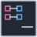

<!-- Generated by tools/export_studio_help.py; edit the reviewed source metadata, then regenerate. -->
# Remove From Map

[Collection functions](../index.md) · [All functions](../../index.md)

Removes only the requested key and returns its value. key not found? is true when absent. FROG: an absent value returns the typed V default and leaves the Map unchanged.

## Product execution profiles

The shared index declares native examples for this object; see [the examples below](remove.md#examples) and [document profiles and evidence boundaries](../../../reference/studio-draft-examples.md). Older binding/help statements retained below can lag those product profiles. They do not establish or deny the separately measured native profiles. An example declaration alone is not an execution result or admission of every overload.

Résumé français de l’aide Studio

**Remove From Map**

Texte historique de l’aide conservé ci-dessous. Des exemples natifs distincts sont déclarés pour cet objet ; consultez les profils et preuves datés, sans déduire une compatibilité universelle de ce texte.

Retire uniquement la clé demandée et retourne sa valeur. key not found? vaut vrai si elle est absente. Décision FROG : l’absence retourne le défaut typé de V et conserve la Map.

## Studio authoring profile

Contract status: **defined**. The connector below describes Studio authoring; execution availability is stated separately.

Retained binding and help description

This is the source declaration, not the current measured product-execution assessment.

Remove one exact key and return its V. Missing key preserves the Map, reports true and requests a full-schema typed V default; unavailable defaults are diagnostics, never physical zero substitutions.

## IN — inputs

| Displayed terminal / internal ID | Accepted / resolved type | Studio connection | Unwired input default | Meaning |
| --- | --- | --- | --- | --- |
| map `map` | `M:any` | Required | Not specified | — |
| key `key` | `K:any` | Required | Not specified | — |

A default is shown only for an input with an explicitly documented value. Preview/default *types* do not imply unwired operand values. If helper and binding flags differ, both are labelled.

## OUT — outputs

| Displayed terminal / internal ID | Accepted / resolved type | Studio connection | Unwired input default | Meaning |
| --- | --- | --- | --- | --- |
| map out `map_out` | `M:any` | Required | — | — |
| key not found? `key_not_found` | `bool` | Required | — | — |
| value `value` | `V:any` | Required | — | — |

A default is shown only for an input with an explicitly documented value. Preview/default *types* do not imply unwired operand values. If helper and binding flags differ, both are labelled.

## Types and connection rules

CollectionBinding is the single actual connector/type authority. Generic variables describe roles only: Map M&lt;K,V&gt;, Set S&lt;T&gt;, C=Map\|Set, Cartesian A/B independent. Full types are invariant and unresolved models stay unknown.

- Type resolution: `custom_resolver`; result expression: `resolve:frog.studio.collection.type-resolution@1`.
- Implicit coercion: not enabled by this resolver; individual port policies remain explicit.
- Arrays: accepted; lifting policy: `none`.

Nested Array/Cluster/Enum/reference metadata is preserved according to CollectionBinding and the shared comparator domain. No scalar lift, flattening or implicit conversion is authorized.

**Input count:** 2; this contract does not enable variadic inputs.

Port order: `map` → `key`.

## Execution and limits

**Public FROG / target Runtime:** not declared available by this authoring contract.

Scope: `requires_explicit_target_capability`.

Implementation: `frog.collection.map.remove`.

Required provider: `frog.studio.collection@1`.

Local Studio profile only. A catalog contract is not a target capability or a published FROG primitive. Actual execution requires Source/FIR lowering, exact type admission and the selected native backend/runtime services; no implicit realization fallback.

Connector type defaults and persistence aliases

| Direction | ID | Preview/default type | Connection policy | Cardinality | Legacy port IDs |
| --- | --- | --- | --- | --- | --- |
| INPUT | `map` | `unknown` | `any_explicit` | `single` | — |
| INPUT | `key` | `unknown` | `any_explicit` | `single` | — |
| OUTPUT | `map_out` | `unknown` | `any_explicit` | `single` | — |
| OUTPUT | `key_not_found` | `bool` | `exact` | `single` | — |
| OUTPUT | `value` | `unknown` | `any_explicit` | `single` | — |

## Examples

These are real `.frog` documents from the same index used by Studio. Backend names and expected results describe the examples; they are not execution certificates.

- [Remove From Map — present key](../../../examples/collection.map.remove.found.md) — Removal emits a new Map and the removed value. A missing key preserves the Map and returns the intrinsic I32 default with key_not_found true. (`execution`, `studio-draft`).
- [Remove From Map — missing key](../../../examples/collection.map.remove.missing.md) — Removal emits a new Map and the removed value. A missing key preserves the Map and returns the intrinsic I32 default with key_not_found true. (`execution`, `studio-draft`).

## Identity and references

- Catalogue ID: `collection.map.remove`.
- Parent palette: [Map](../map.md).
- Profile: `frog.studio.collection.map.remove.v1`.
- Definition: `frog.studio.collection.map.remove`.

NI links are reference sources for the connector model; Studio support is limited to the profile above. [Reference provenance and notation](../../index.md#provenance-and-notation).
