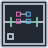

<!-- Generated by tools/export_studio_help.py; edit the reviewed source metadata, then regenerate. -->
# Convert Map To Array

[Collection functions](../index.md) · [All functions](../../index.md)

Places an editable For with AtomicElements indexing and a real internal wire. Map iteration supplies a typed (key,value) cluster in key order; output is a 1D Array of these complete entries. Nested Arrays are not flattened.

Résumé français de l’aide Studio

**Convert Map To Array**

Dépose une vraie For éditable, ses tunnels AtomicElements et son fil interne. Chaque itération fournit un cluster typé (key,value), dans l’ordre des clés ; la sortie est un tableau 1D de ces entrées complètes. Les tableaux imbriqués ne sont pas aplatis.

## Studio authoring profile

Contract status: **editor managed**. This is an editor-managed element; placement and configured values are distinct from an executable function provider.

Editable ordinary For template, not an opaque operator. AtomicElements input iterates sorted complete key/value records and indexed output produces rank-one Array&lt;Cluster&lt;key:K,value:V&gt;&gt; without flattening V. Indexed input cardinality supplies N when N is unconnected.

## IN — inputs

No fixed inputs are declared in this binding profile. The editor or selected instance owns any contextual terminals.

## OUT — outputs

No fixed outputs are declared in this binding profile. The editor or selected instance owns any contextual terminals.

## Types and connection rules

CollectionBinding is the single actual connector/type authority. Generic variables describe roles only: Map M&lt;K,V&gt;, Set S&lt;T&gt;, C=Map\|Set, Cartesian A/B independent. Full types are invariant and unresolved models stay unknown.

- Type resolution: `editor_managed`; result expression: `editor_managed`.
- Implicit coercion: not enabled by this resolver; individual port policies remain explicit.
- Arrays: accepted; lifting policy: `none`.
- Result rank: `1`.
- Array output: yes.

Nested Array/Cluster/Enum/reference metadata is preserved according to CollectionBinding and the shared comparator domain. No scalar lift, flattening or implicit conversion is authorized.

Input count is instance-dependent or not established by this contract.

## Execution and limits

**Public FROG / target Runtime:** not declared available by this authoring contract.

Scope: `requires_explicit_target_capability`.

Implementation: `frog.studio.structures.for_loop`.

Local Studio profile only. A catalog contract is not a target capability or a published FROG primitive. Actual execution requires Source/FIR lowering, exact type admission and the selected native backend/runtime services; no implicit realization fallback.

Connector type defaults and persistence aliases

| Direction | ID | Preview/default type | Connection policy | Cardinality | Legacy port IDs |
| --- | --- | --- | --- | --- | --- |

## Examples

No example for this object is currently declared in the shared index. [Browse the available examples](../../../examples/index.md).

## Identity and references

- Catalogue ID: `collection.map.to_array`.
- Parent palette: [Map](../map.md).
- Profile: `frog.studio.collection.map.to_array.v1`.
- Definition: `frog.studio.collection.map.to_array`.

NI links are reference sources for the connector model; Studio support is limited to the profile above. [Reference provenance and notation](../../index.md#provenance-and-notation).
