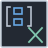

<!-- Generated by tools/export_studio_help.py; edit the reviewed source metadata, then regenerate. -->
# Set Cartesian Product

[Collection functions](../index.md) · [All functions](../../index.md)

Forms set&lt;cluster&lt;first:A,second:B&gt;&gt; for every pair from the two Sets. Fields preserve input order and full types. Capacity is bounded and cancellation is supported. Search also accepts Set Cartesian Product.vim.

## Product execution profiles

The shared index declares native examples for this object; see [the examples below](cartesian_product.md#examples) and [document profiles and evidence boundaries](../../../reference/studio-draft-examples.md). Older binding/help statements retained below can lag those product profiles. They do not establish or deny the separately measured native profiles. An example declaration alone is not an execution result or admission of every overload.

Résumé français de l’aide Studio

**Set Cartesian Product**

Texte historique de l’aide conservé ci-dessous. Des exemples natifs distincts sont déclarés pour cet objet ; consultez les profils et preuves datés, sans déduire une compatibilité universelle de ce texte.

Produit set&lt;cluster&lt;first:A,second:B&gt;&gt; pour chaque combinaison des deux Sets. Les champs conservent l’ordre des entrées et leurs types complets. La capacité est bornée et l’arrêt est pris en charge. La recherche accepte Set Cartesian Product.vim.

## Studio authoring profile

Contract status: **defined**. The connector below describes Studio authoring; execution availability is stated separately.

Retained binding and help description

This is the source declaration, not the current measured product-execution assessment.

Cartesian product of independent Set&lt;A&gt;/Set&lt;B&gt; models. Result is Set&lt;Cluster&lt;first:A,second:B&gt;&gt;, with stable field IDs/order, no flattening, typed empty products and explicit bounded capacity failure without partial publication.

## IN — inputs

| Displayed terminal / internal ID | Accepted / resolved type | Studio connection | Unwired input default | Meaning |
| --- | --- | --- | --- | --- |
| first set `set_a` | `A:any` | Required | Not specified | — |
| second set `set_b` | `B:any` | Required | Not specified | — |

A default is shown only for an input with an explicitly documented value. Preview/default *types* do not imply unwired operand values. If helper and binding flags differ, both are labelled.

## OUT — outputs

| Displayed terminal / internal ID | Accepted / resolved type | Studio connection | Unwired input default | Meaning |
| --- | --- | --- | --- | --- |
| set `set` | `R:any` | Required | — | — |

A default is shown only for an input with an explicitly documented value. Preview/default *types* do not imply unwired operand values. If helper and binding flags differ, both are labelled.

## Types and connection rules

CollectionBinding is the single actual connector/type authority. Generic variables describe roles only: Map M&lt;K,V&gt;, Set S&lt;T&gt;, C=Map\|Set, Cartesian A/B independent. Full types are invariant and unresolved models stay unknown.

- Type resolution: `custom_resolver`; result expression: `resolve:frog.studio.collection.type-resolution@1`.
- Implicit coercion: not enabled by this resolver; individual port policies remain explicit.
- Arrays: accepted; lifting policy: `none`.

Nested Array/Cluster/Enum/reference metadata is preserved according to CollectionBinding and the shared comparator domain. No scalar lift, flattening or implicit conversion is authorized.

**Input count:** 2; this contract does not enable variadic inputs.

Port order: `set_a` → `set_b`.

## Execution and limits

**Public FROG / target Runtime:** not declared available by this authoring contract.

Scope: `requires_explicit_target_capability`.

Implementation: `frog.collection.set.cartesian_product`.

Required provider: `frog.studio.collection@1`.

Local Studio profile only. A catalog contract is not a target capability or a published FROG primitive. Actual execution requires Source/FIR lowering, exact type admission and the selected native backend/runtime services; no implicit realization fallback.

Connector type defaults and persistence aliases

| Direction | ID | Preview/default type | Connection policy | Cardinality | Legacy port IDs |
| --- | --- | --- | --- | --- | --- |
| INPUT | `set_a` | `unknown` | `any_explicit` | `single` | — |
| INPUT | `set_b` | `unknown` | `any_explicit` | `single` | — |
| OUTPUT | `set` | `unknown` | `any_explicit` | `single` | — |

## Examples

These are real `.frog` documents from the same index used by Studio. Backend names and expected results describe the examples; they are not execution certificates.

- [Cartesian product with two element types](../../../examples/collection.set.cartesian.independent-types.md) — The Cartesian product keeps its two independent input types. Every result element is a Cluster whose stable fields first and second retain the corresponding values. (`execution`, `studio-draft`).

## Identity and references

- Catalogue ID: `collection.set.cartesian_product`.
- Parent palette: [Set](../set.md).
- Profile: `frog.studio.collection.set.cartesian_product.v1`.
- Definition: `frog.studio.collection.set.cartesian_product`.

NI links are reference sources for the connector model; Studio support is limited to the profile above. [Reference provenance and notation](../../index.md#provenance-and-notation).
