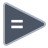

<!-- Generated by tools/export_studio_help.py; edit the reviewed source metadata, then regenerate. -->
# Equal?

[Comparison functions](index.md) · [All functions](../index.md)

Tests equality of compatible values.

## Product execution profiles

The shared index declares native examples for this object; see [the examples below](equal.md#examples) and [document profiles and evidence boundaries](../../reference/studio-draft-examples.md). Older binding/help statements retained below can lag those product profiles. They do not establish or deny the separately measured native profiles. An example declaration alone is not an execution result or admission of every overload.

Résumé français de l’aide Studio

**Égaux ?**

Texte historique de l’aide conservé ci-dessous. Des exemples natifs distincts sont déclarés pour cet objet ; consultez les profils et preuves datés, sans déduire une compatibilité universelle de ce texte.

Teste l’égalité de valeurs compatibles.

## Studio authoring profile

Contract status: **partial**. The connector below describes Studio authoring; execution availability is stated separately.

## IN — inputs

| Displayed terminal / internal ID | Accepted / resolved type | Studio connection | Unwired input default | Meaning |
| --- | --- | --- | --- | --- |
| x `x` | `T:any` | Required | Not specified | — |
| y `y` | `T:any` | Required | Not specified | — |

A default is shown only for an input with an explicitly documented value. Preview/default *types* do not imply unwired operand values. If helper and binding flags differ, both are labelled.

## OUT — outputs

| Displayed terminal / internal ID | Accepted / resolved type | Studio connection | Unwired input default | Meaning |
| --- | --- | --- | --- | --- |
| x = y? `result` | `T:any` | Recommended (help); Required (binding) | — | — |

A default is shown only for an input with an explicitly documented value. Preview/default *types* do not imply unwired operand values. If helper and binding flags differ, both are labelled.

## Types and Compatibility

The notes below retain the reviewed help's original NI and Studio scopes. An NI overload is not a claim of Studio runtime support; the authoring profile and execution limits remain separate.

Retained binding and help statements

These are source declarations, not the current measured product-execution assessment. Compare historical limitations with the separately dated native profiles above.

Compatible numeric, Boolean, String, Path, Timestamp, Enum or Variant leaves; matching-rank arrays/clusters and scalar lifting. Elements mode preserves the Boolean shape; Aggregates mode returns one Boolean. Runtime execution is not implemented by this authoring profile.

Notes de types et de compatibilité de l’aide Studio

Les mentions NI et Studio gardent leur portée d’origine. Une variante NI ne constitue pas une déclaration de prise en charge par le runtime Studio ; consultez les profils et limites d’exécution de cette fiche.

Valeurs numériques, booléennes, chaînes, chemins, horodatages, énumérations ou variants compatibles ; tableaux de même rang, clusters et diffusion d’un scalaire. Le mode Éléments conserve la structure booléenne ; le mode Agrégats renvoie un seul booléen. Ce profil d’édition n’implémente pas l’exécution dans le runtime.

- Type resolution: `custom_resolver`; result expression: `resolve:frog.studio.polymorphic.type-resolution@1`.
- Implicit coercion: not enabled by this resolver; individual port policies remain explicit.
- Arrays: accepted; lifting policy: `shape_preserving`.

**Input count:** 2; this contract does not enable variadic inputs.

## Execution and limits

**Public FROG / target Runtime:** not declared available by this authoring contract.

Scope: `requires_explicit_target_capability`.

Implementation: `frog.studio.comparison.equal.elements.owned.v1`.

Required provider: `frog.studio.comparison.owned-tree@1`.

The existing compiled NumericAggregate service provides the bounded Comparison profile on explicitly admitted targets. Elements/Aggregates use distinct versioned operations; exact established scalar Core/private comparison identities remain unchanged. Complete types, nominal schemas, shapes and exact physical carriers remain checked. This declaration is not a passing test, full overload coverage or AOT/package qualification.

**Private Studio Run/Highlight:** the local function evaluator dispatches this catalogue identity. Inputs and output types must be resolved; unsupported value operations or representations fail explicitly. This local dispatch is separate from the public target Runtime declaration above.

Connector type defaults and persistence aliases

| Direction | ID | Preview/default type | Connection policy | Cardinality | Legacy port IDs |
| --- | --- | --- | --- | --- | --- |
| INPUT | `x` | `f64` | `any_explicit` | `single` | — |
| INPUT | `y` | `f64` | `any_explicit` | `single` | — |
| OUTPUT | `result` | `bool` | `any_explicit` | `single` | — |

## Examples

These are real `.frog` documents from the same index used by Studio. Backend names and expected results describe the examples; they are not execution certificates.

- [Equal? — exact i32](../../examples/comparison.equal.exact_i32.md) — Tests equality of compatible values. (`execution`, `studio-draft`).
- [Equal? — exact i64](../../examples/comparison.equal.exact_i64.md) — Tests equality of compatible values. (`execution`, `studio-draft`).
- [Equal? — exact u64](../../examples/comparison.equal.exact_u64.md) — Tests equality of compatible values. (`execution`, `studio-draft`).
- [Equal? — exact f64](../../examples/comparison.equal.exact_f64.md) — Tests equality of compatible values. (`execution`, `studio-draft`).
- [While : arrêter au troisième incrément](../../examples/structure.while.three_iterations.md) — While : arrêter au troisième incrément (`execution`, `studio-draft`).

## Identity and references

- Catalogue ID: `comparison.equal`.
- Profile: `frog.studio.polymorphic.comparison.equal.v1`.
- Definition: `frog.studio.comparison.equal`.
- [NI API reference](https://www.ni.com/docs/en-US/bundle/labview-api-ref/page/functions/equal.html).

NI links are reference sources for the connector model; Studio support is limited to the profile above. [Reference provenance and notation](../index.md#provenance-and-notation).
