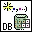

<!-- Generated by tools/export_studio_help.py; edit the reviewed source metadata, then regenerate. -->
# DB Tools Create Parameterized Query.vi

[Connectivity functions](../index.md) · [All functions](../../index.md)

Creates a parameterized SQL query and returns a command reference that you must free eventually. Unless you are detecting the parameters automatically, the number of elements in the parameters array must match the number of parameters you specify in SQL query . For stored procedures, set stored procedure to TRUE and SQL query to the name of the procedure you want to execute.

## Studio authoring profile

Contract status: **partial**. The connector below describes Studio authoring; execution availability is stated separately.

## IN — inputs

| Displayed terminal / internal ID | Accepted / resolved type | Studio connection | Unwired input default | Meaning |
| --- | --- | --- | --- | --- |
| auto-detect parameters? `auto_detect_parameters` | `bool` | Recommended | `False` | auto-detect parameters? |
| connection reference `connection_reference` | `ref<connectivity.database.connection>` | Required | Not specified | ADO Connection object used to identify the database connection. |
| SQL query `sql_query` | `string` | Required | Not specified | SQL query specifies a parameterized SQL query or stored procedure name. |
| parameters `parameters` | `unknown` | Recommended | Not specified | parameters specifies the parameter information. |
| error in `error_in` | `cluster<status:bool,code:i32,source:string>` | Recommended | `{status:false,code:0,source:""}` | Error state received from the preceding operation; the source value is the standard LabVIEW error cluster. |
| stored procedure? `stored_procedure` | `bool` | Recommended | `False` | stored procedure? |

A default is shown only for an input with an explicitly documented value. Preview/default *types* do not imply unwired operand values. If helper and binding flags differ, both are labelled.

## OUT — outputs

| Displayed terminal / internal ID | Accepted / resolved type | Studio connection | Unwired input default | Meaning |
| --- | --- | --- | --- | --- |
| command reference `command_reference` | `ref<connectivity.database.command>` | Recommended | — | ADO Command object whose query or parameters are accessed. |
| parameters out `parameters_out` | `unknown` | Recommended | — | parameters out returns an array of clusters of parameter information. |
| error out `error_out` | `cluster<status:bool,code:i32,source:string>` | Recommended | — | Error status, code and source produced by this operation. |

A default is shown only for an input with an explicitly documented value. Preview/default *types* do not imply unwired operand values. If helper and binding flags differ, both are labelled.

## Types and connection rules

- Type resolution: `custom_resolver`; result expression: `resolve:frog.studio.connectivity.type-resolution@1`.
- Implicit coercion: not enabled by this resolver; individual port policies remain explicit.
- Arrays: not accepted; lifting policy: `none`.

Only declared array types and ranks are accepted; no implicit scalar lifting.

**Input count:** 6; this contract does not enable variadic inputs.

## Configured connector instances

The selected instance supplies its own connector. Requirements and defaults are not borrowed from a different instance.

### DB Tools Create Parameterized Query VI

Instance: `db_tools_create_parameterized_query_vi`.

| Direction | Terminal / ID | Type | Requirement evidence | Default |
| --- | --- | --- | --- | --- |
| INPUT | auto-detect parameters? `auto_detect_parameters` | `bool` | unverified | `False` |
| INPUT | connection reference `connection_reference` | `ref<connectivity.database.connection>` | unverified | Not specified |
| INPUT | SQL query `sql_query` | `string` | unverified | Not specified |
| INPUT | parameters `parameters` | `unresolved:array_rank_1:cluster:parameters:enum_representation_or_field_type` | unverified | Not specified |
| INPUT | error in `error_in` | `cluster<status:bool,code:i32,source:string>` | unverified | `{status:false,code:0,source:""}` |
| INPUT | stored procedure? `stored_procedure` | `bool` | unverified | `False` |
| OUTPUT | command reference `command_reference` | `ref<connectivity.database.command>` | unverified | Not specified |
| OUTPUT | parameters out `parameters_out` | `unresolved:array_rank_1:cluster:parameters_out:enum_representation_or_field_type` | unverified | Not specified |
| OUTPUT | error out `error_out` | `cluster<status:bool,code:i32,source:string>` | unverified | Not specified |

## Execution and limits

**Public FROG / target Runtime:** not declared available by this authoring contract.

Scope: `requires_explicit_target_capability`.

Required provider: `frog.studio.connectivity`.

Authoring only; no new function runtime is implemented.

**Authoring/target contract limits:**

- Connectivity execution and FIR lowering require an explicit provider.
- parameters: unresolved:array_rank_1:cluster:parameters:enum_representation_or_field_type
- parameters out: unresolved:array_rank_1:cluster:parameters_out:enum_representation_or_field_type
- Some documented instances retain unresolved enum representations, waveform or dynamic-data structures; see the exact instance port metadata.

Connector type defaults and persistence aliases

| Direction | ID | Preview/default type | Connection policy | Cardinality | Legacy port IDs |
| --- | --- | --- | --- | --- | --- |
| INPUT | `auto_detect_parameters` | `bool` | `exact` | `single` | — |
| INPUT | `connection_reference` | `ref<connectivity.database.connection>` | `exact` | `single` | — |
| INPUT | `sql_query` | `string` | `exact` | `single` | — |
| INPUT | `parameters` | `unknown` | `exact` | `single` | — |
| INPUT | `error_in` | `cluster<status:bool,code:i32,source:string>` | `exact` | `single` | — |
| INPUT | `stored_procedure` | `bool` | `exact` | `single` | — |
| OUTPUT | `command_reference` | `ref<connectivity.database.command>` | `exact` | `single` | — |
| OUTPUT | `parameters_out` | `unknown` | `exact` | `single` | — |
| OUTPUT | `error_out` | `cluster<status:bool,code:i32,source:string>` | `exact` | `single` | — |

## Identity and references

- Catalogue ID: `connectivity.database.create_parameterized_query`.
- Parent palette: [Advanced](advanced.md).
- Profile: `frog.studio.connectivity.database.create_parameterized_query.v1`.
- Definition: `frog.studio.connectivity.database.create_parameterized_query`.
- [NI API reference](https://www.ni.com/docs/en-US/bundle/lvdct-api-ref/page/vi-lib/addons/database/command-llb/db-tools-create-parameterized-query-vi.html).

NI links are reference sources for the connector model; Studio support is limited to the profile above. [Reference provenance and notation](../../index.md#provenance-and-notation).
