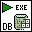

<!-- Generated by tools/export_studio_help.py; edit the reviewed source metadata, then regenerate. -->
# DB Tools Execute Query.vi

[Connectivity functions](../index.md) · [All functions](../../index.md)

Executes an SQL query and returns a recordset reference that you must eventually free with the DB Tools Free Object VI. Wire data to the reference input to determine the polymorphic instance to use or manually select the instance.

## Studio authoring profile

Contract status: **partial**. The connector below describes Studio authoring; execution availability is stated separately.

## IN — inputs

| Displayed terminal / internal ID | Accepted / resolved type | Studio connection | Unwired input default | Meaning |
| --- | --- | --- | --- | --- |
| connection reference `connection_reference` | `ref<connectivity.database.connection>` | Required | Not specified | ADO Connection object used to identify the database connection. |
| SQL query `sql_query` | `string` | Required | Not specified | SQL query specifies the SQL statement to execute. |
| cursor type `cursor_type` | `unknown` | Recommended | Not specified | cursor type specifies the method for navigating the recordset. |
| error in `error_in` | `cluster<status:bool,code:i32,source:string>` | Recommended | `{status:false,code:0,source:""}` | Error state received from the preceding operation; the source value is the standard LabVIEW error cluster. |

A default is shown only for an input with an explicitly documented value. Preview/default *types* do not imply unwired operand values. If helper and binding flags differ, both are labelled.

## OUT — outputs

| Displayed terminal / internal ID | Accepted / resolved type | Studio connection | Unwired input default | Meaning |
| --- | --- | --- | --- | --- |
| recordset reference `recordset_reference` | `ref<connectivity.database.recordset>` | Recommended | — | ADO Recordset object whose records are accessed. |
| error out `error_out` | `cluster<status:bool,code:i32,source:string>` | Recommended | — | Error status, code and source produced by this operation. |

A default is shown only for an input with an explicitly documented value. Preview/default *types* do not imply unwired operand values. If helper and binding flags differ, both are labelled.

## Types and connection rules

- Type resolution: `custom_resolver`; result expression: `resolve:frog.studio.connectivity.type-resolution@1`.
- Implicit coercion: not enabled by this resolver; individual port policies remain explicit.
- Arrays: not accepted; lifting policy: `none`.

Only declared array types and ranks are accepted; no implicit scalar lifting.

**Input count:** 4; this contract does not enable variadic inputs.

## Configured connector instances

The selected instance supplies its own connector. Requirements and defaults are not borrowed from a different instance.

### Connection

Instance: `conn_execute_vi`.

| Direction | Terminal / ID | Type | Requirement evidence | Default |
| --- | --- | --- | --- | --- |
| INPUT | cache size `cache_size` | `i32` | unverified | `1` |
| INPUT | connection reference `connection_reference` | `ref<connectivity.database.connection>` | unverified | Not specified |
| INPUT | SQL query `sql_query` | `string` | unverified | Not specified |
| INPUT | cursor type `cursor_type` | `unresolved:enum:cursor_type:representation_and_values` | unverified | Not specified |
| INPUT | error in `error_in` | `cluster<status:bool,code:i32,source:string>` | unverified | `{status:false,code:0,source:""}` |
| OUTPUT | recordset reference `recordset_reference` | `ref<connectivity.database.recordset>` | unverified | Not specified |
| OUTPUT | error out `error_out` | `cluster<status:bool,code:i32,source:string>` | unverified | Not specified |

### Command

Instance: `cmd_execute_vi`.

| Direction | Terminal / ID | Type | Requirement evidence | Default |
| --- | --- | --- | --- | --- |
| INPUT | cache size `cache_size` | `i32` | unverified | `1` |
| INPUT | command reference `command_reference` | `ref<connectivity.database.command>` | unverified | Not specified |
| INPUT | cursor type `cursor_type` | `unresolved:enum:cursor_type:representation_and_values` | unverified | Not specified |
| INPUT | error in `error_in` | `cluster<status:bool,code:i32,source:string>` | unverified | `{status:false,code:0,source:""}` |
| OUTPUT | command-recordset reference `command_recordset_reference` | `ref<connectivity.database.command_recordset>` | unverified | Not specified |
| OUTPUT | error out `error_out` | `cluster<status:bool,code:i32,source:string>` | unverified | Not specified |

## Execution and limits

**Public FROG / target Runtime:** not declared available by this authoring contract.

Scope: `requires_explicit_target_capability`.

Required provider: `frog.studio.connectivity`.

Authoring only; no new function runtime is implemented.

**Authoring/target contract limits:**

- Connectivity execution and FIR lowering require an explicit provider.
- cursor type: unresolved:enum:cursor_type:representation_and_values
- NI detailed connector includes terminals hidden in the filmed palette help: cache size. These remain documented in instances.
- Some documented instances retain unresolved enum representations, waveform or dynamic-data structures; see the exact instance port metadata.
- Required/recommended/optional settings and connector indices of instances not shown in the video are unverified.

Connector type defaults and persistence aliases

| Direction | ID | Preview/default type | Connection policy | Cardinality | Legacy port IDs |
| --- | --- | --- | --- | --- | --- |
| INPUT | `connection_reference` | `ref<connectivity.database.connection>` | `exact` | `single` | — |
| INPUT | `sql_query` | `string` | `exact` | `single` | — |
| INPUT | `cursor_type` | `unknown` | `exact` | `single` | — |
| INPUT | `error_in` | `cluster<status:bool,code:i32,source:string>` | `exact` | `single` | — |
| OUTPUT | `recordset_reference` | `ref<connectivity.database.recordset>` | `exact` | `single` | — |
| OUTPUT | `error_out` | `cluster<status:bool,code:i32,source:string>` | `exact` | `single` | — |

## Identity and references

- Catalogue ID: `connectivity.database.execute_query`.
- Parent palette: [Advanced](advanced.md).
- Profile: `frog.studio.connectivity.database.execute_query.v1`.
- Definition: `frog.studio.connectivity.database.execute_query`.
- [NI API reference](https://www.ni.com/docs/en-US/bundle/lvdct-api-ref/page/vi-lib/addons/database/auxilliary-llb/db-tools-execute-query-vi.html).

NI links are reference sources for the connector model; Studio support is limited to the profile above. [Reference provenance and notation](../../index.md#provenance-and-notation).
