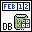

<!-- Generated by tools/export_studio_help.py; edit the reviewed source metadata, then regenerate. -->
# DB Tools Format Datetime String.vi

[Connectivity functions](../index.md) · [All functions](../../index.md)

Returns a string containing the formatted date and time, and identifies the string as a date/time string so other VIs can interpret this string. Wire data to the input of this VI to determine the polymorphic instance to use or manually select the instance.

## Studio authoring profile

Contract status: **partial**. The connector below describes Studio authoring; execution availability is stated separately.

## IN — inputs

| Displayed terminal / internal ID | Accepted / resolved type | Studio connection | Unwired input default | Meaning |
| --- | --- | --- | --- | --- |
| time stamp `time_stamp` | `timestamp` | Recommended | Not specified | time stamp specifies the time stamp that you want to convert to a date/time string. |

A default is shown only for an input with an explicitly documented value. Preview/default *types* do not imply unwired operand values. If helper and binding flags differ, both are labelled.

## OUT — outputs

| Displayed terminal / internal ID | Accepted / resolved type | Studio connection | Unwired input default | Meaning |
| --- | --- | --- | --- | --- |
| date/time string `date_time_string` | `string` | Recommended | — | date/time string returns the formatted date/time string. |

A default is shown only for an input with an explicitly documented value. Preview/default *types* do not imply unwired operand values. If helper and binding flags differ, both are labelled.

## Types and connection rules

- Type resolution: `custom_resolver`; result expression: `resolve:frog.studio.connectivity.type-resolution@1`.
- Implicit coercion: not enabled by this resolver; individual port policies remain explicit.
- Arrays: not accepted; lifting policy: `none`.

Only declared array types and ranks are accepted; no implicit scalar lifting.

**Input count:** 1; this contract does not enable variadic inputs.

## Configured connector instances

The selected instance supplies its own connector. Requirements and defaults are not borrowed from a different instance.

### DB Tools Format Datetime String (Time Stamp) VI

Instance: `db_tools_format_datetime_string_time_stamp_vi`.

| Direction | Terminal / ID | Type | Requirement evidence | Default |
| --- | --- | --- | --- | --- |
| INPUT | time stamp `time_stamp` | `timestamp` | unverified | Not specified |
| OUTPUT | date/time string `date_time_string` | `string` | unverified | Not specified |

### DB Tools Format Datetime String (Seconds) VI

Instance: `db_tools_format_datetime_string_seconds_vi`.

| Direction | Terminal / ID | Type | Requirement evidence | Default |
| --- | --- | --- | --- | --- |
| INPUT | seconds `seconds` | `u32` | unverified | `now` |
| OUTPUT | date/time string `date_time_string` | `string` | unverified | Not specified |

## Execution and limits

**Public FROG / target Runtime:** not declared available by this authoring contract.

Scope: `requires_explicit_target_capability`.

Required provider: `frog.studio.connectivity`.

Authoring only; no new function runtime is implemented.

**Authoring/target contract limits:**

- Connectivity execution and FIR lowering require an explicit provider.
- Required/recommended/optional settings and connector indices of instances not shown in the video are unverified.

Connector type defaults and persistence aliases

| Direction | ID | Preview/default type | Connection policy | Cardinality | Legacy port IDs |
| --- | --- | --- | --- | --- | --- |
| INPUT | `time_stamp` | `timestamp` | `exact` | `single` | — |
| OUTPUT | `date_time_string` | `string` | `exact` | `single` | — |

## Identity and references

- Catalogue ID: `connectivity.database.format_datetime_string`.
- Parent palette: [Utility](utility.md).
- Profile: `frog.studio.connectivity.database.format_datetime_string.v1`.
- Definition: `frog.studio.connectivity.database.format_datetime_string`.
- [NI API reference](https://www.ni.com/docs/en-US/bundle/lvdct-api-ref/page/vi-lib/addons/database/auxilliary-llb/db-tools-format-datetime-string-vi.html).

NI links are reference sources for the connector model; Studio support is limited to the profile above. [Reference provenance and notation](../../index.md#provenance-and-notation).
