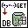

<!-- Generated by tools/export_studio_help.py; edit the reviewed source metadata, then regenerate. -->
# DB Tools Get Parameter Value.vi

[Connectivity functions](../index.md) · [All functions](../../index.md)

Retrieves the value of the parameter specified by the parameter index input in the command or command-recordset. The parameter index can be either the zero-indexed position of the parameter in the command or the name of the parameter. Wire data to the type input to determine the polymorphic instance to use or manually select the instance.

## Studio authoring profile

Contract status: **partial**. The connector below describes Studio authoring; execution availability is stated separately.

## IN — inputs

| Displayed terminal / internal ID | Accepted / resolved type | Studio connection | Unwired input default | Meaning |
| --- | --- | --- | --- | --- |
| command reference `command_reference` | `ref<connectivity.database.command>` | Required | Not specified | ADO Command object whose query or parameters are accessed. |
| parameter index `parameter_index` | `variant` | Required | Not specified | Variant containing a zero-based integer position or a string name of the parameter. |
| type `type` | `string` | Recommended | Not specified | Type specimen selecting the output data type of the chosen instance. |
| error in `error_in` | `cluster<status:bool,code:i32,source:string>` | Recommended | `{status:false,code:0,source:""}` | Error state received from the preceding operation; the source value is the standard LabVIEW error cluster. |

A default is shown only for an input with an explicitly documented value. Preview/default *types* do not imply unwired operand values. If helper and binding flags differ, both are labelled.

## OUT — outputs

| Displayed terminal / internal ID | Accepted / resolved type | Studio connection | Unwired input default | Meaning |
| --- | --- | --- | --- | --- |
| command reference out `command_reference_out` | `ref<connectivity.database.command>` | Recommended | — | ADO Command object returned by this operation. |
| value `value` | `string` | Recommended | — | value returns the value of the parameter. |
| error out `error_out` | `cluster<status:bool,code:i32,source:string>` | Recommended | — | Error status, code and source produced by this operation. |

A default is shown only for an input with an explicitly documented value. Preview/default *types* do not imply unwired operand values. If helper and binding flags differ, both are labelled.

## Types and connection rules

- Type resolution: `custom_resolver`; result expression: `resolve:frog.studio.connectivity.type-resolution@1`.
- Implicit coercion: not enabled by this resolver; individual port policies remain explicit.
- Arrays: not accepted; lifting policy: `none`.

Only declared array types and ranks are accepted; no implicit scalar lifting.

**Input count:** 4; this contract does not enable variadic inputs.

## Configured connector instances

The selected instance supplies its own connector. Requirements and defaults are not borrowed from a different instance.

### String (C)

Instance: `cmd_get_string_parameter_value_c_vi`.

| Direction | Terminal / ID | Type | Requirement evidence | Default |
| --- | --- | --- | --- | --- |
| INPUT | command reference `command_reference` | `ref<connectivity.database.command>` | unverified | Not specified |
| INPUT | parameter index `parameter_index` | `variant` | unverified | Not specified |
| INPUT | type `type` | `string` | unverified | Not specified |
| INPUT | error in `error_in` | `cluster<status:bool,code:i32,source:string>` | unverified | `{status:false,code:0,source:""}` |
| OUTPUT | command reference out `command_reference_out` | `ref<connectivity.database.command>` | unverified | Not specified |
| OUTPUT | value `value` | `string` | unverified | Not specified |
| OUTPUT | error out `error_out` | `cluster<status:bool,code:i32,source:string>` | unverified | Not specified |

### String (CR)

Instance: `cmd_get_string_parameter_value_cr_vi`.

| Direction | Terminal / ID | Type | Requirement evidence | Default |
| --- | --- | --- | --- | --- |
| INPUT | command-recordset reference `command_recordset_reference` | `ref<connectivity.database.command_recordset>` | unverified | Not specified |
| INPUT | parameter index `parameter_index` | `variant` | unverified | Not specified |
| INPUT | type `type` | `string` | unverified | Not specified |
| INPUT | error in `error_in` | `cluster<status:bool,code:i32,source:string>` | unverified | `{status:false,code:0,source:""}` |
| OUTPUT | command-recordset reference out `command_recordset_reference_out` | `ref<connectivity.database.command_recordset>` | unverified | Not specified |
| OUTPUT | value `value` | `string` | unverified | Not specified |
| OUTPUT | error out `error_out` | `cluster<status:bool,code:i32,source:string>` | unverified | Not specified |

### Integer (C)

Instance: `cmd_get_integer_parameter_value_c_vi`.

| Direction | Terminal / ID | Type | Requirement evidence | Default |
| --- | --- | --- | --- | --- |
| INPUT | command reference `command_reference` | `ref<connectivity.database.command>` | unverified | Not specified |
| INPUT | parameter index `parameter_index` | `variant` | unverified | Not specified |
| INPUT | type `type` | `i32` | unverified | Not specified |
| INPUT | error in `error_in` | `cluster<status:bool,code:i32,source:string>` | unverified | `{status:false,code:0,source:""}` |
| OUTPUT | command reference out `command_reference_out` | `ref<connectivity.database.command>` | unverified | Not specified |
| OUTPUT | value `value` | `i32` | unverified | Not specified |
| OUTPUT | error out `error_out` | `cluster<status:bool,code:i32,source:string>` | unverified | Not specified |

### Integer (CR)

Instance: `cmd_get_integer_parameter_value_cr_vi`.

| Direction | Terminal / ID | Type | Requirement evidence | Default |
| --- | --- | --- | --- | --- |
| INPUT | command-recordset reference `command_recordset_reference` | `ref<connectivity.database.command_recordset>` | unverified | Not specified |
| INPUT | parameter index `parameter_index` | `variant` | unverified | Not specified |
| INPUT | type `type` | `i32` | unverified | Not specified |
| INPUT | error in `error_in` | `cluster<status:bool,code:i32,source:string>` | unverified | `{status:false,code:0,source:""}` |
| OUTPUT | command-recordset reference out `command_recordset_reference_out` | `ref<connectivity.database.command_recordset>` | unverified | Not specified |
| OUTPUT | value `value` | `i32` | unverified | Not specified |
| OUTPUT | error out `error_out` | `cluster<status:bool,code:i32,source:string>` | unverified | Not specified |

### Single (C)

Instance: `cmd_get_single_parameter_value_c_vi`.

| Direction | Terminal / ID | Type | Requirement evidence | Default |
| --- | --- | --- | --- | --- |
| INPUT | command reference `command_reference` | `ref<connectivity.database.command>` | unverified | Not specified |
| INPUT | parameter index `parameter_index` | `variant` | unverified | Not specified |
| INPUT | type `type` | `f32` | unverified | Not specified |
| INPUT | error in `error_in` | `cluster<status:bool,code:i32,source:string>` | unverified | `{status:false,code:0,source:""}` |
| OUTPUT | command reference out `command_reference_out` | `ref<connectivity.database.command>` | unverified | Not specified |
| OUTPUT | value `value` | `f32` | unverified | Not specified |
| OUTPUT | error out `error_out` | `cluster<status:bool,code:i32,source:string>` | unverified | Not specified |

### Single (CR)

Instance: `cmd_get_single_parameter_value_cr_vi`.

| Direction | Terminal / ID | Type | Requirement evidence | Default |
| --- | --- | --- | --- | --- |
| INPUT | command-recordset reference `command_recordset_reference` | `ref<connectivity.database.command_recordset>` | unverified | Not specified |
| INPUT | parameter index `parameter_index` | `variant` | unverified | Not specified |
| INPUT | type `type` | `f32` | unverified | Not specified |
| INPUT | error in `error_in` | `cluster<status:bool,code:i32,source:string>` | unverified | `{status:false,code:0,source:""}` |
| OUTPUT | command-recordset reference out `command_recordset_reference_out` | `ref<connectivity.database.command_recordset>` | unverified | Not specified |
| OUTPUT | value `value` | `f32` | unverified | Not specified |
| OUTPUT | error out `error_out` | `cluster<status:bool,code:i32,source:string>` | unverified | Not specified |

### Double (C)

Instance: `cmd_get_double_parameter_value_c_vi`.

| Direction | Terminal / ID | Type | Requirement evidence | Default |
| --- | --- | --- | --- | --- |
| INPUT | command reference `command_reference` | `ref<connectivity.database.command>` | unverified | Not specified |
| INPUT | parameter index `parameter_index` | `variant` | unverified | Not specified |
| INPUT | type `type` | `f64` | unverified | Not specified |
| INPUT | error in `error_in` | `cluster<status:bool,code:i32,source:string>` | unverified | `{status:false,code:0,source:""}` |
| OUTPUT | command reference out `command_reference_out` | `ref<connectivity.database.command>` | unverified | Not specified |
| OUTPUT | value `value` | `f64` | unverified | Not specified |
| OUTPUT | error out `error_out` | `cluster<status:bool,code:i32,source:string>` | unverified | Not specified |

### Double (CR)

Instance: `cmd_get_double_parameter_value_cr_vi`.

| Direction | Terminal / ID | Type | Requirement evidence | Default |
| --- | --- | --- | --- | --- |
| INPUT | command-recordset reference `command_recordset_reference` | `ref<connectivity.database.command_recordset>` | unverified | Not specified |
| INPUT | parameter index `parameter_index` | `variant` | unverified | Not specified |
| INPUT | type `type` | `f64` | unverified | Not specified |
| INPUT | error in `error_in` | `cluster<status:bool,code:i32,source:string>` | unverified | `{status:false,code:0,source:""}` |
| OUTPUT | command-recordset reference out `command_recordset_reference_out` | `ref<connectivity.database.command_recordset>` | unverified | Not specified |
| OUTPUT | value `value` | `f64` | unverified | Not specified |
| OUTPUT | error out `error_out` | `cluster<status:bool,code:i32,source:string>` | unverified | Not specified |

### Date/Time (C)

Instance: `cmd_get_datetime_parameter_value_c_vi`.

| Direction | Terminal / ID | Type | Requirement evidence | Default |
| --- | --- | --- | --- | --- |
| INPUT | command reference `command_reference` | `ref<connectivity.database.command>` | unverified | Not specified |
| INPUT | parameter index `parameter_index` | `variant` | unverified | Not specified |
| INPUT | type `type` | `string` | unverified | Not specified |
| INPUT | error in `error_in` | `cluster<status:bool,code:i32,source:string>` | unverified | `{status:false,code:0,source:""}` |
| OUTPUT | command reference out `command_reference_out` | `ref<connectivity.database.command>` | unverified | Not specified |
| OUTPUT | value `value` | `string` | unverified | Not specified |
| OUTPUT | error out `error_out` | `cluster<status:bool,code:i32,source:string>` | unverified | Not specified |

### Date/Time (CR)

Instance: `cmd_get_datetime_parameter_value_cr_vi`.

| Direction | Terminal / ID | Type | Requirement evidence | Default |
| --- | --- | --- | --- | --- |
| INPUT | command-recordset reference `command_recordset_reference` | `ref<connectivity.database.command_recordset>` | unverified | Not specified |
| INPUT | parameter index `parameter_index` | `variant` | unverified | Not specified |
| INPUT | type `type` | `string` | unverified | Not specified |
| INPUT | error in `error_in` | `cluster<status:bool,code:i32,source:string>` | unverified | `{status:false,code:0,source:""}` |
| OUTPUT | command-recordset reference out `command_recordset_reference_out` | `ref<connectivity.database.command_recordset>` | unverified | Not specified |
| OUTPUT | value `value` | `string` | unverified | Not specified |
| OUTPUT | error out `error_out` | `cluster<status:bool,code:i32,source:string>` | unverified | Not specified |

### Binary (C)

Instance: `cmd_get_binary_parameter_value_c_vi`.

| Direction | Terminal / ID | Type | Requirement evidence | Default |
| --- | --- | --- | --- | --- |
| INPUT | command reference `command_reference` | `ref<connectivity.database.command>` | unverified | Not specified |
| INPUT | parameter index `parameter_index` | `variant` | unverified | Not specified |
| INPUT | type `type` | `variant` | unverified | Not specified |
| INPUT | error in `error_in` | `cluster<status:bool,code:i32,source:string>` | unverified | `{status:false,code:0,source:""}` |
| OUTPUT | command reference out `command_reference_out` | `ref<connectivity.database.command>` | unverified | Not specified |
| OUTPUT | value `value` | `variant` | unverified | Not specified |
| OUTPUT | error out `error_out` | `cluster<status:bool,code:i32,source:string>` | unverified | Not specified |

### Binary (CR)

Instance: `cmd_get_binary_parameter_value_cr_vi`.

| Direction | Terminal / ID | Type | Requirement evidence | Default |
| --- | --- | --- | --- | --- |
| INPUT | command-recordset reference `command_recordset_reference` | `ref<connectivity.database.command_recordset>` | unverified | Not specified |
| INPUT | parameter index `parameter_index` | `variant` | unverified | Not specified |
| INPUT | type `type` | `variant` | unverified | Not specified |
| INPUT | error in `error_in` | `cluster<status:bool,code:i32,source:string>` | unverified | `{status:false,code:0,source:""}` |
| OUTPUT | command-recordset reference out `command_recordset_reference_out` | `ref<connectivity.database.command_recordset>` | unverified | Not specified |
| OUTPUT | value `value` | `variant` | unverified | Not specified |
| OUTPUT | error out `error_out` | `cluster<status:bool,code:i32,source:string>` | unverified | Not specified |

## Execution and limits

**Public FROG / target Runtime:** not declared available by this authoring contract.

Scope: `requires_explicit_target_capability`.

Required provider: `frog.studio.connectivity`.

Authoring only; no new function runtime is implemented.

**Authoring/target contract limits:**

- Connectivity execution and FIR lowering require an explicit provider.
- Required/recommended/optional settings and connector indices of instances not shown in the video are unverified.

Connector type defaults and persistence aliases

| Direction | ID | Preview/default type | Connection policy | Cardinality | Legacy port IDs |
| --- | --- | --- | --- | --- | --- |
| INPUT | `command_reference` | `ref<connectivity.database.command>` | `exact` | `single` | — |
| INPUT | `parameter_index` | `variant` | `exact` | `single` | — |
| INPUT | `type` | `string` | `exact` | `single` | — |
| INPUT | `error_in` | `cluster<status:bool,code:i32,source:string>` | `exact` | `single` | — |
| OUTPUT | `command_reference_out` | `ref<connectivity.database.command>` | `exact` | `single` | — |
| OUTPUT | `value` | `string` | `exact` | `single` | — |
| OUTPUT | `error_out` | `cluster<status:bool,code:i32,source:string>` | `exact` | `single` | — |

## Identity and references

- Catalogue ID: `connectivity.database.get_parameter_value`.
- Parent palette: [Advanced](advanced.md).
- Profile: `frog.studio.connectivity.database.get_parameter_value.v1`.
- Definition: `frog.studio.connectivity.database.get_parameter_value`.
- [NI API reference](https://www.ni.com/docs/en-US/bundle/lvdct-api-ref/page/vi-lib/addons/database/command-llb/db-tools-get-parameter-value-vi.html).

NI links are reference sources for the connector model; Studio support is limited to the profile above. [Reference provenance and notation](../../index.md#provenance-and-notation).
