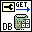

<!-- Generated by tools/export_studio_help.py; edit the reviewed source metadata, then regenerate. -->
# DB Tools Get Properties.vi

[Connectivity functions](../index.md) · [All functions](../../index.md)

Gets properties of the object as determined by the inputs. This VI works for connections, commands, recordsets, columns, and parameters. Wire data to the reference input to determine the polymorphic instance to use or manually select the instance.

## Studio authoring profile

Contract status: **partial**. The connector below describes Studio authoring; execution availability is stated separately.

## IN — inputs

| Displayed terminal / internal ID | Accepted / resolved type | Studio connection | Unwired input default | Meaning |
| --- | --- | --- | --- | --- |
| connection reference `connection_reference` | `ref<connectivity.database.connection>` | Required | Not specified | ADO Connection object used to identify the database connection. |
| error in `error_in` | `cluster<status:bool,code:i32,source:string>` | Recommended | `{status:false,code:0,source:""}` | Error state received from the preceding operation; the source value is the standard LabVIEW error cluster. |

A default is shown only for an input with an explicitly documented value. Preview/default *types* do not imply unwired operand values. If helper and binding flags differ, both are labelled.

## OUT — outputs

| Displayed terminal / internal ID | Accepted / resolved type | Studio connection | Unwired input default | Meaning |
| --- | --- | --- | --- | --- |
| connection reference out `connection_reference_out` | `ref<connectivity.database.connection>` | Recommended | — | ADO Connection object returned by this operation. |
| connection properties `connection_properties` | `cluster<command_timeout_s:i32,connection_string:string,default_database:string,provider:string>` | Recommended | — | connection properties returns the following properties that define the database connection. |
| error out `error_out` | `cluster<status:bool,code:i32,source:string>` | Recommended | — | Error status, code and source produced by this operation. |

A default is shown only for an input with an explicitly documented value. Preview/default *types* do not imply unwired operand values. If helper and binding flags differ, both are labelled.

## Types and connection rules

- Type resolution: `custom_resolver`; result expression: `resolve:frog.studio.connectivity.type-resolution@1`.
- Implicit coercion: not enabled by this resolver; individual port policies remain explicit.
- Arrays: not accepted; lifting policy: `none`.

Only declared array types and ranks are accepted; no implicit scalar lifting.

**Input count:** 2; this contract does not enable variadic inputs.

## Configured connector instances

The selected instance supplies its own connector. Requirements and defaults are not borrowed from a different instance.

### Connection

Instance: `conn_get_properties_vi`.

| Direction | Terminal / ID | Type | Requirement evidence | Default |
| --- | --- | --- | --- | --- |
| INPUT | connection reference `connection_reference` | `ref<connectivity.database.connection>` | unverified | Not specified |
| INPUT | error in `error_in` | `cluster<status:bool,code:i32,source:string>` | unverified | `{status:false,code:0,source:""}` |
| OUTPUT | connection reference out `connection_reference_out` | `ref<connectivity.database.connection>` | unverified | Not specified |
| OUTPUT | connection properties `connection_properties` | `cluster<command_timeout_s:i32,connection_string:string,default_database:string,provider:string>` | unverified | Not specified |
| OUTPUT | error out `error_out` | `cluster<status:bool,code:i32,source:string>` | unverified | Not specified |

### Recordset (R)

Instance: `rec_get_recordset_properties_r_vi`.

| Direction | Terminal / ID | Type | Requirement evidence | Default |
| --- | --- | --- | --- | --- |
| INPUT | recordset reference `recordset_reference` | `ref<connectivity.database.recordset>` | unverified | Not specified |
| INPUT | error in `error_in` | `cluster<status:bool,code:i32,source:string>` | unverified | `{status:false,code:0,source:""}` |
| OUTPUT | recordset reference out `recordset_reference_out` | `ref<connectivity.database.recordset>` | unverified | Not specified |
| OUTPUT | recordset properties `recordset_properties` | `unresolved:cluster:recordset_properties:enum_representation_or_field_type` | unverified | Not specified |
| OUTPUT | error out `error_out` | `cluster<status:bool,code:i32,source:string>` | unverified | Not specified |

### Recordset (CR).vi

Instance: `rec_get_recordset_properties_cr_vi`.

| Direction | Terminal / ID | Type | Requirement evidence | Default |
| --- | --- | --- | --- | --- |
| INPUT | command-recordset reference `command_recordset_reference` | `ref<connectivity.database.command_recordset>` | unverified | Not specified |
| INPUT | error in `error_in` | `cluster<status:bool,code:i32,source:string>` | unverified | `{status:false,code:0,source:""}` |
| OUTPUT | command-recordset reference out `command_recordset_reference_out` | `ref<connectivity.database.command_recordset>` | unverified | Not specified |
| OUTPUT | recordset properties `recordset_properties` | `unresolved:cluster:recordset_properties:enum_representation_or_field_type` | unverified | Not specified |
| OUTPUT | error out `error_out` | `cluster<status:bool,code:i32,source:string>` | unverified | Not specified |

### Column (R)

Instance: `rec_get_column_properties_r_vi`.

| Direction | Terminal / ID | Type | Requirement evidence | Default |
| --- | --- | --- | --- | --- |
| INPUT | recordset reference `recordset_reference` | `ref<connectivity.database.recordset>` | unverified | Not specified |
| INPUT | column index `column_index` | `variant` | unverified | Not specified |
| INPUT | error in `error_in` | `cluster<status:bool,code:i32,source:string>` | unverified | `{status:false,code:0,source:""}` |
| OUTPUT | recordset reference out `recordset_reference_out` | `ref<connectivity.database.recordset>` | unverified | Not specified |
| OUTPUT | column properties `column_properties` | `unresolved:cluster:column_properties:enum_representation_or_field_type` | unverified | Not specified |
| OUTPUT | error out `error_out` | `cluster<status:bool,code:i32,source:string>` | unverified | Not specified |

### Column (CR)

Instance: `rec_get_column_properties_cr_vi`.

| Direction | Terminal / ID | Type | Requirement evidence | Default |
| --- | --- | --- | --- | --- |
| INPUT | command-recordset reference `command_recordset_reference` | `ref<connectivity.database.command_recordset>` | unverified | Not specified |
| INPUT | column index `column_index` | `variant` | unverified | Not specified |
| INPUT | error in `error_in` | `cluster<status:bool,code:i32,source:string>` | unverified | `{status:false,code:0,source:""}` |
| OUTPUT | command-recordset reference out `command_recordset_reference_out` | `ref<connectivity.database.command_recordset>` | unverified | Not specified |
| OUTPUT | column properties `column_properties` | `unresolved:cluster:column_properties:enum_representation_or_field_type` | unverified | Not specified |
| OUTPUT | error out `error_out` | `cluster<status:bool,code:i32,source:string>` | unverified | Not specified |

### Command (C)

Instance: `cmd_get_command_properties_c_vi`.

| Direction | Terminal / ID | Type | Requirement evidence | Default |
| --- | --- | --- | --- | --- |
| INPUT | command reference `command_reference` | `ref<connectivity.database.command>` | unverified | Not specified |
| INPUT | error in `error_in` | `cluster<status:bool,code:i32,source:string>` | unverified | `{status:false,code:0,source:""}` |
| OUTPUT | command reference out `command_reference_out` | `ref<connectivity.database.command>` | unverified | Not specified |
| OUTPUT | command properties `command_properties` | `cluster<parameter_count:i32,command_text:string,command_timeout_s:i32>` | unverified | Not specified |
| OUTPUT | error out `error_out` | `cluster<status:bool,code:i32,source:string>` | unverified | Not specified |

### Command (CR)

Instance: `cmd_get_command_properties_cr_vi`.

| Direction | Terminal / ID | Type | Requirement evidence | Default |
| --- | --- | --- | --- | --- |
| INPUT | command-recordset reference `command_recordset_reference` | `ref<connectivity.database.command_recordset>` | unverified | Not specified |
| INPUT | error in `error_in` | `cluster<status:bool,code:i32,source:string>` | unverified | `{status:false,code:0,source:""}` |
| OUTPUT | command-recordset reference out `command_recordset_reference_out` | `ref<connectivity.database.command_recordset>` | unverified | Not specified |
| OUTPUT | command properties `command_properties` | `cluster<parameter_count:i32,command_text:string,command_timeout_s:i32>` | unverified | Not specified |
| OUTPUT | error out `error_out` | `cluster<status:bool,code:i32,source:string>` | unverified | Not specified |

### Parameter (C)

Instance: `cmd_get_parameter_properties_c_vi`.

| Direction | Terminal / ID | Type | Requirement evidence | Default |
| --- | --- | --- | --- | --- |
| INPUT | command reference `command_reference` | `ref<connectivity.database.command>` | unverified | Not specified |
| INPUT | parameter index `parameter_index` | `variant` | unverified | Not specified |
| INPUT | error in `error_in` | `cluster<status:bool,code:i32,source:string>` | unverified | `{status:false,code:0,source:""}` |
| OUTPUT | command reference out `command_reference_out` | `ref<connectivity.database.command>` | unverified | Not specified |
| OUTPUT | parameter properties `parameter_properties` | `unresolved:cluster:parameter_properties:enum_representation_or_field_type` | unverified | Not specified |
| OUTPUT | error out `error_out` | `cluster<status:bool,code:i32,source:string>` | unverified | Not specified |

### Parameter (CR)

Instance: `cmd_get_parameter_properties_cr_vi`.

| Direction | Terminal / ID | Type | Requirement evidence | Default |
| --- | --- | --- | --- | --- |
| INPUT | command-recordset reference `command_recordset_reference` | `ref<connectivity.database.command_recordset>` | unverified | Not specified |
| INPUT | parameter index `parameter_index` | `variant` | unverified | Not specified |
| INPUT | error in `error_in` | `cluster<status:bool,code:i32,source:string>` | unverified | `{status:false,code:0,source:""}` |
| OUTPUT | command-recordset reference out `command_recordset_reference_out` | `ref<connectivity.database.command_recordset>` | unverified | Not specified |
| OUTPUT | parameter properties `parameter_properties` | `unresolved:cluster:parameter_properties:enum_representation_or_field_type` | unverified | Not specified |
| OUTPUT | error out `error_out` | `cluster<status:bool,code:i32,source:string>` | unverified | Not specified |

## Execution and limits

**Public FROG / target Runtime:** not declared available by this authoring contract.

Scope: `requires_explicit_target_capability`.

Required provider: `frog.studio.connectivity`.

Authoring only; no new function runtime is implemented.

**Authoring/target contract limits:**

- Connectivity execution and FIR lowering require an explicit provider.
- Some documented instances retain unresolved enum representations, waveform or dynamic-data structures; see the exact instance port metadata.
- Required/recommended/optional settings and connector indices of instances not shown in the video are unverified.

Connector type defaults and persistence aliases

| Direction | ID | Preview/default type | Connection policy | Cardinality | Legacy port IDs |
| --- | --- | --- | --- | --- | --- |
| INPUT | `connection_reference` | `ref<connectivity.database.connection>` | `exact` | `single` | — |
| INPUT | `error_in` | `cluster<status:bool,code:i32,source:string>` | `exact` | `single` | — |
| OUTPUT | `connection_reference_out` | `ref<connectivity.database.connection>` | `exact` | `single` | — |
| OUTPUT | `connection_properties` | `cluster<command_timeout_s:i32,connection_string:string,default_database:string,provider:string>` | `exact` | `single` | — |
| OUTPUT | `error_out` | `cluster<status:bool,code:i32,source:string>` | `exact` | `single` | — |

## Identity and references

- Catalogue ID: `connectivity.database.get_properties`.
- Parent palette: [Utility](utility.md).
- Profile: `frog.studio.connectivity.database.get_properties.v1`.
- Definition: `frog.studio.connectivity.database.get_properties`.
- [NI API reference](https://www.ni.com/docs/en-US/bundle/lvdct-api-ref/page/vi-lib/addons/database/auxilliary-llb/db-tools-get-properties-vi.html).

NI links are reference sources for the connector model; Studio support is limited to the profile above. [Reference provenance and notation](../../index.md#provenance-and-notation).
