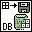

<!-- Generated by tools/export_studio_help.py; edit the reviewed source metadata, then regenerate. -->
# DB Tools Save Recordset To File.vi

[Connectivity functions](../index.md) · [All functions](../../index.md)

Saves the recordset identified by the recordset reference to either an XML or ADTG file. The ADTG file format is a proprietary format that only the LabVIEW Database Connectivity Toolkit can interpret. The ADTG format results in a smaller file than the XML format. You can reload both formats into LabVIEW using the DB Tools Load Recordset From File VI. Wire data to the reference input to determine the polymorphic instance to use or manually select the instance.

## Studio authoring profile

Contract status: **partial**. The connector below describes Studio authoring; execution availability is stated separately.

## IN — inputs

| Displayed terminal / internal ID | Accepted / resolved type | Studio connection | Unwired input default | Meaning |
| --- | --- | --- | --- | --- |
| recordset reference `recordset_reference` | `ref<connectivity.database.recordset>` | Required | Not specified | ADO Recordset object whose records are accessed. |
| file name `file_name` | `path` | Recommended | Not specified | file name specifies the path where you want to save the file. |
| save format `save_format` | `unknown` | Recommended | `XML` | save format specifies the format to use when saving a recordset to file. |
| error in `error_in` | `cluster<status:bool,code:i32,source:string>` | Recommended | `{status:false,code:0,source:""}` | Error state received from the preceding operation; the source value is the standard LabVIEW error cluster. |

A default is shown only for an input with an explicitly documented value. Preview/default *types* do not imply unwired operand values. If helper and binding flags differ, both are labelled.

## OUT — outputs

| Displayed terminal / internal ID | Accepted / resolved type | Studio connection | Unwired input default | Meaning |
| --- | --- | --- | --- | --- |
| recordset reference out `recordset_reference_out` | `ref<connectivity.database.recordset>` | Recommended | — | ADO Recordset object returned by this operation. |
| error out `error_out` | `cluster<status:bool,code:i32,source:string>` | Recommended | — | Error status, code and source produced by this operation. |

A default is shown only for an input with an explicitly documented value. Preview/default *types* do not imply unwired operand values. If helper and binding flags differ, both are labelled.

## Types and connection rules

- Type resolution: `custom_resolver`; result expression: `resolve:frog.studio.connectivity.type-resolution@1`.
- Implicit coercion: not enabled by this resolver; individual port policies remain explicit.
- Arrays: not accepted; lifting policy: `none`.

Only declared array types and ranks are accepted; no implicit scalar lifting.

**Input count:** 4; this contract does not enable variadic inputs.

## Configured connector instances

The selected instance supplies its own connector. Requirements and defaults are not borrowed from a different instance.

### Save Recordset To File (R).vi

Instance: `rec_save_recordset_to_file_r_vi`.

| Direction | Terminal / ID | Type | Requirement evidence | Default |
| --- | --- | --- | --- | --- |
| INPUT | overwrite? `overwrite` | `bool` | unverified | `False` |
| INPUT | recordset reference `recordset_reference` | `ref<connectivity.database.recordset>` | unverified | Not specified |
| INPUT | file name `file_name` | `path` | unverified | Not specified |
| INPUT | save format `save_format` | `unresolved:enum:save_format:representation_and_values` | unverified | `XML` |
| INPUT | error in `error_in` | `cluster<status:bool,code:i32,source:string>` | unverified | `{status:false,code:0,source:""}` |
| OUTPUT | recordset reference out `recordset_reference_out` | `ref<connectivity.database.recordset>` | unverified | Not specified |
| OUTPUT | error out `error_out` | `cluster<status:bool,code:i32,source:string>` | unverified | Not specified |

### Save Recordset To File (CR).vi

Instance: `rec_save_recordset_to_file_cr_vi`.

| Direction | Terminal / ID | Type | Requirement evidence | Default |
| --- | --- | --- | --- | --- |
| INPUT | overwrite? `overwrite` | `bool` | unverified | `False` |
| INPUT | command-recordset reference `command_recordset_reference` | `ref<connectivity.database.command_recordset>` | unverified | Not specified |
| INPUT | file name `file_name` | `path` | unverified | Not specified |
| INPUT | save format `save_format` | `unresolved:enum:save_format:representation_and_values` | unverified | `XML` |
| INPUT | error in `error_in` | `cluster<status:bool,code:i32,source:string>` | unverified | `{status:false,code:0,source:""}` |
| OUTPUT | command-recordset reference out `command_recordset_reference_out` | `ref<connectivity.database.command_recordset>` | unverified | Not specified |
| OUTPUT | error out `error_out` | `cluster<status:bool,code:i32,source:string>` | unverified | Not specified |

## Execution and limits

**Public FROG / target Runtime:** not declared available by this authoring contract.

Scope: `requires_explicit_target_capability`.

Required provider: `frog.studio.connectivity`.

Authoring only; no new function runtime is implemented.

**Authoring/target contract limits:**

- Connectivity execution and FIR lowering require an explicit provider.
- save format: unresolved:enum:save_format:representation_and_values
- NI detailed connector includes terminals hidden in the filmed palette help: overwrite?. These remain documented in instances.
- Some documented instances retain unresolved enum representations, waveform or dynamic-data structures; see the exact instance port metadata.
- Required/recommended/optional settings and connector indices of instances not shown in the video are unverified.

Connector type defaults and persistence aliases

| Direction | ID | Preview/default type | Connection policy | Cardinality | Legacy port IDs |
| --- | --- | --- | --- | --- | --- |
| INPUT | `recordset_reference` | `ref<connectivity.database.recordset>` | `exact` | `single` | — |
| INPUT | `file_name` | `path` | `exact` | `single` | — |
| INPUT | `save_format` | `unknown` | `exact` | `single` | — |
| INPUT | `error_in` | `cluster<status:bool,code:i32,source:string>` | `exact` | `single` | — |
| OUTPUT | `recordset_reference_out` | `ref<connectivity.database.recordset>` | `exact` | `single` | — |
| OUTPUT | `error_out` | `cluster<status:bool,code:i32,source:string>` | `exact` | `single` | — |

## Identity and references

- Catalogue ID: `connectivity.database.save_recordset_to_file`.
- Parent palette: [Utility](utility.md).
- Profile: `frog.studio.connectivity.database.save_recordset_to_file.v1`.
- Definition: `frog.studio.connectivity.database.save_recordset_to_file`.
- [NI API reference](https://www.ni.com/docs/en-US/bundle/lvdct-api-ref/page/vi-lib/addons/database/recordset-llb/db-tools-save-recordset-to-file-vi.html).

NI links are reference sources for the connector model; Studio support is limited to the profile above. [Reference provenance and notation](../../index.md#provenance-and-notation).
