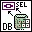

<!-- Generated by tools/export_studio_help.py; edit the reviewed source metadata, then regenerate. -->
# DB Tools Select Data.vi

[Connectivity functions](../index.md) · [All functions](../../index.md)

Selects data from the table in the database identified by connection reference using the columns supplied in the columns array. This VI returns the data as a 2D array of variants. You can convert each element in the array to its native LabVIEW data type using the Database Variant To Data function.

## Studio authoring profile

Contract status: **partial**. The connector below describes Studio authoring; execution availability is stated separately.

## IN — inputs

| Displayed terminal / internal ID | Accepted / resolved type | Studio connection | Unwired input default | Meaning |
| --- | --- | --- | --- | --- |
| connection reference `connection_reference` | `ref<connectivity.database.connection>` | Required | Not specified | ADO Connection object used to identify the database connection. |
| table `table` | `string` | Required | Not specified | table is the name of the table in the database from which to select data. |
| columns `columns` | `array<string,rank=1>` | Recommended | Not specified | columns specifies the columns in table from which to select data. |
| error in `error_in` | `cluster<status:bool,code:i32,source:string>` | Recommended | `{status:false,code:0,source:""}` | Error state received from the preceding operation; the source value is the standard LabVIEW error cluster. |

A default is shown only for an input with an explicitly documented value. Preview/default *types* do not imply unwired operand values. If helper and binding flags differ, both are labelled.

## OUT — outputs

| Displayed terminal / internal ID | Accepted / resolved type | Studio connection | Unwired input default | Meaning |
| --- | --- | --- | --- | --- |
| connection reference out `connection_reference_out` | `ref<connectivity.database.connection>` | Recommended | — | ADO Connection object returned by this operation. |
| data `data` | `array<variant,rank=2>` | Recommended | — | data returns a 2D array of database variants that contains the selected data. |
| error out `error_out` | `cluster<status:bool,code:i32,source:string>` | Recommended | — | Error status, code and source produced by this operation. |

A default is shown only for an input with an explicitly documented value. Preview/default *types* do not imply unwired operand values. If helper and binding flags differ, both are labelled.

## Types and connection rules

- Type resolution: `custom_resolver`; result expression: `resolve:frog.studio.connectivity.type-resolution@1`.
- Implicit coercion: not enabled by this resolver; individual port policies remain explicit.
- Arrays: not accepted; lifting policy: `none`.

Only declared array types and ranks are accepted; no implicit scalar lifting.

**Input count:** 4; this contract does not enable variadic inputs.

## Configured connector instances

The selected instance supplies its own connector. Requirements and defaults are not borrowed from a different instance.

### DB Tools Select Data VI

Instance: `db_tools_select_data_vi`.

| Direction | Terminal / ID | Type | Requirement evidence | Default |
| --- | --- | --- | --- | --- |
| INPUT | condition `condition` | `string` | unverified | Not specified |
| INPUT | connection reference `connection_reference` | `ref<connectivity.database.connection>` | unverified | Not specified |
| INPUT | table `table` | `string` | unverified | Not specified |
| INPUT | columns `columns` | `array<string,rank=1>` | unverified | Not specified |
| INPUT | error in `error_in` | `cluster<status:bool,code:i32,source:string>` | unverified | `{status:false,code:0,source:""}` |
| OUTPUT | connection reference out `connection_reference_out` | `ref<connectivity.database.connection>` | unverified | Not specified |
| OUTPUT | data `data` | `array<variant,rank=2>` | unverified | Not specified |
| OUTPUT | error out `error_out` | `cluster<status:bool,code:i32,source:string>` | unverified | Not specified |

## Execution and limits

**Public FROG / target Runtime:** not declared available by this authoring contract.

Scope: `requires_explicit_target_capability`.

Required provider: `frog.studio.connectivity`.

Authoring only; no new function runtime is implemented.

**Authoring/target contract limits:**

- Connectivity execution and FIR lowering require an explicit provider.
- NI detailed connector includes terminals hidden in the filmed palette help: condition. These remain documented in instances.

Connector type defaults and persistence aliases

| Direction | ID | Preview/default type | Connection policy | Cardinality | Legacy port IDs |
| --- | --- | --- | --- | --- | --- |
| INPUT | `connection_reference` | `ref<connectivity.database.connection>` | `exact` | `single` | — |
| INPUT | `table` | `string` | `exact` | `single` | — |
| INPUT | `columns` | `array<string,rank=1>` | `exact` | `single` | — |
| INPUT | `error_in` | `cluster<status:bool,code:i32,source:string>` | `exact` | `single` | — |
| OUTPUT | `connection_reference_out` | `ref<connectivity.database.connection>` | `exact` | `single` | — |
| OUTPUT | `data` | `array<variant,rank=2>` | `exact` | `single` | — |
| OUTPUT | `error_out` | `cluster<status:bool,code:i32,source:string>` | `exact` | `single` | — |

## Identity and references

- Catalogue ID: `connectivity.database.select_data`.
- Parent palette: [Database](../database.md).
- Profile: `frog.studio.connectivity.database.select_data.v1`.
- Definition: `frog.studio.connectivity.database.select_data`.
- [NI API reference](https://www.ni.com/docs/en-US/bundle/lvdct-api-ref/page/vi-lib/addons/database/auxilliary-llb/db-tools-select-data-vi.html).

NI links are reference sources for the connector model; Studio support is limited to the profile above. [Reference provenance and notation](../../index.md#provenance-and-notation).
