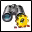

<!-- Generated by tools/export_studio_help.py; edit the reviewed source metadata, then regenerate. -->
# Create Query.vi

[Connectivity functions](../index.md) · [All functions](../../index.md)

Creates a query. You can search for text, paths, numeric values, and time/date values. Use the instance Order by only to sort search results according to a property without searching for this particular property. Use the Merge Queries VI to query conditions to each other. Use the Execute Query VI to execute a query that consists of one or more search conditions. To select the polymorphic instance, connect data to the appropriate input or select the instance manually.

## Studio authoring profile

Contract status: **partial**. The connector below describes Studio authoring; execution availability is stated separately.

## IN — inputs

| Displayed terminal / internal ID | Accepted / resolved type | Studio connection | Unwired input default | Meaning |
| --- | --- | --- | --- | --- |
| object type `object_type` | `u16` | Required | Not specified | object type Enumeration for the object type. |
| property name `property_name` | `string` | Required | Not specified | property name specifies the property that the DataFinder searches for the specified value. |
| comparison operator `comparison_operator` | `u16` | Recommended | `=` | comparison operator (=) specifies the operator that the DataFinder searches for. |
| value `value` | `string` | Recommended | Not specified | value specifies the value of the property to be searched for. |
| error in `error_in` | `cluster<status:bool,code:i32,source:string>` | Recommended | `{status:false,code:0,source:""}` | Error state received from the preceding operation; the source value is the standard LabVIEW error cluster. |

A default is shown only for an input with an explicitly documented value. Preview/default *types* do not imply unwired operand values. If helper and binding flags differ, both are labelled.

## OUT — outputs

| Displayed terminal / internal ID | Accepted / resolved type | Studio connection | Unwired input default | Meaning |
| --- | --- | --- | --- | --- |
| query reference out `query_reference_out` | `ref<connectivity.datafinder.query>` | Recommended | — | The query reference returned by this operation. |
| error out `error_out` | `cluster<status:bool,code:i32,source:string>` | Recommended | — | Error status, code and source produced by this operation. |

A default is shown only for an input with an explicitly documented value. Preview/default *types* do not imply unwired operand values. If helper and binding flags differ, both are labelled.

## Types and connection rules

- Type resolution: `custom_resolver`; result expression: `resolve:frog.studio.connectivity.type-resolution@1`.
- Implicit coercion: not enabled by this resolver; individual port policies remain explicit.
- Arrays: not accepted; lifting policy: `none`.

Only declared array types and ranks are accepted; no implicit scalar lifting.

**Input count:** 5; this contract does not enable variadic inputs.

## Configured connector instances

The selected instance supplies its own connector. Requirements and defaults are not borrowed from a different instance.

### Create Query (String) VI

Instance: `create_query_string_vi`.

| Direction | Terminal / ID | Type | Requirement evidence | Default |
| --- | --- | --- | --- | --- |
| INPUT | order by `order_by` | `u16` | unverified | `none` |
| INPUT | object type `object_type` | `u16` | unverified | Not specified |
| INPUT | property name `property_name` | `string` | unverified | Not specified |
| INPUT | comparison operator `comparison_operator` | `u16` | unverified | `=` |
| INPUT | value `value` | `string` | unverified | Not specified |
| INPUT | error in `error_in` | `cluster<status:bool,code:i32,source:string>` | unverified | `{status:false,code:0,source:""}` |
| OUTPUT | query reference out `query_reference_out` | `ref<connectivity.datafinder.query>` | unverified | Not specified |
| OUTPUT | error out `error_out` | `cluster<status:bool,code:i32,source:string>` | unverified | Not specified |

### Create Query (Numeric) VI

Instance: `create_query_numeric_vi`.

| Direction | Terminal / ID | Type | Requirement evidence | Default |
| --- | --- | --- | --- | --- |
| INPUT | order by `order_by` | `u16` | unverified | `none` |
| INPUT | object type `object_type` | `u16` | unverified | Not specified |
| INPUT | property name `property_name` | `string` | unverified | Not specified |
| INPUT | comparison operator `comparison_operator` | `u16` | unverified | `=` |
| INPUT | value `value` | `f64` | unverified | Not specified |
| INPUT | error in `error_in` | `cluster<status:bool,code:i32,source:string>` | unverified | `{status:false,code:0,source:""}` |
| OUTPUT | query reference out `query_reference_out` | `ref<connectivity.datafinder.query>` | unverified | Not specified |
| OUTPUT | error out `error_out` | `cluster<status:bool,code:i32,source:string>` | unverified | Not specified |

### Create Query (Date) VI

Instance: `create_query_date_vi`.

| Direction | Terminal / ID | Type | Requirement evidence | Default |
| --- | --- | --- | --- | --- |
| INPUT | order by `order_by` | `u16` | unverified | `none` |
| INPUT | object type `object_type` | `u16` | unverified | Not specified |
| INPUT | property name `property_name` | `string` | unverified | Not specified |
| INPUT | comparison operator `comparison_operator` | `u16` | unverified | `=` |
| INPUT | value `value` | `timestamp` | unverified | Not specified |
| INPUT | error in `error_in` | `cluster<status:bool,code:i32,source:string>` | unverified | `{status:false,code:0,source:""}` |
| OUTPUT | query reference out `query_reference_out` | `ref<connectivity.datafinder.query>` | unverified | Not specified |
| OUTPUT | error out `error_out` | `cluster<status:bool,code:i32,source:string>` | unverified | Not specified |

### Create Query (Path) VI

Instance: `create_query_path_vi`.

| Direction | Terminal / ID | Type | Requirement evidence | Default |
| --- | --- | --- | --- | --- |
| INPUT | order by `order_by` | `u16` | unverified | `none` |
| INPUT | object type `object_type` | `u16` | unverified | Not specified |
| INPUT | property name `property_name` | `string` | unverified | Not specified |
| INPUT | comparison operator `comparison_operator` | `u16` | unverified | `=` |
| INPUT | value `value` | `path` | unverified | Not specified |
| INPUT | error in `error_in` | `cluster<status:bool,code:i32,source:string>` | unverified | `{status:false,code:0,source:""}` |
| OUTPUT | query reference out `query_reference_out` | `ref<connectivity.datafinder.query>` | unverified | Not specified |
| OUTPUT | error out `error_out` | `cluster<status:bool,code:i32,source:string>` | unverified | Not specified |

### Create Query (Order by only) VI

Instance: `create_query_order_by_only_vi`.

| Direction | Terminal / ID | Type | Requirement evidence | Default |
| --- | --- | --- | --- | --- |
| INPUT | order by `order_by` | `u16` | unverified | Not specified |
| INPUT | object type `object_type` | `u16` | unverified | Not specified |
| INPUT | property name `property_name` | `string` | unverified | Not specified |
| INPUT | error in `error_in` | `cluster<status:bool,code:i32,source:string>` | unverified | `{status:false,code:0,source:""}` |
| OUTPUT | query reference out `query_reference_out` | `ref<connectivity.datafinder.query>` | unverified | Not specified |
| OUTPUT | error out `error_out` | `cluster<status:bool,code:i32,source:string>` | unverified | Not specified |

## Execution and limits

**Public FROG / target Runtime:** not declared available by this authoring contract.

Scope: `requires_explicit_target_capability`.

Required provider: `frog.studio.connectivity`.

Authoring only; no new function runtime is implemented.

**Authoring/target contract limits:**

- Connectivity execution and FIR lowering require an explicit provider.
- NI detailed connector includes terminals hidden in the filmed palette help: order by. These remain documented in instances.
- Required/recommended/optional settings and connector indices of instances not shown in the video are unverified.

Connector type defaults and persistence aliases

| Direction | ID | Preview/default type | Connection policy | Cardinality | Legacy port IDs |
| --- | --- | --- | --- | --- | --- |
| INPUT | `object_type` | `u16` | `exact` | `single` | — |
| INPUT | `property_name` | `string` | `exact` | `single` | — |
| INPUT | `comparison_operator` | `u16` | `exact` | `single` | — |
| INPUT | `value` | `string` | `exact` | `single` | — |
| INPUT | `error_in` | `cluster<status:bool,code:i32,source:string>` | `exact` | `single` | — |
| OUTPUT | `query_reference_out` | `ref<connectivity.datafinder.query>` | `exact` | `single` | — |
| OUTPUT | `error_out` | `cluster<status:bool,code:i32,source:string>` | `exact` | `single` | — |

## Identity and references

- Catalogue ID: `connectivity.datafinder.create_query`.
- Parent palette: [DataFinder](../datafinder.md).
- Profile: `frog.studio.connectivity.datafinder.create_query.v1`.
- Definition: `frog.studio.connectivity.datafinder.create_query`.
- [NI API reference](https://www.ni.com/docs/en-US/bundle/lvdfc-api-ref/page/vi-lib/datafinder/create-query-vi.html).

NI links are reference sources for the connector model; Studio support is limited to the profile above. [Reference provenance and notation](../../index.md#provenance-and-notation).
