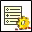

<!-- Generated by tools/export_studio_help.py; edit the reviewed source metadata, then regenerate. -->
# Get Indexed Properties.vi

[Connectivity functions](../index.md) · [All functions](../../index.md)

Determines for files, groups, or channels, the list of all the indexed properties in which you can execute a search with the DataFinder.

## Studio authoring profile

Contract status: **partial**. The connector below describes Studio authoring; execution availability is stated separately.

## IN — inputs

| Displayed terminal / internal ID | Accepted / resolved type | Studio connection | Unwired input default | Meaning |
| --- | --- | --- | --- | --- |
| DataFinder reference `datafinder_reference` | `ref<connectivity.datafinder.server>` | Required | Not specified | DataFinder server connection whose index supplies this operation. |
| object type `object_type` | `u16` | Required | Not specified | object type specifies whether the indexed properties of a channel, a group, or a file, are returned. |
| error in `error_in` | `cluster<status:bool,code:i32,source:string>` | Recommended | `{status:false,code:0,source:""}` | Error state received from the preceding operation; the source value is the standard LabVIEW error cluster. |

A default is shown only for an input with an explicitly documented value. Preview/default *types* do not imply unwired operand values. If helper and binding flags differ, both are labelled.

## OUT — outputs

| Displayed terminal / internal ID | Accepted / resolved type | Studio connection | Unwired input default | Meaning |
| --- | --- | --- | --- | --- |
| DataFinder reference out `datafinder_reference_out` | `ref<connectivity.datafinder.server>` | Recommended | — | The same DataFinder server connection after this operation. |
| properties `properties` | `array<cluster<object_type:u16,property_name:string,data_type:u16>,rank=1>` | Recommended | — | Indexed property descriptors, each containing object type, property name and data type. |
| error out `error_out` | `cluster<status:bool,code:i32,source:string>` | Recommended | — | Error status, code and source produced by this operation. |

A default is shown only for an input with an explicitly documented value. Preview/default *types* do not imply unwired operand values. If helper and binding flags differ, both are labelled.

## Types and connection rules

- Type resolution: `custom_resolver`; result expression: `resolve:frog.studio.connectivity.type-resolution@1`.
- Implicit coercion: not enabled by this resolver; individual port policies remain explicit.
- Arrays: not accepted; lifting policy: `none`.

Only declared array types and ranks are accepted; no implicit scalar lifting.

**Input count:** 3; this contract does not enable variadic inputs.

## Configured connector instances

The selected instance supplies its own connector. Requirements and defaults are not borrowed from a different instance.

### Get Indexed Properties VI

Instance: `get_indexed_properties_vi`.

| Direction | Terminal / ID | Type | Requirement evidence | Default |
| --- | --- | --- | --- | --- |
| INPUT | DataFinder reference `datafinder_reference` | `ref<connectivity.datafinder.server>` | unverified | Not specified |
| INPUT | object type `object_type` | `u16` | unverified | Not specified |
| INPUT | error in `error_in` | `cluster<status:bool,code:i32,source:string>` | unverified | `{status:false,code:0,source:""}` |
| OUTPUT | DataFinder reference out `datafinder_reference_out` | `ref<connectivity.datafinder.server>` | unverified | Not specified |
| OUTPUT | properties `properties` | `array<cluster<object_type:u16,property_name:string,data_type:u16>,rank=1>` | unverified | Not specified |
| OUTPUT | error out `error_out` | `cluster<status:bool,code:i32,source:string>` | unverified | Not specified |

## Execution and limits

**Public FROG / target Runtime:** not declared available by this authoring contract.

Scope: `requires_explicit_target_capability`.

Required provider: `frog.studio.connectivity`.

Authoring only; no new function runtime is implemented.

**Authoring/target contract limits:**

- Connectivity execution and FIR lowering require an explicit provider.

Connector type defaults and persistence aliases

| Direction | ID | Preview/default type | Connection policy | Cardinality | Legacy port IDs |
| --- | --- | --- | --- | --- | --- |
| INPUT | `datafinder_reference` | `ref<connectivity.datafinder.server>` | `exact` | `single` | — |
| INPUT | `object_type` | `u16` | `exact` | `single` | — |
| INPUT | `error_in` | `cluster<status:bool,code:i32,source:string>` | `exact` | `single` | — |
| OUTPUT | `datafinder_reference_out` | `ref<connectivity.datafinder.server>` | `exact` | `single` | — |
| OUTPUT | `properties` | `array<cluster<object_type:u16,property_name:string,data_type:u16>,rank=1>` | `exact` | `single` | — |
| OUTPUT | `error_out` | `cluster<status:bool,code:i32,source:string>` | `exact` | `single` | — |

## Identity and references

- Catalogue ID: `connectivity.datafinder.get_indexed_properties`.
- Parent palette: [DataFinder](../datafinder.md).
- Profile: `frog.studio.connectivity.datafinder.get_indexed_properties.v1`.
- Definition: `frog.studio.connectivity.datafinder.get_indexed_properties`.
- [NI API reference](https://www.ni.com/docs/en-US/bundle/lvdfc-api-ref/page/vi-lib/datafinder/get-indexed-properties-vi.html).

NI links are reference sources for the connector model; Studio support is limited to the profile above. [Reference provenance and notation](../../index.md#provenance-and-notation).
