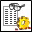

<!-- Generated by tools/export_studio_help.py; edit the reviewed source metadata, then regenerate. -->
# Get Property Values.vi

[Connectivity functions](../index.md) · [All functions](../../index.md)

Determines from the result references the values of one or more properties that are the same data type. To select the polymorphic instance, connect data to the Data Type input or to the Property input or select the instance manually.

## Studio authoring profile

Contract status: **partial**. The connector below describes Studio authoring; execution availability is stated separately.

## IN — inputs

| Displayed terminal / internal ID | Accepted / resolved type | Studio connection | Unwired input default | Meaning |
| --- | --- | --- | --- | --- |
| data type `data_type` | `array<string,rank=1>` | Recommended | Not specified | Type specimen selecting the documented polymorphic result instance. |
| property `property` | `cluster<object_type:u16,property_name:string,data_type:u16>` | Required | Not specified | Property descriptor: object type, property name and indexed data type. |
| result references `result_references` | `array<ref<connectivity.datafinder.result_element>,rank=1>` | Required | Not specified | Search result element references from which signal or property data is read. |
| error in `error_in` | `cluster<status:bool,code:i32,source:string>` | Recommended | `{status:false,code:0,source:""}` | Error state received from the preceding operation; the source value is the standard LabVIEW error cluster. |

A default is shown only for an input with an explicitly documented value. Preview/default *types* do not imply unwired operand values. If helper and binding flags differ, both are labelled.

## OUT — outputs

| Displayed terminal / internal ID | Accepted / resolved type | Studio connection | Unwired input default | Meaning |
| --- | --- | --- | --- | --- |
| property values `property_values` | `array<string,rank=1>` | Recommended | — | Property values in the shape and scalar type selected by the instance. |
| result references out `result_references_out` | `array<ref<connectivity.datafinder.result_element>,rank=1>` | Recommended | — | Separate array of search result element references returned by the search or passed through the reader. |
| error out `error_out` | `cluster<status:bool,code:i32,source:string>` | Recommended | — | Error status, code and source produced by this operation. |

A default is shown only for an input with an explicitly documented value. Preview/default *types* do not imply unwired operand values. If helper and binding flags differ, both are labelled.

## Types and connection rules

- Type resolution: `custom_resolver`; result expression: `resolve:frog.studio.connectivity.type-resolution@1`.
- Implicit coercion: not enabled by this resolver; individual port policies remain explicit.
- Arrays: not accepted; lifting policy: `none`.

Only declared array types and ranks are accepted; no implicit scalar lifting.

**Input count:** 4; this contract does not enable variadic inputs.

## Configured connector instances

The selected instance supplies its own connector. Requirements and defaults are not borrowed from a different instance.

### Get Property Values (String Property) VI

Instance: `get_property_values_string_property_vi`.

| Direction | Terminal / ID | Type | Requirement evidence | Default |
| --- | --- | --- | --- | --- |
| INPUT | data type `data_type` | `array<string,rank=1>` | unverified | Not specified |
| INPUT | property `property` | `cluster<object_type:u16,property_name:string,data_type:u16>` | unverified | Not specified |
| INPUT | result references `result_references` | `array<ref<connectivity.datafinder.result_element>,rank=1>` | unverified | Not specified |
| INPUT | error in `error_in` | `cluster<status:bool,code:i32,source:string>` | unverified | `{status:false,code:0,source:""}` |
| OUTPUT | property values `property_values` | `array<string,rank=1>` | unverified | Not specified |
| OUTPUT | result references out `result_references_out` | `array<ref<connectivity.datafinder.result_element>,rank=1>` | unverified | Not specified |
| OUTPUT | error out `error_out` | `cluster<status:bool,code:i32,source:string>` | unverified | Not specified |

### Get Property Values (String Properties) VI

Instance: `get_property_values_string_properties_vi`.

| Direction | Terminal / ID | Type | Requirement evidence | Default |
| --- | --- | --- | --- | --- |
| INPUT | data type `data_type` | `array<string,rank=2>` | unverified | Not specified |
| INPUT | properties `properties` | `array<cluster<object_type:u16,property_name:string,data_type:u16>,rank=1>` | unverified | Not specified |
| INPUT | result references `result_references` | `array<ref<connectivity.datafinder.result_element>,rank=1>` | unverified | Not specified |
| INPUT | error in `error_in` | `cluster<status:bool,code:i32,source:string>` | unverified | `{status:false,code:0,source:""}` |
| OUTPUT | property values `property_values` | `array<string,rank=2>` | unverified | Not specified |
| OUTPUT | result references out `result_references_out` | `array<ref<connectivity.datafinder.result_element>,rank=1>` | unverified | Not specified |
| OUTPUT | error out `error_out` | `cluster<status:bool,code:i32,source:string>` | unverified | Not specified |

### Get Property Values (Numeric Property) VI

Instance: `get_property_values_numeric_property_vi`.

| Direction | Terminal / ID | Type | Requirement evidence | Default |
| --- | --- | --- | --- | --- |
| INPUT | data type `data_type` | `array<f64,rank=1>` | unverified | Not specified |
| INPUT | property `property` | `cluster<object_type:u16,property_name:string,data_type:u16>` | unverified | Not specified |
| INPUT | result references `result_references` | `array<ref<connectivity.datafinder.result_element>,rank=1>` | unverified | Not specified |
| INPUT | error in `error_in` | `cluster<status:bool,code:i32,source:string>` | unverified | `{status:false,code:0,source:""}` |
| OUTPUT | property values `property_values` | `array<f64,rank=1>` | unverified | Not specified |
| OUTPUT | result references out `result_references_out` | `array<ref<connectivity.datafinder.result_element>,rank=1>` | unverified | Not specified |
| OUTPUT | error out `error_out` | `cluster<status:bool,code:i32,source:string>` | unverified | Not specified |

### Get Property Values (Numeric Properties) VI

Instance: `get_property_values_numeric_properties_vi`.

| Direction | Terminal / ID | Type | Requirement evidence | Default |
| --- | --- | --- | --- | --- |
| INPUT | data type `data_type` | `array<f64,rank=2>` | unverified | Not specified |
| INPUT | properties `properties` | `array<cluster<object_type:u16,property_name:string,data_type:u16>,rank=1>` | unverified | Not specified |
| INPUT | result references `result_references` | `array<ref<connectivity.datafinder.result_element>,rank=1>` | unverified | Not specified |
| INPUT | error in `error_in` | `cluster<status:bool,code:i32,source:string>` | unverified | `{status:false,code:0,source:""}` |
| OUTPUT | property values `property_values` | `array<f64,rank=2>` | unverified | Not specified |
| OUTPUT | result references out `result_references_out` | `array<ref<connectivity.datafinder.result_element>,rank=1>` | unverified | Not specified |
| OUTPUT | error out `error_out` | `cluster<status:bool,code:i32,source:string>` | unverified | Not specified |

### Get Property Values (Date Property) VI

Instance: `get_property_values_date_property_vi`.

| Direction | Terminal / ID | Type | Requirement evidence | Default |
| --- | --- | --- | --- | --- |
| INPUT | data type `data_type` | `array<timestamp,rank=1>` | unverified | Not specified |
| INPUT | property `property` | `cluster<object_type:u16,property_name:string,data_type:u16>` | unverified | Not specified |
| INPUT | result references `result_references` | `array<ref<connectivity.datafinder.result_element>,rank=1>` | unverified | Not specified |
| INPUT | error in `error_in` | `cluster<status:bool,code:i32,source:string>` | unverified | `{status:false,code:0,source:""}` |
| OUTPUT | property values `property_values` | `array<timestamp,rank=1>` | unverified | Not specified |
| OUTPUT | result references out `result_references_out` | `array<ref<connectivity.datafinder.result_element>,rank=1>` | unverified | Not specified |
| OUTPUT | error out `error_out` | `cluster<status:bool,code:i32,source:string>` | unverified | Not specified |

### Get Property Values (Date Properties) VI

Instance: `get_property_values_date_properties_vi`.

| Direction | Terminal / ID | Type | Requirement evidence | Default |
| --- | --- | --- | --- | --- |
| INPUT | data type `data_type` | `array<timestamp,rank=2>` | unverified | Not specified |
| INPUT | properties `properties` | `array<cluster<object_type:u16,property_name:string,data_type:u16>,rank=1>` | unverified | Not specified |
| INPUT | result references `result_references` | `array<ref<connectivity.datafinder.result_element>,rank=1>` | unverified | Not specified |
| INPUT | error in `error_in` | `cluster<status:bool,code:i32,source:string>` | unverified | `{status:false,code:0,source:""}` |
| OUTPUT | property values `property_values` | `array<timestamp,rank=2>` | unverified | Not specified |
| OUTPUT | result references out `result_references_out` | `array<ref<connectivity.datafinder.result_element>,rank=1>` | unverified | Not specified |
| OUTPUT | error out `error_out` | `cluster<status:bool,code:i32,source:string>` | unverified | Not specified |

### Get Property Values (Path Property) VI

Instance: `get_property_values_path_property_vi`.

| Direction | Terminal / ID | Type | Requirement evidence | Default |
| --- | --- | --- | --- | --- |
| INPUT | data type `data_type` | `array<path,rank=1>` | unverified | Not specified |
| INPUT | property `property` | `cluster<object_type:u16,property_name:string,data_type:u16>` | unverified | Not specified |
| INPUT | result references `result_references` | `array<ref<connectivity.datafinder.result_element>,rank=1>` | unverified | Not specified |
| INPUT | error in `error_in` | `cluster<status:bool,code:i32,source:string>` | unverified | `{status:false,code:0,source:""}` |
| OUTPUT | property values `property_values` | `array<path,rank=1>` | unverified | Not specified |
| OUTPUT | result references out `result_references_out` | `array<ref<connectivity.datafinder.result_element>,rank=1>` | unverified | Not specified |
| OUTPUT | error out `error_out` | `cluster<status:bool,code:i32,source:string>` | unverified | Not specified |

### Get Property Values (Path Properties) VI

Instance: `get_property_values_path_properties_vi`.

| Direction | Terminal / ID | Type | Requirement evidence | Default |
| --- | --- | --- | --- | --- |
| INPUT | data type `data_type` | `array<path,rank=2>` | unverified | Not specified |
| INPUT | properties `properties` | `array<cluster<object_type:u16,property_name:string,data_type:u16>,rank=1>` | unverified | Not specified |
| INPUT | result references `result_references` | `array<ref<connectivity.datafinder.result_element>,rank=1>` | unverified | Not specified |
| INPUT | error in `error_in` | `cluster<status:bool,code:i32,source:string>` | unverified | `{status:false,code:0,source:""}` |
| OUTPUT | property values `property_values` | `array<path,rank=2>` | unverified | Not specified |
| OUTPUT | result references out `result_references_out` | `array<ref<connectivity.datafinder.result_element>,rank=1>` | unverified | Not specified |
| OUTPUT | error out `error_out` | `cluster<status:bool,code:i32,source:string>` | unverified | Not specified |

## Execution and limits

**Public FROG / target Runtime:** not declared available by this authoring contract.

Scope: `requires_explicit_target_capability`.

Required provider: `frog.studio.connectivity`.

Authoring only; no new function runtime is implemented.

**Authoring/target contract limits:**

- Connectivity execution and FIR lowering require an explicit provider.
- Required/recommended/optional settings and connector indices of instances not shown in the video are unverified.

Connector type defaults and persistence aliases

| Direction | ID | Preview/default type | Connection policy | Cardinality | Legacy port IDs |
| --- | --- | --- | --- | --- | --- |
| INPUT | `data_type` | `array<string,rank=1>` | `exact` | `single` | — |
| INPUT | `property` | `cluster<object_type:u16,property_name:string,data_type:u16>` | `exact` | `single` | — |
| INPUT | `result_references` | `array<ref<connectivity.datafinder.result_element>,rank=1>` | `exact` | `single` | — |
| INPUT | `error_in` | `cluster<status:bool,code:i32,source:string>` | `exact` | `single` | — |
| OUTPUT | `property_values` | `array<string,rank=1>` | `exact` | `single` | — |
| OUTPUT | `result_references_out` | `array<ref<connectivity.datafinder.result_element>,rank=1>` | `exact` | `single` | — |
| OUTPUT | `error_out` | `cluster<status:bool,code:i32,source:string>` | `exact` | `single` | — |

## Identity and references

- Catalogue ID: `connectivity.datafinder.get_property_values`.
- Parent palette: [DataFinder](../datafinder.md).
- Profile: `frog.studio.connectivity.datafinder.get_property_values.v1`.
- Definition: `frog.studio.connectivity.datafinder.get_property_values`.
- [NI API reference](https://www.ni.com/docs/en-US/bundle/lvdfc-api-ref/page/vi-lib/datafinder/get-property-values-vi.html).

NI links are reference sources for the connector model; Studio support is limited to the profile above. [Reference provenance and notation](../../index.md#provenance-and-notation).
