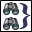

<!-- Generated by tools/export_studio_help.py; edit the reviewed source metadata, then regenerate. -->
# Merge Queries.vi

[Connectivity functions](../index.md) · [All functions](../../index.md)

Uses an operator to combine several queries into one query. For example, you can generate queries as "C1 AND C2 AND C3", "(C1 AND C2) OR C3", or "(C1 AND C2) OR (C3 AND C4).

## Studio authoring profile

Contract status: **partial**. The connector below describes Studio authoring; execution availability is stated separately.

## IN — inputs

| Displayed terminal / internal ID | Accepted / resolved type | Studio connection | Unwired input default | Meaning |
| --- | --- | --- | --- | --- |
| query reference in 1 `query_reference_in_1` | `ref<connectivity.datafinder.query>` | Recommended | Not specified | query reference in 1 is the first query that is to be connected to other queries. |
| query reference in 2 `query_reference_in_2` | `ref<connectivity.datafinder.query>` | Recommended | Not specified | query reference in 2 is the second query that is to be connected to other queries. |
| query reference array in `query_reference_array_in` | `array<ref<connectivity.datafinder.query>,rank=1>` | Recommended | Not specified | query reference array in is an array of queries that are to be connected to each other or to other queries. |
| operation `operation` | `u16` | Recommended | `AND` | Operator to connect query conditions. |
| error in `error_in` | `cluster<status:bool,code:i32,source:string>` | Recommended | `{status:false,code:0,source:""}` | Error state received from the preceding operation; the source value is the standard LabVIEW error cluster. |

A default is shown only for an input with an explicitly documented value. Preview/default *types* do not imply unwired operand values. If helper and binding flags differ, both are labelled.

## OUT — outputs

| Displayed terminal / internal ID | Accepted / resolved type | Studio connection | Unwired input default | Meaning |
| --- | --- | --- | --- | --- |
| query reference out `query_reference_out` | `ref<connectivity.datafinder.query>` | Recommended | — | The query reference returned by this operation. |
| error out `error_out` | `cluster<status:bool,code:i32,source:string>` | Recommended | — | Error status, code and source produced by this operation. |

A default is shown only for an input with an explicitly documented value. Preview/default *types* do not imply unwired operand values. If helper and binding flags differ, both are labelled.

## Types and connection rules

- Type resolution: `custom_resolver`; result expression: `resolve:frog.studio.connectivity.type-resolution@1`.
- Implicit coercion: not enabled by this resolver; individual port policies remain explicit.
- Arrays: not accepted; lifting policy: `none`.

Only declared array types and ranks are accepted; no implicit scalar lifting.

**Input count:** 5; this contract does not enable variadic inputs.

## Configured connector instances

The selected instance supplies its own connector. Requirements and defaults are not borrowed from a different instance.

### Merge Queries VI

Instance: `merge_queries_vi`.

| Direction | Terminal / ID | Type | Requirement evidence | Default |
| --- | --- | --- | --- | --- |
| INPUT | query reference in 1 `query_reference_in_1` | `ref<connectivity.datafinder.query>` | unverified | Not specified |
| INPUT | query reference in 2 `query_reference_in_2` | `ref<connectivity.datafinder.query>` | unverified | Not specified |
| INPUT | query reference array in `query_reference_array_in` | `array<ref<connectivity.datafinder.query>,rank=1>` | unverified | Not specified |
| INPUT | operation `operation` | `u16` | unverified | `AND` |
| INPUT | error in `error_in` | `cluster<status:bool,code:i32,source:string>` | unverified | `{status:false,code:0,source:""}` |
| OUTPUT | query reference out `query_reference_out` | `ref<connectivity.datafinder.query>` | unverified | Not specified |
| OUTPUT | error out `error_out` | `cluster<status:bool,code:i32,source:string>` | unverified | Not specified |

## Execution and limits

**Public FROG / target Runtime:** not declared available by this authoring contract.

Scope: `requires_explicit_target_capability`.

Required provider: `frog.studio.connectivity`.

Authoring only; no new function runtime is implemented.

**Authoring/target contract limits:**

- Connectivity execution and FIR lowering require an explicit provider.

Connector type defaults and persistence aliases

| Direction | ID | Preview/default type | Connection policy | Cardinality | Legacy port IDs |
| --- | --- | --- | --- | --- | --- |
| INPUT | `query_reference_in_1` | `ref<connectivity.datafinder.query>` | `exact` | `single` | — |
| INPUT | `query_reference_in_2` | `ref<connectivity.datafinder.query>` | `exact` | `single` | — |
| INPUT | `query_reference_array_in` | `array<ref<connectivity.datafinder.query>,rank=1>` | `exact` | `single` | — |
| INPUT | `operation` | `u16` | `exact` | `single` | — |
| INPUT | `error_in` | `cluster<status:bool,code:i32,source:string>` | `exact` | `single` | — |
| OUTPUT | `query_reference_out` | `ref<connectivity.datafinder.query>` | `exact` | `single` | — |
| OUTPUT | `error_out` | `cluster<status:bool,code:i32,source:string>` | `exact` | `single` | — |

## Identity and references

- Catalogue ID: `connectivity.datafinder.merge_queries`.
- Parent palette: [DataFinder](../datafinder.md).
- Profile: `frog.studio.connectivity.datafinder.merge_queries.v1`.
- Definition: `frog.studio.connectivity.datafinder.merge_queries`.
- [NI API reference](https://www.ni.com/docs/en-US/bundle/lvdfc-api-ref/page/vi-lib/datafinder/merge-queries-vi.html).

NI links are reference sources for the connector model; Studio support is limited to the profile above. [Reference provenance and notation](../../index.md#provenance-and-notation).
