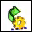

<!-- Generated by tools/export_studio_help.py; edit the reviewed source metadata, then regenerate. -->
# Open Server.vi

[Connectivity functions](../index.md) · [All functions](../../index.md)

Connects a DataFinder or a DataFinder federation with the specified connection parameters.

## Studio authoring profile

Contract status: **partial**. The connector below describes Studio authoring; execution availability is stated separately.

## IN — inputs

| Displayed terminal / internal ID | Accepted / resolved type | Studio connection | Unwired input default | Meaning |
| --- | --- | --- | --- | --- |
| DataFinder name `datafinder_name` | `string` | Required | Not specified | DataFinder name is the name of the DataFinder on the other computer. |
| server name `server_name` | `string` | Recommended | `localhost` | server name (localhost) is the name of the computer where the remote DataFinder is located. |
| error in `error_in` | `cluster<status:bool,code:i32,source:string>` | Recommended | `{status:false,code:0,source:""}` | Error state received from the preceding operation; the source value is the standard LabVIEW error cluster. |

A default is shown only for an input with an explicitly documented value. Preview/default *types* do not imply unwired operand values. If helper and binding flags differ, both are labelled.

## OUT — outputs

| Displayed terminal / internal ID | Accepted / resolved type | Studio connection | Unwired input default | Meaning |
| --- | --- | --- | --- | --- |
| DataFinder reference out `datafinder_reference_out` | `ref<connectivity.datafinder.server>` | Recommended | — | The same DataFinder server connection after this operation. |
| error out `error_out` | `cluster<status:bool,code:i32,source:string>` | Recommended | — | Error status, code and source produced by this operation. |

A default is shown only for an input with an explicitly documented value. Preview/default *types* do not imply unwired operand values. If helper and binding flags differ, both are labelled.

## Types and connection rules

- Type resolution: `custom_resolver`; result expression: `resolve:frog.studio.connectivity.type-resolution@1`.
- Implicit coercion: not enabled by this resolver; individual port policies remain explicit.
- Arrays: not accepted; lifting policy: `none`.

Only declared array types and ranks are accepted; no implicit scalar lifting.

**Input count:** 3; this contract does not enable variadic inputs.

## Configured connector instances

The selected instance supplies its own connector. Requirements and defaults are not borrowed from a different instance.

### Open DataFinder VI

Instance: `open_datafinder_vi`.

| Direction | Terminal / ID | Type | Requirement evidence | Default |
| --- | --- | --- | --- | --- |
| INPUT | DataFinder name `datafinder_name` | `string` | unverified | Not specified |
| INPUT | server name `server_name` | `string` | unverified | `localhost` |
| INPUT | connection timeout in s `connection_timeout_in_s` | `u64` | unverified | `5` |
| INPUT | query timeout in s `query_timeout_in_s` | `u64` | unverified | `20` |
| INPUT | error in `error_in` | `cluster<status:bool,code:i32,source:string>` | unverified | `{status:false,code:0,source:""}` |
| OUTPUT | DataFinder reference out `datafinder_reference_out` | `ref<connectivity.datafinder.server>` | unverified | Not specified |
| OUTPUT | error out `error_out` | `cluster<status:bool,code:i32,source:string>` | unverified | Not specified |

### Open Federation VI

Instance: `open_federation_vi`.

| Direction | Terminal / ID | Type | Requirement evidence | Default |
| --- | --- | --- | --- | --- |
| INPUT | port `port` | `u64` | unverified | `2809` |
| INPUT | DataFinder name `datafinder_name` | `string` | unverified | Not specified |
| INPUT | server name `server_name` | `string` | unverified | `localhost` |
| INPUT | user name `user_name` | `string` | unverified | Not specified |
| INPUT | password `password` | `string` | unverified | Not specified |
| INPUT | error in `error_in` | `cluster<status:bool,code:i32,source:string>` | unverified | `{status:false,code:0,source:""}` |
| INPUT | authentication mode `authentication_mode` | `unresolved:u16_ring:authentication_mode_values` | unverified | `no security` |
| OUTPUT | DataFinder reference out `datafinder_reference_out` | `ref<connectivity.datafinder.server>` | unverified | Not specified |
| OUTPUT | error out `error_out` | `cluster<status:bool,code:i32,source:string>` | unverified | Not specified |

## Execution and limits

**Public FROG / target Runtime:** not declared available by this authoring contract.

Scope: `requires_explicit_target_capability`.

Required provider: `frog.studio.connectivity`.

Authoring only; no new function runtime is implemented.

**Authoring/target contract limits:**

- Connectivity execution and FIR lowering require an explicit provider.
- NI detailed connector includes terminals hidden in the filmed palette help: connection timeout in s, query timeout in s. These remain documented in instances.
- Some documented instances retain unresolved enum representations, waveform or dynamic-data structures; see the exact instance port metadata.
- Required/recommended/optional settings and connector indices of instances not shown in the video are unverified.

Connector type defaults and persistence aliases

| Direction | ID | Preview/default type | Connection policy | Cardinality | Legacy port IDs |
| --- | --- | --- | --- | --- | --- |
| INPUT | `datafinder_name` | `string` | `exact` | `single` | — |
| INPUT | `server_name` | `string` | `exact` | `single` | — |
| INPUT | `error_in` | `cluster<status:bool,code:i32,source:string>` | `exact` | `single` | — |
| OUTPUT | `datafinder_reference_out` | `ref<connectivity.datafinder.server>` | `exact` | `single` | — |
| OUTPUT | `error_out` | `cluster<status:bool,code:i32,source:string>` | `exact` | `single` | — |

## Identity and references

- Catalogue ID: `connectivity.datafinder.open_server`.
- Parent palette: [DataFinder](../datafinder.md).
- Profile: `frog.studio.connectivity.datafinder.open_server.v1`.
- Definition: `frog.studio.connectivity.datafinder.open_server`.
- [NI API reference](https://www.ni.com/docs/en-US/bundle/lvdfc-api-ref/page/vi-lib/datafinder/open-server-vi.html).

NI links are reference sources for the connector model; Studio support is limited to the profile above. [Reference provenance and notation](../../index.md#provenance-and-notation).
