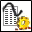

<!-- Generated by tools/export_studio_help.py; edit the reviewed source metadata, then regenerate. -->
# Results to Waveforms.vi

[Connectivity functions](../index.md) · [All functions](../../index.md)

Extracts the signals from the results of a DataFinder search. To select the polymorphic instance, connect data to the Data type input or select the instance manually.

## Studio authoring profile

Contract status: **partial**. The connector below describes Studio authoring; execution availability is stated separately.

## IN — inputs

| Displayed terminal / internal ID | Accepted / resolved type | Studio connection | Unwired input default | Meaning |
| --- | --- | --- | --- | --- |
| data type `data_type` | `unknown` | Recommended | Not specified | Type specimen selecting the documented polymorphic result instance. |
| result references `result_references` | `array<ref<connectivity.datafinder.result_element>,rank=1>` | Required | Not specified | Search result element references from which signal or property data is read. |
| error in `error_in` | `cluster<status:bool,code:i32,source:string>` | Recommended | `{status:false,code:0,source:""}` | Error state received from the preceding operation; the source value is the standard LabVIEW error cluster. |

A default is shown only for an input with an explicitly documented value. Preview/default *types* do not imply unwired operand values. If helper and binding flags differ, both are labelled.

## OUT — outputs

| Displayed terminal / internal ID | Accepted / resolved type | Studio connection | Unwired input default | Meaning |
| --- | --- | --- | --- | --- |
| signals out `signals_out` | `unknown` | Recommended | — | Signals read from the search results in the representation selected by data type. |
| result references out `result_references_out` | `array<ref<connectivity.datafinder.result_element>,rank=1>` | Recommended | — | Separate array of search result element references returned by the search or passed through the reader. |
| error out `error_out` | `cluster<status:bool,code:i32,source:string>` | Recommended | — | Error status, code and source produced by this operation. |

A default is shown only for an input with an explicitly documented value. Preview/default *types* do not imply unwired operand values. If helper and binding flags differ, both are labelled.

## Types and connection rules

- Type resolution: `custom_resolver`; result expression: `resolve:frog.studio.connectivity.type-resolution@1`.
- Implicit coercion: not enabled by this resolver; individual port policies remain explicit.
- Arrays: not accepted; lifting policy: `none`.

Only declared array types and ranks are accepted; no implicit scalar lifting.

**Input count:** 3; this contract does not enable variadic inputs.

## Configured connector instances

The selected instance supplies its own connector. Requirements and defaults are not borrowed from a different instance.

### Results to Waveforms (ddt) VI

Instance: `results_to_waveforms_ddt_vi`.

| Direction | Terminal / ID | Type | Requirement evidence | Default |
| --- | --- | --- | --- | --- |
| INPUT | data type `data_type` | `unresolved:labview_dynamic_data` | unverified | Not specified |
| INPUT | result references `result_references` | `array<ref<connectivity.datafinder.result_element>,rank=1>` | unverified | Not specified |
| INPUT | error in `error_in` | `cluster<status:bool,code:i32,source:string>` | unverified | `{status:false,code:0,source:""}` |
| OUTPUT | signals out `signals_out` | `unresolved:labview_dynamic_data` | unverified | Not specified |
| OUTPUT | result references out `result_references_out` | `array<ref<connectivity.datafinder.result_element>,rank=1>` | unverified | Not specified |
| OUTPUT | error out `error_out` | `cluster<status:bool,code:i32,source:string>` | unverified | Not specified |

### Results to Waveforms (array of waveforms) VI

Instance: `results_to_waveforms_array_of_waveforms_vi`.

| Direction | Terminal / ID | Type | Requirement evidence | Default |
| --- | --- | --- | --- | --- |
| INPUT | data type `data_type` | `unresolved:array_rank_1:labview_analog_waveform_structure` | unverified | Not specified |
| INPUT | result references `result_references` | `array<ref<connectivity.datafinder.result_element>,rank=1>` | unverified | Not specified |
| INPUT | error in `error_in` | `cluster<status:bool,code:i32,source:string>` | unverified | `{status:false,code:0,source:""}` |
| OUTPUT | signals out `signals_out` | `unresolved:array_rank_1:labview_analog_waveform_structure` | unverified | Not specified |
| OUTPUT | result references out `result_references_out` | `array<ref<connectivity.datafinder.result_element>,rank=1>` | unverified | Not specified |
| OUTPUT | error out `error_out` | `cluster<status:bool,code:i32,source:string>` | unverified | Not specified |

### Results to Waveforms (array of doubles) VI

Instance: `results_to_waveforms_array_of_doubles_vi`.

| Direction | Terminal / ID | Type | Requirement evidence | Default |
| --- | --- | --- | --- | --- |
| INPUT | data type `data_type` | `array<f64,rank=2>` | unverified | Not specified |
| INPUT | result references `result_references` | `array<ref<connectivity.datafinder.result_element>,rank=1>` | unverified | Not specified |
| INPUT | error in `error_in` | `cluster<status:bool,code:i32,source:string>` | unverified | `{status:false,code:0,source:""}` |
| OUTPUT | signals out `signals_out` | `array<f64,rank=2>` | unverified | Not specified |
| OUTPUT | result references out `result_references_out` | `array<ref<connectivity.datafinder.result_element>,rank=1>` | unverified | Not specified |
| OUTPUT | error out `error_out` | `cluster<status:bool,code:i32,source:string>` | unverified | Not specified |

### Results to Waveforms (array of I32) VI

Instance: `results_to_waveforms_array_of_i32_vi`.

| Direction | Terminal / ID | Type | Requirement evidence | Default |
| --- | --- | --- | --- | --- |
| INPUT | data type `data_type` | `array<i32,rank=2>` | unverified | Not specified |
| INPUT | result references `result_references` | `array<ref<connectivity.datafinder.result_element>,rank=1>` | unverified | Not specified |
| INPUT | error in `error_in` | `cluster<status:bool,code:i32,source:string>` | unverified | `{status:false,code:0,source:""}` |
| OUTPUT | signals out `signals_out` | `array<i32,rank=2>` | unverified | Not specified |
| OUTPUT | result references out `result_references_out` | `array<ref<connectivity.datafinder.result_element>,rank=1>` | unverified | Not specified |
| OUTPUT | error out `error_out` | `cluster<status:bool,code:i32,source:string>` | unverified | Not specified |

### Results to Waveforms (array of I16) VI

Instance: `results_to_waveforms_array_of_i16_vi`.

| Direction | Terminal / ID | Type | Requirement evidence | Default |
| --- | --- | --- | --- | --- |
| INPUT | data type `data_type` | `array<i16,rank=2>` | unverified | Not specified |
| INPUT | result references `result_references` | `array<ref<connectivity.datafinder.result_element>,rank=1>` | unverified | Not specified |
| INPUT | error in `error_in` | `cluster<status:bool,code:i32,source:string>` | unverified | `{status:false,code:0,source:""}` |
| OUTPUT | signals out `signals_out` | `array<i16,rank=2>` | unverified | Not specified |
| OUTPUT | result references out `result_references_out` | `array<ref<connectivity.datafinder.result_element>,rank=1>` | unverified | Not specified |
| OUTPUT | error out `error_out` | `cluster<status:bool,code:i32,source:string>` | unverified | Not specified |

### Results to Waveforms (array of U8) VI

Instance: `results_to_waveforms_array_of_u8_vi`.

| Direction | Terminal / ID | Type | Requirement evidence | Default |
| --- | --- | --- | --- | --- |
| INPUT | data type `data_type` | `array<u8,rank=2>` | unverified | Not specified |
| INPUT | result references `result_references` | `array<ref<connectivity.datafinder.result_element>,rank=1>` | unverified | Not specified |
| INPUT | error in `error_in` | `cluster<status:bool,code:i32,source:string>` | unverified | `{status:false,code:0,source:""}` |
| OUTPUT | signals out `signals_out` | `array<u8,rank=2>` | unverified | Not specified |
| OUTPUT | result references out `result_references_out` | `array<ref<connectivity.datafinder.result_element>,rank=1>` | unverified | Not specified |
| OUTPUT | error out `error_out` | `cluster<status:bool,code:i32,source:string>` | unverified | Not specified |

### Results to Waveforms (array of strings) VI

Instance: `results_to_waveforms_array_of_strings_vi`.

| Direction | Terminal / ID | Type | Requirement evidence | Default |
| --- | --- | --- | --- | --- |
| INPUT | data type `data_type` | `array<string,rank=2>` | unverified | Not specified |
| INPUT | result references `result_references` | `array<ref<connectivity.datafinder.result_element>,rank=1>` | unverified | Not specified |
| INPUT | error in `error_in` | `cluster<status:bool,code:i32,source:string>` | unverified | `{status:false,code:0,source:""}` |
| OUTPUT | signals out `signals_out` | `array<string,rank=2>` | unverified | Not specified |
| OUTPUT | result references out `result_references_out` | `array<ref<connectivity.datafinder.result_element>,rank=1>` | unverified | Not specified |
| OUTPUT | error out `error_out` | `cluster<status:bool,code:i32,source:string>` | unverified | Not specified |

### Results to Waveforms (array of timestamps) VI

Instance: `results_to_waveforms_array_of_timestamps_vi`.

| Direction | Terminal / ID | Type | Requirement evidence | Default |
| --- | --- | --- | --- | --- |
| INPUT | data type `data_type` | `array<timestamp,rank=2>` | unverified | Not specified |
| INPUT | result references `result_references` | `array<ref<connectivity.datafinder.result_element>,rank=1>` | unverified | Not specified |
| INPUT | error in `error_in` | `cluster<status:bool,code:i32,source:string>` | unverified | `{status:false,code:0,source:""}` |
| OUTPUT | signals out `signals_out` | `array<timestamp,rank=2>` | unverified | Not specified |
| OUTPUT | result references out `result_references_out` | `array<ref<connectivity.datafinder.result_element>,rank=1>` | unverified | Not specified |
| OUTPUT | error out `error_out` | `cluster<status:bool,code:i32,source:string>` | unverified | Not specified |

## Execution and limits

**Public FROG / target Runtime:** not declared available by this authoring contract.

Scope: `requires_explicit_target_capability`.

Required provider: `frog.studio.connectivity`.

Authoring only; no new function runtime is implemented.

**Authoring/target contract limits:**

- Connectivity execution and FIR lowering require an explicit provider.
- Some documented instances retain unresolved enum representations, waveform or dynamic-data structures; see the exact instance port metadata.
- Required/recommended/optional settings and connector indices of instances not shown in the video are unverified.
- The filmed family does not identify the numeric instance width; all eight NI instances are preserved without choosing by wire color.

Connector type defaults and persistence aliases

| Direction | ID | Preview/default type | Connection policy | Cardinality | Legacy port IDs |
| --- | --- | --- | --- | --- | --- |
| INPUT | `data_type` | `unknown` | `exact` | `single` | — |
| INPUT | `result_references` | `array<ref<connectivity.datafinder.result_element>,rank=1>` | `exact` | `single` | — |
| INPUT | `error_in` | `cluster<status:bool,code:i32,source:string>` | `exact` | `single` | — |
| OUTPUT | `signals_out` | `unknown` | `exact` | `single` | — |
| OUTPUT | `result_references_out` | `array<ref<connectivity.datafinder.result_element>,rank=1>` | `exact` | `single` | — |
| OUTPUT | `error_out` | `cluster<status:bool,code:i32,source:string>` | `exact` | `single` | — |

## Identity and references

- Catalogue ID: `connectivity.datafinder.results_to_waveforms`.
- Parent palette: [DataFinder](../datafinder.md).
- Profile: `frog.studio.connectivity.datafinder.results_to_waveforms.v1`.
- Definition: `frog.studio.connectivity.datafinder.results_to_waveforms`.
- [NI API reference](https://www.ni.com/docs/en-US/bundle/lvdfc-api-ref/page/vi-lib/datafinder/results-to-waveforms-vi.html).

NI links are reference sources for the connector model; Studio support is limited to the profile above. [Reference provenance and notation](../../index.md#provenance-and-notation).
