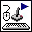

<!-- Generated by tools/export_studio_help.py; edit the reviewed source metadata, then regenerate. -->
# Acquire Input Data.vi

[Connectivity functions](../index.md) · [All functions](../../index.md)

Acquires joystick, keyboard or mouse state using the instance selected by the initialized device reference.

## Studio authoring profile

Contract status: **partial**. The connector below describes Studio authoring; execution availability is stated separately.

## IN — inputs

| Displayed terminal / internal ID | Accepted / resolved type | Studio connection | Unwired input default | Meaning |
| --- | --- | --- | --- | --- |
| device ID `device_id` | `ref<connectivity.input_device.joystick>` | Recommended; NI flag unverified | Not specified | DLL refnum identifying the initialized input device used by this instance. |
| error in `error_in` | `cluster<status:bool,code:i32,source:string>` | Recommended; NI flag unverified | `no error` | Error conditions received before this node; the shared status, code and source cluster is preserved. |

A default is shown only for an input with an explicitly documented value. Preview/default *types* do not imply unwired operand values. If helper and binding flags differ, both are labelled.

## OUT — outputs

| Displayed terminal / internal ID | Accepted / resolved type | Studio connection | Unwired input default | Meaning |
| --- | --- | --- | --- | --- |
| device ID `device_id_out` | `ref<connectivity.input_device.joystick>` | Recommended; NI flag unverified | — | DLL refnum identifying the initialized input device used by this instance. |
| axis info `axis_info` | `cluster<x_axis:i32,y_axis:i32,z_axis:i32,x_axis_rotation:i32,y_axis_rotation:i32,z_axis_rotation:i32,u_axis:i32,v_axis:i32>` | Recommended; NI flag unverified | — | Ordered axis measurements for the selected input device; every axis retains its signed I32 representation. |
| button info `button_info` | `cluster<button_1:bool,button_2:bool,button_3:bool,button_4:bool,button_5:bool,button_6:bool,button_7:bool,button_8:bool,button_9:bool,button_10:bool,button_11:bool,button_12:bool,button_13:bool,button_14:bool,button_15:bool,button_16:bool,button_17:bool,button_18:bool,button_19:bool,button_20:bool,button_21:bool,button_22:bool,button_23:bool,button_24:bool,button_25:bool,button_26:bool,button_27:bool,button_28:bool,button_29:bool,button_30:bool,button_31:bool,button_32:bool>` | Recommended; NI flag unverified | — | Ordered Boolean button states for the selected input device; true indicates a pressed button. |
| direction info `direction_info` | `cluster<pov_1:i32,pov_2:i32,pov_3:i32,pov_4:i32>` | Recommended; NI flag unverified | — | Four signed I32 point-of-view values for the initialized joystick. |
| error out `error_out` | `cluster<status:bool,code:i32,source:string>` | Recommended; NI flag unverified | — | Error information from this node using the shared status, code and source cluster. |

A default is shown only for an input with an explicitly documented value. Preview/default *types* do not imply unwired operand values. If helper and binding flags differ, both are labelled.

## Types and connection rules

- Type resolution: `custom_resolver`; result expression: `resolve:frog.studio.connectivity.type-resolution@1`.
- Implicit coercion: not enabled by this resolver; individual port policies remain explicit.
- Arrays: not accepted; lifting policy: `none`.

Only declared array types and ranks are accepted; no implicit scalar lifting.

**Input count:** 2; this contract does not enable variadic inputs.

## Configured connector instances

The selected instance supplies its own connector. Requirements and defaults are not borrowed from a different instance.

### joystickAcquire VI

Instance: `joystick`.

| Direction | Terminal / ID | Type | Requirement evidence | Default |
| --- | --- | --- | --- | --- |
| INPUT | device ID `device_id` | `ref<connectivity.input_device.joystick>` | unverified | Not specified |
| INPUT | error in `error_in` | `cluster<status:bool,code:i32,source:string>` | unverified | `no error` |
| OUTPUT | device ID `device_id_out` | `ref<connectivity.input_device.joystick>` | unverified | Not specified |
| OUTPUT | axis info `axis_info` | `cluster<x_axis:i32,y_axis:i32,z_axis:i32,x_axis_rotation:i32,y_axis_rotation:i32,z_axis_rotation:i32,u_axis:i32,v_axis:i32>` | unverified | Not specified |
| OUTPUT | button info `button_info` | `cluster<button_1:bool,button_2:bool,button_3:bool,button_4:bool,button_5:bool,button_6:bool,button_7:bool,button_8:bool,button_9:bool,button_10:bool,button_11:bool,button_12:bool,button_13:bool,button_14:bool,button_15:bool,button_16:bool,button_17:bool,button_18:bool,button_19:bool,button_20:bool,button_21:bool,button_22:bool,button_23:bool,button_24:bool,button_25:bool,button_26:bool,button_27:bool,button_28:bool,button_29:bool,button_30:bool,button_31:bool,button_32:bool>` | unverified | Not specified |
| OUTPUT | direction info `direction_info` | `cluster<pov_1:i32,pov_2:i32,pov_3:i32,pov_4:i32>` | unverified | Not specified |
| OUTPUT | error out `error_out` | `cluster<status:bool,code:i32,source:string>` | unverified | Not specified |

### keyboardAcquire VI

Instance: `keyboard`.

| Direction | Terminal / ID | Type | Requirement evidence | Default |
| --- | --- | --- | --- | --- |
| INPUT | device ID `device_id` | `ref<connectivity.input_device.keyboard>` | unverified | Not specified |
| INPUT | error in `error_in` | `cluster<status:bool,code:i32,source:string>` | unverified | `no error` |
| OUTPUT | device ID `device_id_out` | `ref<connectivity.input_device.keyboard>` | unverified | Not specified |
| OUTPUT | keys pressed `keys_pressed` | `unresolved:NI enum terminal icon establishes enum identity, but its integer representation is not exposed` | unverified | Not specified |
| OUTPUT | error out `error_out` | `cluster<status:bool,code:i32,source:string>` | unverified | Not specified |

### mouseAcquire VI

Instance: `mouse`.

| Direction | Terminal / ID | Type | Requirement evidence | Default |
| --- | --- | --- | --- | --- |
| INPUT | device ID `device_id` | `ref<connectivity.input_device.mouse>` | unverified | Not specified |
| INPUT | key mode `key_mode` | `unresolved:NI enum terminal icon establishes enum identity, but its integer representation is not exposed` | unverified | Not specified |
| INPUT | error in `error_in` | `cluster<status:bool,code:i32,source:string>` | unverified | `no error` |
| OUTPUT | device ID `device_id_out` | `ref<connectivity.input_device.mouse>` | unverified | Not specified |
| OUTPUT | axis info `axis_info` | `cluster<horizontal:i32,vertical:i32,scrolling:i32>` | unverified | Not specified |
| OUTPUT | button info `button_info` | `cluster<button_1:bool,button_2:bool,button_3:bool,button_4:bool>` | unverified | Not specified |
| OUTPUT | error out `error_out` | `cluster<status:bool,code:i32,source:string>` | unverified | Not specified |

## Execution and limits

**Public FROG / target Runtime:** not declared available by this authoring contract.

Scope: `requires_explicit_target_capability`.

Required provider: `frog.studio.connectivity`.

Authoring only; no new function runtime is implemented.

**Authoring/target contract limits:**

- Connectivity execution and FIR lowering require an explicit provider.
- NI page does not specify Required/Recommended/Optional flags; these remain unverified.

Connector type defaults and persistence aliases

| Direction | ID | Preview/default type | Connection policy | Cardinality | Legacy port IDs |
| --- | --- | --- | --- | --- | --- |
| INPUT | `device_id` | `ref<connectivity.input_device.joystick>` | `exact` | `single` | — |
| INPUT | `error_in` | `cluster<status:bool,code:i32,source:string>` | `exact` | `single` | — |
| OUTPUT | `device_id_out` | `ref<connectivity.input_device.joystick>` | `exact` | `single` | — |
| OUTPUT | `axis_info` | `cluster<x_axis:i32,y_axis:i32,z_axis:i32,x_axis_rotation:i32,y_axis_rotation:i32,z_axis_rotation:i32,u_axis:i32,v_axis:i32>` | `exact` | `single` | — |
| OUTPUT | `button_info` | `cluster<button_1:bool,button_2:bool,button_3:bool,button_4:bool,button_5:bool,button_6:bool,button_7:bool,button_8:bool,button_9:bool,button_10:bool,button_11:bool,button_12:bool,button_13:bool,button_14:bool,button_15:bool,button_16:bool,button_17:bool,button_18:bool,button_19:bool,button_20:bool,button_21:bool,button_22:bool,button_23:bool,button_24:bool,button_25:bool,button_26:bool,button_27:bool,button_28:bool,button_29:bool,button_30:bool,button_31:bool,button_32:bool>` | `exact` | `single` | — |
| OUTPUT | `direction_info` | `cluster<pov_1:i32,pov_2:i32,pov_3:i32,pov_4:i32>` | `exact` | `single` | — |
| OUTPUT | `error_out` | `cluster<status:bool,code:i32,source:string>` | `exact` | `single` | — |

## Examples

No example for this object is currently declared in the shared index. [Browse the available examples](../../../examples/index.md).

## Identity and references

- Catalogue ID: `connectivity.input_device.acquire_input_data`.
- Parent palette: [Input Device Control](../input_device.md).
- Profile: `frog.studio.connectivity.input_device.acquire_input_data.v1`.
- Definition: `frog.studio.connectivity.input_device.acquire_input_data`.
- [NI API reference](https://www.ni.com/docs/en-US/bundle/labview-api-ref/page/vi-lib/utility/inputdevices-llb/joystickacquire-vi.html).

NI links are reference sources for the connector model; Studio support is limited to the profile above. [Reference provenance and notation](../../index.md#provenance-and-notation).
