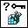

<!-- Generated by tools/export_studio_help.py; edit the reviewed source metadata, then regenerate. -->
# Query Registry Key Info.vi

[Connectivity functions](../index.md) · [All functions](../../index.md)

Returns the key class and separate I32 value-information and subkey-information clusters.

## Studio authoring profile

Contract status: **partial**. The connector below describes Studio authoring; execution availability is stated separately.

## IN — inputs

| Displayed terminal / internal ID | Accepted / resolved type | Studio connection | Unwired input default | Meaning |
| --- | --- | --- | --- | --- |
| refnum `refnum` | `ref<connectivity.registry.key>` | Recommended; NI flag unverified | Not specified | DLL refnum identifying the open registry key used by this operation. |
| error in `error_in` | `cluster<status:bool,code:i32,source:string>` | Recommended; NI flag unverified | `no error` | Error conditions received before this node; the shared status, code and source cluster is preserved. |

A default is shown only for an input with an explicitly documented value. Preview/default *types* do not imply unwired operand values. If helper and binding flags differ, both are labelled.

## OUT — outputs

| Displayed terminal / internal ID | Accepted / resolved type | Studio connection | Unwired input default | Meaning |
| --- | --- | --- | --- | --- |
| refnum out `refnum_out` | `ref<connectivity.registry.key>` | Recommended; NI flag unverified | — | The open registry key refnum forwarded by this operation. |
| class `class` | `string` | Recommended; NI flag unverified | — | Class string associated with the Windows registry key. |
| value info `value_info` | `cluster<num_values:i32,max_value_name_len:i32,max_value_data_len:i32>` | Recommended; NI flag unverified | — | Ordered I32 fields: numValues, maxValueNameLen and maxValueDataLen for the referenced registry key. |
| error out `error_out` | `cluster<status:bool,code:i32,source:string>` | Recommended; NI flag unverified | — | Error information from this node using the shared status, code and source cluster. |
| subkey info `subkey_info` | `cluster<num_sub_keys:i32,max_sub_key_len:i32,max_sub_key_class_len:i32>` | Recommended; NI flag unverified | — | Ordered I32 fields: numSubKeys, maxSubKeyLen and maxSubKeyClassLen for the referenced registry key. |

A default is shown only for an input with an explicitly documented value. Preview/default *types* do not imply unwired operand values. If helper and binding flags differ, both are labelled.

## Types and connection rules

- Type resolution: `custom_resolver`; result expression: `resolve:frog.studio.connectivity.type-resolution@1`.
- Implicit coercion: not enabled by this resolver; individual port policies remain explicit.
- Arrays: not accepted; lifting policy: `none`.

Only declared array types and ranks are accepted; no implicit scalar lifting.

**Input count:** 2; this contract does not enable variadic inputs.

## Execution and limits

**Public FROG / target Runtime:** not declared available by this authoring contract.

Scope: `requires_explicit_target_capability`.

Required provider: `frog.studio.connectivity`.

Authoring only; no new function runtime is implemented.

**Authoring/target contract limits:**

- Connectivity execution and FIR lowering require an explicit provider.
- NI page does not specify Required/Recommended/Optional flags; these remain unverified.

Connector type defaults and persistence aliases

| Direction | ID | Preview/default type | Connection policy | Cardinality | Legacy port IDs |
| --- | --- | --- | --- | --- | --- |
| INPUT | `refnum` | `ref<connectivity.registry.key>` | `exact` | `single` | — |
| INPUT | `error_in` | `cluster<status:bool,code:i32,source:string>` | `exact` | `single` | — |
| OUTPUT | `refnum_out` | `ref<connectivity.registry.key>` | `exact` | `single` | — |
| OUTPUT | `class` | `string` | `exact` | `single` | — |
| OUTPUT | `value_info` | `cluster<num_values:i32,max_value_name_len:i32,max_value_data_len:i32>` | `exact` | `single` | — |
| OUTPUT | `error_out` | `cluster<status:bool,code:i32,source:string>` | `exact` | `single` | — |
| OUTPUT | `subkey_info` | `cluster<num_sub_keys:i32,max_sub_key_len:i32,max_sub_key_class_len:i32>` | `exact` | `single` | — |

## Identity and references

- Catalogue ID: `connectivity.registry.query_key_info`.
- Parent palette: [Windows Registry Access VIs](../registry.md).
- Profile: `frog.studio.connectivity.registry.query_key_info.v1`.
- Definition: `frog.studio.connectivity.registry.query_key_info`.
- [NI API reference](https://www.ni.com/docs/en-US/bundle/labview-api-ref/page/vi-lib/registry/registry-llb/query-registry-key-info-vi.html).

NI links are reference sources for the connector model; Studio support is limited to the profile above. [Reference provenance and notation](../../index.md#provenance-and-notation).
