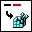

<!-- Generated by tools/export_studio_help.py; edit the reviewed source metadata, then regenerate. -->
# Write Registry Value Simple.vi

[Connectivity functions](../index.md) · [All functions](../../index.md)

Writes string/binary or U32 DWORD data to a named registry value using the verified write connector.

## Studio authoring profile

Contract status: **partial**. The connector below describes Studio authoring; execution availability is stated separately.

## IN — inputs

| Displayed terminal / internal ID | Accepted / resolved type | Studio connection | Unwired input default | Meaning |
| --- | --- | --- | --- | --- |
| String/Binary data `string_binary_data` | `string` | Recommended; NI flag unverified | Not specified | String or binary registry data represented as a LabVIEW string for this instance. |
| refnum `refnum` | `ref<connectivity.registry.key>` | Recommended; NI flag unverified | Not specified | DLL refnum identifying the open registry key used by this operation. |
| value `value` | `string` | Recommended; NI flag unverified | Not specified | Name of the registry value to read, write or delete under the referenced key. |
| simple data type `simple_data_type` | `unknown` | Recommended; NI flag unverified | Not specified | Simplified Windows registry type associated with the value being read or written. |
| error in `error_in` | `cluster<status:bool,code:i32,source:string>` | Recommended; NI flag unverified | `no error` | Error conditions received before this node; the shared status, code and source cluster is preserved. |

A default is shown only for an input with an explicitly documented value. Preview/default *types* do not imply unwired operand values. If helper and binding flags differ, both are labelled.

## OUT — outputs

| Displayed terminal / internal ID | Accepted / resolved type | Studio connection | Unwired input default | Meaning |
| --- | --- | --- | --- | --- |
| refnum out `refnum_out` | `ref<connectivity.registry.key>` | Recommended; NI flag unverified | — | The open registry key refnum forwarded by this operation. |
| error out `error_out` | `cluster<status:bool,code:i32,source:string>` | Recommended; NI flag unverified | — | Error information from this node using the shared status, code and source cluster. |

A default is shown only for an input with an explicitly documented value. Preview/default *types* do not imply unwired operand values. If helper and binding flags differ, both are labelled.

## Types and connection rules

- Type resolution: `custom_resolver`; result expression: `resolve:frog.studio.connectivity.type-resolution@1`.
- Implicit coercion: not enabled by this resolver; individual port policies remain explicit.
- Arrays: not accepted; lifting policy: `none`.

Only declared array types and ranks are accepted; no implicit scalar lifting.

**Input count:** 5; this contract does not enable variadic inputs.

## Configured connector instances

The selected instance supplies its own connector. Requirements and defaults are not borrowed from a different instance.

### Write Registry Value Simple STR

Instance: `str`.

| Direction | Terminal / ID | Type | Requirement evidence | Default |
| --- | --- | --- | --- | --- |
| INPUT | String/Binary data `string_binary_data` | `string` | unverified | Not specified |
| INPUT | refnum `refnum` | `ref<connectivity.registry.key>` | unverified | Not specified |
| INPUT | value `value` | `string` | unverified | Not specified |
| INPUT | simple data type `simple_data_type` | `unresolved:NI enum terminal icon establishes enum identity, but its integer representation is not exposed` | unverified | Not specified |
| INPUT | error in `error_in` | `cluster<status:bool,code:i32,source:string>` | unverified | `no error` |
| OUTPUT | refnum out `refnum_out` | `ref<connectivity.registry.key>` | unverified | Not specified |
| OUTPUT | error out `error_out` | `cluster<status:bool,code:i32,source:string>` | unverified | Not specified |

### Write Registry Value Simple U32 VI

Instance: `u32`.

| Direction | Terminal / ID | Type | Requirement evidence | Default |
| --- | --- | --- | --- | --- |
| INPUT | DWORD data `dword_data` | `u32` | unverified | Not specified |
| INPUT | refnum `refnum` | `ref<connectivity.registry.key>` | unverified | Not specified |
| INPUT | value `value` | `string` | unverified | Not specified |
| INPUT | simple data type `simple_data_type` | `unresolved:NI enum terminal icon establishes enum identity, but its integer representation is not exposed` | unverified | Not specified |
| INPUT | error in `error_in` | `cluster<status:bool,code:i32,source:string>` | unverified | `no error` |
| OUTPUT | refnum out `refnum_out` | `ref<connectivity.registry.key>` | unverified | Not specified |
| OUTPUT | error out `error_out` | `cluster<status:bool,code:i32,source:string>` | unverified | Not specified |

## Execution and limits

**Public FROG / target Runtime:** not declared available by this authoring contract.

Scope: `requires_explicit_target_capability`.

Required provider: `frog.studio.connectivity`.

Authoring only; no new function runtime is implemented.

**Authoring/target contract limits:**

- Connectivity execution and FIR lowering require an explicit provider.
- NI page does not specify Required/Recommended/Optional flags; these remain unverified.
- Enum labels/values are preserved when documented, but integer representation requires VI/type metadata and is not guessed from cenum/ienum icons.

Connector type defaults and persistence aliases

| Direction | ID | Preview/default type | Connection policy | Cardinality | Legacy port IDs |
| --- | --- | --- | --- | --- | --- |
| INPUT | `string_binary_data` | `string` | `exact` | `single` | — |
| INPUT | `refnum` | `ref<connectivity.registry.key>` | `exact` | `single` | — |
| INPUT | `value` | `string` | `exact` | `single` | — |
| INPUT | `simple_data_type` | `unknown` | `exact` | `single` | — |
| INPUT | `error_in` | `cluster<status:bool,code:i32,source:string>` | `exact` | `single` | — |
| OUTPUT | `refnum_out` | `ref<connectivity.registry.key>` | `exact` | `single` | — |
| OUTPUT | `error_out` | `cluster<status:bool,code:i32,source:string>` | `exact` | `single` | — |

## Identity and references

- Catalogue ID: `connectivity.registry.write_value_simple`.
- Parent palette: [Windows Registry Access VIs](../registry.md).
- Profile: `frog.studio.connectivity.registry.write_value_simple.v1`.
- Definition: `frog.studio.connectivity.registry.write_value_simple`.
- [NI API reference](https://www.ni.com/docs/en-US/bundle/labview-api-ref/page/vi-lib/registry/registry-llb/write-registry-value-simple-str-vi.html).

NI links are reference sources for the connector model; Studio support is limited to the profile above. [Reference provenance and notation](../../index.md#provenance-and-notation).
