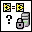

<!-- Generated by tools/export_studio_help.py; edit the reviewed source metadata, then regenerate. -->
# SCC Compare VIs.vi

[Connectivity functions](../index.md) · [All functions](../../index.md)

Compares a local VI with its source controlled version using LabVIEW VI comparison options.

## Studio authoring profile

Contract status: **partial**. The connector below describes Studio authoring; execution availability is stated separately.

## IN — inputs

| Displayed terminal / internal ID | Accepted / resolved type | Studio connection | Unwired input default | Meaning |
| --- | --- | --- | --- | --- |
| source control reference in `source_control_reference_in` | `ref<connectivity.source_control>` | Recommended; NI flag unverified | Not specified | Identifies the source control project opened by SCC Open SCC Project. |
| VI path `vi_path` | `path` | Recommended; NI flag unverified | Not specified | Path of the local VI compared with its source controlled version. |
| compare options `compare_options` | `cluster<"VI Attributes":bool,"Front Panel":bool,"FP position/size":bool,"Block Diagram":bool,"BD cosmetic":bool,"BD position/size":bool>` | Recommended; NI flag unverified | `{"VI Attributes":false,"Front Panel":true,"FP position/size":false,"Block Diagram":true,"BD cosmetic":false,"BD position/size":false}` | Named Boolean controls governing the selected comparison. |
| error in `error_in` | `cluster<status:bool,code:i32,source:string>` | Recommended; NI flag unverified | `{status:false,code:0,source:""}` | Carries error information from earlier diagram operations. |
| interactive? `interactive` | `bool` | Recommended; NI flag unverified | `false` | Selects visual interactive comparison instead of a silent status result. |
| version `version` | `string` | Recommended; NI flag unverified | Not specified | Provider-specific version to compare; empty text selects the latest version. |

A default is shown only for an input with an explicitly documented value. Preview/default *types* do not imply unwired operand values. If helper and binding flags differ, both are labelled.

## OUT — outputs

| Displayed terminal / internal ID | Accepted / resolved type | Studio connection | Unwired input default | Meaning |
| --- | --- | --- | --- | --- |
| file differs? `file_differs` | `bool` | Recommended; NI flag unverified | — | Indicates that the local file or VI differs from its source controlled version. |
| source control reference out `source_control_reference_out` | `ref<connectivity.source_control>` | Recommended; NI flag unverified | — | Returns the source control project reference for later SCC operations. |
| status message `status_message` | `string` | Recommended; NI flag unverified | — | Returns provider-specific information about this source control operation. |
| error out `error_out` | `cluster<status:bool,code:i32,source:string>` | Recommended; NI flag unverified | — | Returns error status, numeric code and source text. |

A default is shown only for an input with an explicitly documented value. Preview/default *types* do not imply unwired operand values. If helper and binding flags differ, both are labelled.

## Types and connection rules

- Type resolution: `custom_resolver`; result expression: `resolve:frog.studio.connectivity.type-resolution@1`.
- Implicit coercion: not enabled by this resolver; individual port policies remain explicit.
- Arrays: not accepted; lifting policy: `none`.

Only declared array types and ranks are accepted; no implicit scalar lifting.

**Input count:** 6; this contract does not enable variadic inputs.

## Configured connector instances

The selected instance supplies its own connector. Requirements and defaults are not borrowed from a different instance.

### NI documented optional terminals

Instance: `documented_optional`.

| Direction | Terminal / ID | Type | Requirement evidence | Default |
| --- | --- | --- | --- | --- |
| INPUT | application reference `application_reference` | `ref<connectivity.source_control.application>` | unverified | Not specified |
| INPUT | source control reference in `source_control_reference_in` | `ref<connectivity.source_control>` | unverified | Not specified |
| INPUT | VI path `vi_path` | `path` | unverified | Not specified |
| INPUT | compare options `compare_options` | `cluster<"VI Attributes":bool,"Front Panel":bool,"FP position/size":bool,"Block Diagram":bool,"BD cosmetic":bool,"BD position/size":bool>` | unverified | `{"VI Attributes":false,"Front Panel":true,"FP position/size":false,"Block Diagram":true,"BD cosmetic":false,"BD position/size":false}` |
| INPUT | error in `error_in` | `cluster<status:bool,code:i32,source:string>` | unverified | `{status:false,code:0,source:""}` |
| INPUT | interactive? `interactive` | `bool` | unverified | `false` |
| INPUT | version `version` | `string` | unverified | Not specified |
| OUTPUT | file differs? `file_differs` | `bool` | unverified | Not specified |
| OUTPUT | source control reference out `source_control_reference_out` | `ref<connectivity.source_control>` | unverified | Not specified |
| OUTPUT | status message `status_message` | `string` | unverified | Not specified |
| OUTPUT | error out `error_out` | `cluster<status:bool,code:i32,source:string>` | unverified | Not specified |

## Execution and limits

**Public FROG / target Runtime:** not declared available by this authoring contract.

Scope: `requires_explicit_target_capability`.

Required provider: `frog.studio.connectivity`.

Authoring only; no new function runtime is implemented.

**Authoring/target contract limits:**

- Connectivity execution and FIR lowering require an explicit provider.
- Required/recommended/optional typography and connector indices have not yet been matched to a titled video frame.
- Optional NI terminals omitted from the filmed simple help are retained only in the documented optional-terminal instance.
- Its exact NI connector and six-field Boolean compare-options cluster are documented, but no titled help frame was obtained in the supplied video. It is not the SCC Compare Files contract.

Connector type defaults and persistence aliases

| Direction | ID | Preview/default type | Connection policy | Cardinality | Legacy port IDs |
| --- | --- | --- | --- | --- | --- |
| INPUT | `source_control_reference_in` | `ref<connectivity.source_control>` | `exact` | `single` | — |
| INPUT | `vi_path` | `path` | `exact` | `single` | — |
| INPUT | `compare_options` | `cluster<"VI Attributes":bool,"Front Panel":bool,"FP position/size":bool,"Block Diagram":bool,"BD cosmetic":bool,"BD position/size":bool>` | `exact` | `single` | — |
| INPUT | `error_in` | `cluster<status:bool,code:i32,source:string>` | `exact` | `single` | — |
| INPUT | `interactive` | `bool` | `exact` | `single` | — |
| INPUT | `version` | `string` | `exact` | `single` | — |
| OUTPUT | `file_differs` | `bool` | `exact` | `single` | — |
| OUTPUT | `source_control_reference_out` | `ref<connectivity.source_control>` | `exact` | `single` | — |
| OUTPUT | `status_message` | `string` | `exact` | `single` | — |
| OUTPUT | `error_out` | `cluster<status:bool,code:i32,source:string>` | `exact` | `single` | — |

## Examples

No example for this object is currently declared in the shared index. [Browse the available examples](../../../examples/index.md).

## Identity and references

- Catalogue ID: `connectivity.source_control.compare_vis`.
- Parent palette: [Source Control](../source_control.md).
- Profile: `frog.studio.connectivity.source_control.compare_vis.v1`.
- Definition: `frog.studio.connectivity.source_control.compare_vis`.
- [NI API reference](https://www.ni.com/docs/en-US/bundle/labview-api-ref/page/vi-lib/sourcecontrol/sccapi/scc-compare-vis-vi.html).

NI links are reference sources for the connector model; Studio support is limited to the profile above. [Reference provenance and notation](../../index.md#provenance-and-notation).
