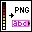

<!-- Generated by tools/export_studio_help.py; edit the reviewed source metadata, then regenerate. -->
# LV Image to PNG Data.vi

[Connectivity functions](../../index.md) · [All functions](../../../index.md)

Encodes the LabVIEW image data cluster as a binary PNG buffer.

## Studio authoring profile

Contract status: **partial**. The connector below describes Studio authoring; execution availability is stated separately.

## IN — inputs

| Displayed terminal / internal ID | Accepted / resolved type | Studio connection | Unwired input default | Meaning |
| --- | --- | --- | --- | --- |
| compression `compression` | `i32` | Recommended | Not specified | PNG compression level from -1 through 9; -1 balances compression and speed. |
| image data `image_data` | `cluster<"image type":i32,"image depth":i32,image:array<u8,rank=1>,mask:array<u8,rank=1>,colors:array<u32,rank=1>,Rectangle:cluster<left:i16,top:i16,right:i16,bottom:i16>>` | Required | Not specified | LabVIEW image cluster with pixel data, transparency mask, palette and bounding rectangle. |
| error in `error_in` | `cluster<status:bool,code:i32,source:string>` | Recommended | `{status:false,code:0,source:""}` | Carries error information from earlier diagram operations. |

A default is shown only for an input with an explicitly documented value. Preview/default *types* do not imply unwired operand values. If helper and binding flags differ, both are labelled.

## OUT — outputs

| Displayed terminal / internal ID | Accepted / resolved type | Studio connection | Unwired input default | Meaning |
| --- | --- | --- | --- | --- |
| png data `png_data` | `string` | Recommended | — | Binary PNG file data carried as a LabVIEW string. |
| error out `error_out` | `cluster<status:bool,code:i32,source:string>` | Recommended | — | Returns error status, numeric code and source text. |

A default is shown only for an input with an explicitly documented value. Preview/default *types* do not imply unwired operand values. If helper and binding flags differ, both are labelled.

## Types and connection rules

- Type resolution: `custom_resolver`; result expression: `resolve:frog.studio.connectivity.type-resolution@1`.
- Implicit coercion: not enabled by this resolver; individual port policies remain explicit.
- Arrays: not accepted; lifting policy: `none`.

Only declared array types and ranks are accepted; no implicit scalar lifting.

**Input count:** 3; this contract does not enable variadic inputs.

## Execution and limits

**Public FROG / target Runtime:** not declared available by this authoring contract.

Scope: `requires_explicit_target_capability`.

Required provider: `frog.studio.connectivity`.

Authoring only; no new function runtime is implemented.

**Authoring/target contract limits:**

- Connectivity execution and FIR lowering require an explicit provider.
- The filmed compression default label is none, while the NI table calls -1 the default. No numeric default is certified from these conflicting sources.

Connector type defaults and persistence aliases

| Direction | ID | Preview/default type | Connection policy | Cardinality | Legacy port IDs |
| --- | --- | --- | --- | --- | --- |
| INPUT | `compression` | `i32` | `exact` | `single` | — |
| INPUT | `image_data` | `cluster<"image type":i32,"image depth":i32,image:array<u8,rank=1>,mask:array<u8,rank=1>,colors:array<u32,rank=1>,Rectangle:cluster<left:i16,top:i16,right:i16,bottom:i16>>` | `exact` | `single` | — |
| INPUT | `error_in` | `cluster<status:bool,code:i32,source:string>` | `exact` | `single` | — |
| OUTPUT | `png_data` | `string` | `exact` | `single` | — |
| OUTPUT | `error_out` | `cluster<status:bool,code:i32,source:string>` | `exact` | `single` | — |

## Identity and references

- Catalogue ID: `connectivity.web_services.conversion.image_to_png`.
- Parent palette: [Conversion](../conversion.md).
- Profile: `frog.studio.connectivity.web_services.conversion.image_to_png.v1`.
- Definition: `frog.studio.connectivity.web_services.conversion.image_to_png`.
- [NI API reference](https://www.ni.com/docs/en-US/bundle/labview-api-ref/page/vi-lib/wsapi/vis/lv-image-to-png-data-vi.html).

NI links are reference sources for the connector model; Studio support is limited to the profile above. [Reference provenance and notation](../../../index.md#provenance-and-notation).
