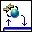

<!-- Generated by tools/export_studio_help.py; edit the reviewed source metadata, then regenerate. -->
# Set HTTP Redirect.vi

[Connectivity functions](../../index.md) · [All functions](../../../index.md)

Sets an HTTP redirect for the current streaming response.

## Studio authoring profile

Contract status: **partial**. The connector below describes Studio authoring; execution availability is stated separately.

## IN — inputs

| Displayed terminal / internal ID | Accepted / resolved type | Studio connection | Unwired input default | Meaning |
| --- | --- | --- | --- | --- |
| LabVIEW Web Service Request `labview_web_service_request` | `ref<connectivity.web_service_request>` | Required | Not specified | Identifies the HTTP request processed by this VI. |
| redirect URL `redirect_url` | `string` | Required | Not specified | Destination URL placed in the HTTP redirect response. |
| error in `error_in` | `cluster<status:bool,code:i32,source:string>` | Recommended | `{status:false,code:0,source:""}` | Carries error information from earlier diagram operations. |

A default is shown only for an input with an explicitly documented value. Preview/default *types* do not imply unwired operand values. If helper and binding flags differ, both are labelled.

## OUT — outputs

| Displayed terminal / internal ID | Accepted / resolved type | Studio connection | Unwired input default | Meaning |
| --- | --- | --- | --- | --- |
| LabVIEW Web Service Request out `labview_web_service_request_out` | `ref<connectivity.web_service_request>` | Recommended | — | Preserves the request identity for subsequent Web Services VIs. |
| error out `error_out` | `cluster<status:bool,code:i32,source:string>` | Recommended | — | Returns error status, numeric code and source text. |

A default is shown only for an input with an explicitly documented value. Preview/default *types* do not imply unwired operand values. If helper and binding flags differ, both are labelled.

## Types and connection rules

- Type resolution: `custom_resolver`; result expression: `resolve:frog.studio.connectivity.type-resolution@1`.
- Implicit coercion: not enabled by this resolver; individual port policies remain explicit.
- Arrays: not accepted; lifting policy: `none`.

Only declared array types and ranks are accepted; no implicit scalar lifting.

**Input count:** 3; this contract does not enable variadic inputs.

## Configured connector instances

The selected instance supplies its own connector. Requirements and defaults are not borrowed from a different instance.

### NI documented optional terminals

Instance: `documented_optional`.

| Direction | Terminal / ID | Type | Requirement evidence | Default |
| --- | --- | --- | --- | --- |
| INPUT | LabVIEW Web Service Request `labview_web_service_request` | `ref<connectivity.web_service_request>` | required | Not specified |
| INPUT | redirect URL `redirect_url` | `string` | required | Not specified |
| INPUT | response code `response_code` | `i32` | optional | `307` |
| INPUT | error in `error_in` | `cluster<status:bool,code:i32,source:string>` | recommended | `{status:false,code:0,source:""}` |
| OUTPUT | LabVIEW Web Service Request out `labview_web_service_request_out` | `ref<connectivity.web_service_request>` | recommended | Not specified |
| OUTPUT | error out `error_out` | `cluster<status:bool,code:i32,source:string>` | recommended | Not specified |

## Execution and limits

**Public FROG / target Runtime:** not declared available by this authoring contract.

Scope: `requires_explicit_target_capability`.

Required provider: `frog.studio.connectivity`.

Authoring only; no new function runtime is implemented.

**Authoring/target contract limits:**

- Connectivity execution and FIR lowering require an explicit provider.
- Optional NI terminals omitted from the filmed simple help are retained only in the documented optional-terminal instance.

Connector type defaults and persistence aliases

| Direction | ID | Preview/default type | Connection policy | Cardinality | Legacy port IDs |
| --- | --- | --- | --- | --- | --- |
| INPUT | `labview_web_service_request` | `ref<connectivity.web_service_request>` | `exact` | `single` | — |
| INPUT | `redirect_url` | `string` | `exact` | `single` | — |
| INPUT | `error_in` | `cluster<status:bool,code:i32,source:string>` | `exact` | `single` | — |
| OUTPUT | `labview_web_service_request_out` | `ref<connectivity.web_service_request>` | `exact` | `single` | — |
| OUTPUT | `error_out` | `cluster<status:bool,code:i32,source:string>` | `exact` | `single` | — |

## Identity and references

- Catalogue ID: `connectivity.web_services.output.set_redirect`.
- Parent palette: [Output](../output.md).
- Profile: `frog.studio.connectivity.web_services.output.set_redirect.v1`.
- Definition: `frog.studio.connectivity.web_services.output.set_redirect`.
- [NI API reference](https://www.ni.com/docs/en-US/bundle/labview-api-ref/page/vi-lib/wsapi/class/set-http-redirect-vi.html).

NI links are reference sources for the connector model; Studio support is limited to the profile above. [Reference provenance and notation](../../../index.md#provenance-and-notation).
