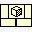

<!-- Generated by tools/export_studio_help.py; edit the reviewed source metadata, then regenerate. -->
# .NET Reference

[Connectivity functions](../connectivity/index.md) · [All functions](../index.md)

Authors a typed null .NET reference constant. The selected CLR class is resolved from the saved configuration and inspected assembly metadata; this constant does not construct an instance.

## Studio authoring profile

Contract status: **partial**. The connector below describes Studio authoring; execution availability is stated separately.

## IN — inputs

No fixed inputs are declared in this binding profile. No connector is invented here.

## OUT — outputs

| Displayed terminal / internal ID | Accepted / resolved type | Studio connection | Unwired input default | Meaning |
| --- | --- | --- | --- | --- |
| reference `reference` | `ref<connectivity.dotnet.object>` | Recommended | — | — |

A default is shown only for an input with an explicitly documented value. Preview/default *types* do not imply unwired operand values. If helper and binding flags differ, both are labelled.

## Types and connection rules

- Type resolution: `custom_resolver`; result expression: `resolve:frog.studio.connectivity.type-resolution@1`.
- Implicit coercion: not enabled by this resolver; individual port policies remain explicit.
- Arrays: not accepted; lifting policy: `none`.

Only declared array types and ranks are accepted; no implicit scalar lifting.

**Input count:** 0; this contract does not enable variadic inputs.

## Execution and limits

**Public FROG / target Runtime:** not declared available by this authoring contract.

Scope: `requires_explicit_target_capability`.

Required provider: `frog.studio.connectivity`.

Authoring only; no new function runtime is implemented.

**Authoring/target contract limits:**

- Normal graph execution and FIR lowering require an explicit .NET target provider.

Connector type defaults and persistence aliases

| Direction | ID | Preview/default type | Connection policy | Cardinality | Legacy port IDs |
| --- | --- | --- | --- | --- | --- |
| OUTPUT | `reference` | `ref<connectivity.dotnet.object>` | `exact` | `single` | — |

## Examples

No example for this object is currently declared in the shared index. [Browse the available examples](../../examples/index.md).

## Identity and references

- Catalogue ID: `dotnet.reference`.
- Profile: `frog.studio.dotnet.reference.v1`.
- Definition: `frog.studio.dotnet.reference`.
- This identity is retained for existing documents and is hidden from new palette placement.

NI links are reference sources for the connector model; Studio support is limited to the profile above. [Reference provenance and notation](../index.md#provenance-and-notation).
