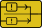

<!-- Generated by tools/export_studio_help.py; edit the reviewed source metadata, then regenerate. -->
# Retain First Error

[Error functions](index.md) · [All functions](../index.md)

Expandable inputs are checked from top to bottom: first error, otherwise first warning, otherwise no error. This is not Multiplex Errors.

## Product execution profiles

The shared index declares native examples for this object; see [the examples below](retain_first.md#examples) and [document profiles and evidence boundaries](../../reference/studio-draft-examples.md). Older binding/help statements retained below can lag those product profiles. They do not establish or deny the separately measured native profiles. An example declaration alone is not an execution result or admission of every overload.

Résumé français de l’aide Studio

**Retenir la première erreur**

Texte historique de l’aide conservé ci-dessous. Des exemples natifs distincts sont déclarés pour cet objet ; consultez les profils et preuves datés, sans déduire une compatibilité universelle de ce texte.

Les entrées déroulables sont examinées de haut en bas : première erreur, sinon première mise en garde, sinon aucune erreur. Cette sélection n’est pas Combiner les erreurs. [Types] Erreur = status:booléen, code:I32, source:chaîne. Pas de traitement implicite des tableaux ; pas de fournisseur runtime dans cette livraison.

## Studio authoring profile

Contract status: **partial**. The connector below describes Studio authoring; execution availability is stated separately.

Retained binding and help description

This is the source declaration, not the current measured product-execution assessment.

Error = status:Boolean, code:I32, source:String. No automatic array lifting; no runtime provider in this delivery.

## IN — inputs

| Displayed terminal / internal ID | Accepted / resolved type | Studio connection | Unwired input default | Meaning |
| --- | --- | --- | --- | --- |
| a `a` | `cluster<status:bool,code:i32,source:string>` | Required (help); Optional (binding) | Not specified | — |
| b `b` | `cluster<status:bool,code:i32,source:string>` | Required (help); Optional (binding) | Not specified | — |

A default is shown only for an input with an explicitly documented value. Preview/default *types* do not imply unwired operand values. If helper and binding flags differ, both are labelled.

## OUT — outputs

| Displayed terminal / internal ID | Accepted / resolved type | Studio connection | Unwired input default | Meaning |
| --- | --- | --- | --- | --- |
| error out `error_out` | `cluster<status:bool,code:i32,source:string>` | Recommended (help); Required (binding) | — | — |

A default is shown only for an input with an explicitly documented value. Preview/default *types* do not imply unwired operand values. If helper and binding flags differ, both are labelled.

Additional input IDs: `input_N`, starting at 3.

## Types and connection rules

Expandable inputs are checked from top to bottom: first error, otherwise first warning, otherwise no error. This is not Multiplex Errors.

- Type resolution: `custom_resolver`; result expression: `resolve:frog.studio.polymorphic.type-resolution@1`.
- Implicit coercion: not enabled by this resolver; individual port policies remain explicit.
- Arrays: not accepted; lifting policy: `none`.

**Expandable inputs:** 2 to 16. Reduction: `first_error_then_warning`.

Port order: `a` → `b` → `input_N_ascending`.

## Execution and limits

**Public FROG / target Runtime:** not declared available by this authoring contract.

Scope: `requires_explicit_target_capability`.

Authoring only; no error propagation, dialog, code lookup or execution provider is implemented here.

Retained authoring-contract limitations

These declarations belong to the binding snapshot. Compare them with the separately admitted native profiles and dated measurements linked above; they are not a current denial of those product profiles.

**Authoring/target contract limits:**

- Runtime execution is not implemented by this authoring profile.

Connector type defaults and persistence aliases

| Direction | ID | Preview/default type | Connection policy | Cardinality | Legacy port IDs |
| --- | --- | --- | --- | --- | --- |
| INPUT | `a` | `cluster<status:bool,code:i32,source:string>` | `exact` | `single` | — |
| INPUT | `b` | `cluster<status:bool,code:i32,source:string>` | `exact` | `single` | — |
| OUTPUT | `error_out` | `cluster<status:bool,code:i32,source:string>` | `exact` | `single` | — |

## Examples

These are real `.frog` documents from the same index used by Studio. Backend names and expected results describe the examples; they are not execution certificates.

- [Retain First Error : une erreur prime sur un warning](../../examples/error.retain_first.error_before_warning.md) — Retain First Error : une erreur prime sur un warning (`execution`, `studio-draft`).
- [Retain First : conserver le premier avertissement en l'absence d'erreur](../../examples/error.retain_first.warning_priority.md) — Retain First : conserver le premier avertissement en l'absence d'erreur (`execution`, `studio-draft`).

## Identity and references

- Catalogue ID: `error.retain_first`.
- Profile: `frog.studio.palette.error.retain_first.v1`.
- Definition: `frog.studio.error.retain_first`.
- [NI API reference](https://www.ni.com/docs/en-US/bundle/labview-nxg-nodes-api-ref/page/merge-errors.html).

NI links are reference sources for the connector model; Studio support is limited to the profile above. [Reference provenance and notation](../index.md#provenance-and-notation).
