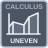

<!-- Generated by tools/export_studio_help.py; edit the reviewed source metadata, then regenerate. -->
# Uneven Numeric Integration

[Mathematics functions](../../mathematics/index.md) · [All functions](../../index.md)

Integrates paired values X and sample positions T by trapezoids after a non-destructive coupled stable sort of T; neither vector is truncated. Real DBL only; exact structured schemas and explicit real numeric promotion. Variants: default.

Résumé français de l’aide Studio

**Uneven Numeric Integration**

Intègre par trapèzes des couples aux abscisses irrégulières après tri associé.

## Studio authoring profile

Contract status: **partial**. The connector below describes Studio authoring; execution availability is stated separately.

## IN — inputs

| Displayed terminal / internal ID | Accepted / resolved type | Studio connection | Unwired input default | Meaning |
| --- | --- | --- | --- | --- |
| X `x` | `array<f64>` | Required | Not specified | — |
| T `t` | `array<f64>` | Required | Not specified | — |

A default is shown only for an input with an explicitly documented value. Preview/default *types* do not imply unwired operand values. If helper and binding flags differ, both are labelled.

## OUT — outputs

| Displayed terminal / internal ID | Accepted / resolved type | Studio connection | Unwired input default | Meaning |
| --- | --- | --- | --- | --- |
| result `result` | `f64` | Recommended | — | — |
| error `error` | `i32` | Recommended | — | — |

A default is shown only for an input with an explicitly documented value. Preview/default *types* do not imply unwired operand values. If helper and binding flags differ, both are labelled.

## Types and Compatibility

The notes below retain the reviewed help's original NI and Studio scopes. An NI overload is not a claim of Studio runtime support; the authoring profile and execution limits remain separate.

Real DBL vectors/matrices, exact I32/U16/Boolean options and typed piecewise-polynomial records; native GS profile.

Notes de types et de compatibilité de l’aide Studio

Les mentions NI et Studio gardent leur portée d’origine. Une variante NI ne constitue pas une déclaration de prise en charge par le runtime Studio ; consultez les profils et limites d’exécution de cette fiche.

Vecteurs/matrices DBL réels, options I32/U16/booléennes et polynômes par morceaux typés ; profil natif GS.

- Type resolution: `custom_resolver`; result expression: `resolve:frog.studio.calculus.type-resolution@1`.
- Implicit coercion: permitted by this profile.
- Arrays: accepted; lifting policy: `none`.
- Shape rule: `calculus_exact_variant_rank_axes_and_signal_schema`.
- Scalar lifting: no.
- Broadcasting: no.

**Input count:** 2; this contract does not enable variadic inputs.

Port order: `x` → `t`.

## Execution and limits

**Public FROG / target Runtime:** declared available within the scope below.

Scope: `requires_explicit_target_capability`.

Implementation: `frog.studio.math.calculus.uneven_numeric_integration.owned.v1`.

Required provider: `frog.studio.math.calculus.owned@1`.

Per selected exact variant; complete-graph target admission and runtime tests remain separate. Time Domain state is private to node/invocation/channel, never global.

Connector type defaults and persistence aliases

| Direction | ID | Preview/default type | Connection policy | Cardinality | Legacy port IDs |
| --- | --- | --- | --- | --- | --- |
| INPUT | `x` | `array<f64>` | `numeric_array_implicit` | `single` | — |
| INPUT | `t` | `array<f64>` | `numeric_array_implicit` | `single` | — |
| OUTPUT | `result` | `f64` | `exact` | `single` | — |
| OUTPUT | `error` | `i32` | `exact` | `single` | — |

## Examples

No example for this object is currently declared in the shared index. [Browse the available examples](../../../examples/index.md).

## Identity and references

- Catalogue ID: `math.calculus.uneven_numeric_integration`.
- Parent palette: [Integration &amp; Differentiation](../../mathematics/integration_differentiation.md).
- Profile: `frog.studio.polymorphic.math.calculus.uneven_numeric_integration.v1`.
- Definition: `frog.studio.math.calculus.uneven_numeric_integration`.
- [NI API reference](https://www.ni.com/docs/en-US/bundle/labview-api-ref/page/vi-lib/analysis/8numeric-llb/uneven-numeric-integration-vi.html).

NI links are reference sources for the connector model; Studio support is limited to the profile above. [Reference provenance and notation](../../index.md#provenance-and-notation).
