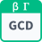

<!-- Generated by tools/export_studio_help.py; edit the reviewed source metadata, then regenerate. -->
# GCD

[Mathematics functions](../../mathematics/index.md) · [All functions](../../index.md)

Computes the nonnegative greatest common divisor of two I32 integers. FROG defines gcd(x,0)=abs(x) and gcd(0,0)=0; a magnitude of 2^31 is an I32 overflow, reported without wraparound or a usable result. Formula: gcd(abs(x),abs(y)). Example: GCD(-48,18)=6; GCD(0,0)=0.

## Product execution profiles

The shared index declares native examples for this object; see [the examples below](gcd.md#examples) and [document profiles and evidence boundaries](../../../reference/studio-draft-examples.md). Older binding/help statements retained below can lag those product profiles. They do not establish or deny the separately measured native profiles. An example declaration alone is not an execution result or admission of every overload.

Résumé français de l’aide Studio

**PGCD**

Texte historique de l’aide conservé ci-dessous. Des exemples natifs distincts sont déclarés pour cet objet ; consultez les profils et preuves datés, sans déduire une compatibilité universelle de ce texte.

Calcule le plus grand commun diviseur non négatif de deux entiers I32. FROG définit PGCD(x,0)=abs(x) et PGCD(0,0)=0 ; une magnitude de 2^31 dépasse I32 et produit un diagnostic sans valeur exploitable ni débordement circulaire. Formule : gcd(abs(x),abs(y)). Exemple : GCD(-48,18)=6; GCD(0,0)=0. [Types] x: i32; y: i32 → gcd: i32. Toutes les entrées sont requises ; arité fixe, sans lifting implicite. NI documente les connecteurs de LabVIEW classique ; FROG précise les limites et entrées requises. Signature NXG non vérifiée.

## Studio authoring profile

Contract status: **partial**. The connector below describes Studio authoring; execution availability is stated separately.

Retained binding and help description

This is the source declaration, not the current measured product-execution assessment.

Computes the nonnegative greatest common divisor of two I32 integers. FROG defines gcd(x,0)=abs(x) and gcd(0,0)=0; a magnitude of 2^31 is an I32 overflow, reported without wraparound or a usable result. Fixed signature only. Required inputs have no implicit unwired value. No automatic polymorphism, element-wise Array/Cluster lifting, scalar broadcasting or truncation of real values to integers. Wire conversions must follow explicit engine type rules; I64 values must not pass through F64. FROG I32 status codes: 0=Ok, 1=Domain, 2=Overflow, 3=Cancelled, 4=WorkLimit. These are not NI codes and not an Error Cluster. Error outputs are present only on Binomial Coefficient and Continued Fraction. The supplied NI references describe classic LabVIEW connector types, not verified NXG signatures. FROG owns required-input choices, boundary conventions and numeric status codes; no bit-for-bit NI equivalence is claimed. Continued Fraction equation indexing remains unconfirmed in NI.

x: i32; y: i32 → gcd: i32. Every input is required; fixed arity, no implicit lifting. NI documents classic LabVIEW connector types; FROG specifies boundaries and required inputs. No verified NXG signature.

## IN — inputs

| Displayed terminal / internal ID | Accepted / resolved type | Studio connection | Unwired input default | Meaning |
| --- | --- | --- | --- | --- |
| x `x` | `i32` | Required | Not specified | — |
| y `y` | `i32` | Required | Not specified | — |

A default is shown only for an input with an explicitly documented value. Preview/default *types* do not imply unwired operand values. If helper and binding flags differ, both are labelled.

## OUT — outputs

| Displayed terminal / internal ID | Accepted / resolved type | Studio connection | Unwired input default | Meaning |
| --- | --- | --- | --- | --- |
| gcd `gcd` | `i32` | Recommended | — | — |

A default is shown only for an input with an explicitly documented value. Preview/default *types* do not imply unwired operand values. If helper and binding flags differ, both are labelled.

## Types and connection rules

Fixed signature only. Required inputs have no implicit unwired value. No automatic polymorphism, element-wise Array/Cluster lifting, scalar broadcasting or truncation of real values to integers. Wire conversions must follow explicit engine type rules; I64 values must not pass through F64.

- Type resolution: `fixed`; result expression: `i32`.
- Implicit coercion: not enabled by this resolver; individual port policies remain explicit.
- Arrays: not accepted; lifting policy: `none`.
- Shape rule: `Exact declared rank-one array values only; Continued Fraction consumes the pair as one expression.`.
- Scalar lifting: no.
- Broadcasting: no.

Arrays are fixed whole-value ports; no element-wise lifting or ragged results.

**Input count:** 2; this contract does not enable variadic inputs.

Port order: `x` → `y`.

## Execution and limits

**Public FROG / target Runtime:** not declared available by this authoring contract.

Generic authoring metadata declares no universal target capability. The selected native target must advertise explicit support for each exact discrete signature; local Highlight support is separate.

Retained authoring-contract limitations

These declarations belong to the binding snapshot. Compare them with the separately admitted native profiles and dated measurements linked above; they are not a current denial of those product profiles.

**Authoring/target contract limits:**

- Selected execution target must explicitly support the exact declared signature.
- No implicit polymorphic overload or Array/Cluster lifting.

Connector type defaults and persistence aliases

| Direction | ID | Preview/default type | Connection policy | Cardinality | Legacy port IDs |
| --- | --- | --- | --- | --- | --- |
| INPUT | `x` | `i32` | `exact` | `single` | — |
| INPUT | `y` | `i32` | `exact` | `single` | — |
| OUTPUT | `gcd` | `i32` | `exact` | `single` | — |

## Examples

These are real `.frog` documents from the same index used by Studio. Backend names and expected results describe the examples; they are not execution certificates.

- [GCD — basic exact](../../../examples/math.discrete.gcd.basic_exact.md) — Computes the nonnegative greatest common divisor of two I32 integers. (`execution`, `studio-draft`).

## Identity and references

- Catalogue ID: `math.discrete.gcd`.
- Parent palette: [Discrete Math](../../mathematics/elementary/discrete.md).
- Profile: `frog.studio.palette.math.discrete.gcd.v1`.
- Definition: `frog.studio.math.discrete.gcd`.
- [NI API reference](https://www.ni.com/docs/en-US/bundle/labview-api-ref/page/vi-lib/gmath/discretemath-llb/gcd-vi.html).

NI links are reference sources for the connector model; Studio support is limited to the profile above. [Reference provenance and notation](../../index.md#provenance-and-notation).
