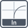

<!-- Generated by tools/export_studio_help.py; edit the reviewed source metadata, then regenerate. -->
# Natural Logarithm

[Mathematics functions](../../mathematics/index.md) · [All functions](../../index.md)

Computes the natural logarithm of x.

## Product execution profiles

The shared index declares native examples for this object; see [the examples below](natural_logarithm.md#examples) and [document profiles and evidence boundaries](../../../reference/studio-draft-examples.md). Older binding/help statements retained below can lag those product profiles. They do not establish or deny the separately measured native profiles. An example declaration alone is not an execution result or admission of every overload.

Formula: `ln(x)`.

Résumé français de l’aide Studio

**Logarithme népérien**

Texte historique de l’aide conservé ci-dessous. Des exemples natifs distincts sont déclarés pour cet objet ; consultez les profils et preuves datés, sans déduire une compatibilité universelle de ce texte.

Le texte existant ci-dessous ne décrit pas le profil matriciel déclaré dans les métadonnées actuelles. Les règles et limites de ce profil sont précisées dans les sections anglaises de cette fiche.

Calcule le logarithme naturel de x. [Types] Scalaires F32/F64 et complexes C32/C64, tableaux ou clusters numériques récursifs. Les entiers sont convertis en F64 ; au-delà de 2^53, la conversion peut arrondir. Les rangs des tableaux et les identités ordonnées des champs sont conservés. Deux opérandes composés exigent la même structure et les mêmes dimensions réelles ; un opérande entièrement scalaire peut être appliqué à chaque feuille de l’autre. Pas de virgule fixe, précision étendue, calcul matriciel nominal ni diffusion entre dimensions. Les résultats réels hors domaine suivent NaN/Inf IEEE ; les résultats complexes non finis sont refusés. Toutes les entrées sont obligatoires dans le profil de calcul Studio ; l’aperçu F64 non câblé ne fournit aucune valeur implicite. Le calcul Highlight local utilise son fournisseur dédié ; l’exécution runtime sur cible est indisponible.

## Studio authoring profile

Contract status: **partial**. The connector below describes Studio authoring; execution availability is stated separately.

Retained binding and help description

This is the source declaration, not the current measured product-execution assessment.

Computes the natural logarithm of x. Numeric scalar, array or recursively numeric cluster. F32/F64 and C32/C64 are supported; integer leaves convert to F64 before calculation and values above 2^53 may round. Arrays preserve rank and clusters preserve ordered field identities. Binary operands require matching aggregate structures and actual array dimensions; one whole scalar operand may lift through the other aggregate. No fixed-point, extended precision, dimensional broadcasting. Real invalid-domain results follow IEEE NaN/Infinity; non-finite complex results are explicitly unsupported. This private Studio profile declares local Highlight calculation separately from target Runtime execution. Concrete matrix&lt;f64&gt; dispatch is separate from element-wise Array/Cluster lifting: nonempty square matrices of dimension at most 32; finite real output only, bounded arithmetic and numerical residual checks. Exponential uses matrix Pade scaling/squaring; Natural Logarithm uses the convergent real principal matrix logarithm; Power uses actual matrix products for integer exponents and Exp(y*Ln(A)) for admissible noninteger real exponents. Complex branch-cut, ill-conditioned, nonconvergent or overflowing Matrix results fail explicitly.

## IN — inputs

| Displayed terminal / internal ID | Accepted / resolved type | Studio connection | Unwired input default | Meaning |
| --- | --- | --- | --- | --- |
| x `x` | `T:any` | Required | Not specified | Numeric value whose function result is calculated. |

A default is shown only for an input with an explicitly documented value. Preview/default *types* do not imply unwired operand values. If helper and binding flags differ, both are labelled.

## OUT — outputs

| Displayed terminal / internal ID | Accepted / resolved type | Studio connection | Unwired input default | Meaning |
| --- | --- | --- | --- | --- |
| ln(x) `result` | `T:any` | Recommended | — | Computes the natural logarithm of x. |

A default is shown only for an input with an explicitly documented value. Preview/default *types* do not imply unwired operand values. If helper and binding flags differ, both are labelled.

## Types and connection rules

Numeric scalar, array or recursively numeric cluster. F32/F64 and C32/C64 are supported; integer leaves convert to F64 before calculation and values above 2^53 may round. Arrays preserve rank and clusters preserve ordered field identities. Binary operands require matching aggregate structures and actual array dimensions; one whole scalar operand may lift through the other aggregate. No fixed-point, extended precision, dimensional broadcasting. Real invalid-domain results follow IEEE NaN/Infinity; non-finite complex results are explicitly unsupported. Concrete matrix&lt;f64&gt; dispatch is separate from element-wise Array/Cluster lifting: nonempty square matrices of dimension at most 32; finite real output only, bounded arithmetic and numerical residual checks. Exponential uses matrix Pade scaling/squaring; Natural Logarithm uses the convergent real principal matrix logarithm; Power uses actual matrix products for integer exponents and Exp(y*Ln(A)) for admissible noninteger real exponents. Complex branch-cut, ill-conditioned, nonconvergent or overflowing Matrix results fail explicitly.

- Type resolution: `custom_resolver`; result expression: `resolve:frog.studio.exponential.type-resolution@1`.
- Implicit coercion: permitted by this profile.
- Arrays: accepted; lifting policy: `element_wise_same_shape_with_scalar_lift`.
- Shape rule: `preserve_rank_and_ordered_fields; binary_array_dimensions_must_match`.
- Scalar lifting: no.
- Broadcasting: no.

**Input count:** 1; this contract does not enable variadic inputs.

Port order: `x`.

**Integer output:** f64

**Integer conversion:** Convert to binary64 before calculation; values above 2^53 may round.

**Real output:** f32 retains f32; f64 retains f64; binary real operands promote to f64 if either has f64 or an integer leaf.

**Complex output:** c32 with f32/c32 stays c32; c64, f64 or integer mixed with a complex operand produces c64.

**Aggregate output:** Preserve every array rank and ordered cluster field identity. Both aggregate operands must share the same structural shape; a whole scalar operand may lift through the other aggregate.

**Unwired:** f64 preview is incomplete; there is no implicit numerical default operand.

## Execution and limits

**Public FROG / target Runtime:** not declared available by this authoring contract.

The local Highlight provider is not a public FROG lowering or a target Runtime provider.

Retained authoring-contract limitations

These declarations belong to the binding snapshot. Compare them with the separately admitted native profiles and dated measurements linked above; they are not a current denial of those product profiles.

**Authoring/target contract limits:**

- NI fixed-point, physical units and extended numeric precision are outside this explicit Studio profile.
- Complex input/output transport reuses the existing complete finite c32/c64 lexical grammar; non-finite complex results are rejected explicitly.
- Binary arrays use equal actual dimensions; no dimensional broadcasting or truncation.
- No public FROG lowering or target Runtime provider is declared.

**Private Studio Run/Highlight:** a local calculation provider is declared.

f32/f64, bounded finite lexical c32/c64, and recursively numeric arrays/clusters. Concrete matrix&lt;f64&gt; dispatch is separate from element-wise Array/Cluster lifting: nonempty square matrices of dimension at most 32; finite real output only, bounded arithmetic and numerical residual checks. Exponential uses matrix Pade scaling/squaring; Natural Logarithm uses the convergent real principal matrix logarithm; Power uses actual matrix products for integer exponents and Exp(y*Ln(A)) for admissible noninteger real exponents. Complex branch-cut, ill-conditioned, nonconvergent or overflowing Matrix results fail explicitly.

**Additional connector limits:**

- Matrix profile is finite real f64, nonempty square dimension &lt;=32, with explicit work, conditioning, branch-domain, convergence and overflow refusals. Matrix inputs require an explicit Array To Matrix producer; Matrix To Array returns to existing Array indicators.

Connector type defaults and persistence aliases

| Direction | ID | Preview/default type | Connection policy | Cardinality | Legacy port IDs |
| --- | --- | --- | --- | --- | --- |
| INPUT | `x` | `f64` | `any_explicit` | `single` | — |
| OUTPUT | `result` | `f64` | `exact` | `single` | — |

## Examples

These are real `.frog` documents from the same index used by Studio. Backend names and expected results describe the examples; they are not execution certificates.

- [Natural Logarithm — real identity](../../../examples/math.exponential.natural_logarithm.real_identity.md) — Computes the natural logarithm of x. (`execution`, `studio-draft`).

## Identity and references

- Catalogue ID: `math.exponential.natural_logarithm`.
- Parent palette: [Exponential](../../mathematics/elementary/exponential.md).
- Profile: `frog.studio.polymorphic.math.exponential.natural_logarithm.v1`.
- Definition: `frog.studio.math.exponential.natural_logarithm`.
- [NI API reference](https://www.ni.com/docs/en-US/bundle/labview-api-ref/page/functions/natural-logarithm.html).
- [NI API reference](https://www.ni.com/docs/en-US/bundle/labview-api-ref/page/menus/categories/mathematics/elementary/exponential-and-power-functions-mnu.html).

NI links are reference sources for the connector model; Studio support is limited to the profile above. [Reference provenance and notation](../../index.md#provenance-and-notation).
